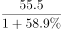
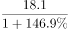
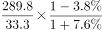
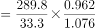
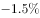

# 综合分析-逐项判断（基期量比较为主，兼考基期倍数、混合增长率、两期差距比较）

考点：[[20-考点/资料分析/综合/综合分析-逐项判断（基期量比较为主，兼考基期倍数、混合增长率、两期差距比较）|综合 / 综合分析-逐项判断（基期量比较为主，兼考基期倍数、混合增长率、两期差距比较）]]
材料：[[15-材料/资料分析/239834 2018年1-9月中国汽车行业产销统|239834 2018年1-9月中国汽车行业产销统]]

**问法模型**：题干为'以下说法一定正确的是'→对四个选项分别套用基期量比较、基期倍数、混合增长率居中、两期差距比较模型逐项定性验证，排除必错项与无法判断项。

## 推理链
1. 第1步：定位材料第四段，纯电动汽车2018年1-9月产55.5万辆、销54.1万辆，同比均增长（增速留空）；插电式混合动力汽车产18.0万辆、销18.1万辆，同比均增长（增速留空）——A项取数。
2. 第2步：基期量=现期量/(1+增速)；纯电动汽车基期产量55.5/(1+产速)分子大且按官方解析产量对应分母更小，故2017年1-9月纯电动基期产量>基期销量；插电混动18.0与18.1分子几乎相等而产量分母更小，基期产量也更大——A项一定正确。
3. 第3步：B项用基期倍数公式：货车销量289.8万辆同比增长(a)、客车销量33.3万辆同比下降(b)，基期倍数=(289.8/33.3)×(1+b)/(1+a)；因(1+b)<1且(1+a)>1，基期倍数<289.8/33.3≈8.7，必小于9.7——B项错误。
4. 第4步：C项按官方解析：乘用车销量整体同比增长0.6%，中国品牌乘用车销售724.2万辆同比下降，由混合增长率居中，整体增速必大于中国品牌增速且小于非中国品牌增速，故非中国品牌销量增速>0.6%，为正增长而非同比下降——C项错误。
5. 第5步：D项'同比进一步扩大'指2017年比2016年扩大、2018年又比2017年扩大的连续两期比较，材料仅有2018年1-9月乘用车出口60.1万辆、商用车出口21.3万辆及增速，无2016年数据——D项无法推断，错误。
6. 第6步：A项成立，B、C、D均被排除，故选A。

**最快解法**：⚡ 定性排除法+基期量定性比较（不硬算具体基期值）：B项看增速方向——货车增(a>0)、客车降(b<0)⇒(1+b)/(1+a)<1，基期倍数<现期倍数289.8/33.3≈8.7<9.7，秒杀排除；C项用混合增长率居中——整体0.6%居中且中国品牌下降⇒非中国品牌增速>0.6%为正增长，排除；D项缺2016年数据直接排除；A项按'基期产量/基期销量=(现期产量/现期销量)×(1+销速)/(1+产速)'，纯电动分子55.5>54.1且按解析产量分母更小，插电混动分子几乎相等而产量分母更小，两车型基期产量均大于基期销量，选A。

## 易错点
- ⚠ 本版材料所有同比增速数值均留空，严禁凭记忆或经验代入任何增速数值计算（解析中'0.6%'等出自原版带数值材料），只能使用现期量与'增长/下降'方向做定性判断。
- ⚠ B项基期倍数方向坑：货车增长、客车下降时(1+b)/(1+a)<1，基期倍数应小于现期倍数≈8.7，勿把现期倍数或凭感觉放大当成基期倍数9.7。
- ⚠ '同比进一步扩大'是两期连续比较（2017比2016扩大且2018比2017扩大），只有一期数据时绝不能判定；另外产量与销量成对且数值极近（55.5/54.1、18.0/18.1、841.3/842.6），基期比较时分子分母勿串列。

## 母题抽象
> 🧩 当综合分析题问'一定正确的是'且涉及基期判断时，用定性排除：基期倍数先比(1+增速)的方向定大小范围，混合增长率用'整体居中+子集反向'推另一部分方向，'进一步扩大/连续N期'缺上一期数据即排除，最后对唯一可行项用基期量=现期/(1+增速)做分子分母同向比较验证。

**同类特征**：说法一定正确的是（综合判断）、2017年1-9月基期量比较（产量vs销量）、基期倍数=现期倍数×(1+b)/(1+a)、混合增长率居中（整体-子集-另一部分）、同比进一步扩大=两期连续比较、增速数值留空，靠增降方向定性判断

## 相关题
（暂无）

---

### 题干
根据上文，以下说法一定正确的是（    ）。

### 选项
- A. 2017年1-9月，纯电动汽车和插电式混合动力汽车的产量均高于自身销量　✅
- B. 2017年1-9月，货车销量是客车销量的9.7倍
- C. 2018年1-9月，非中国品牌乘用车销量同比下降
- D. 2018年1-9月，乘用车与商用车的整车出口量差距同比进一步扩大

### 官方解析

A项：定位材料第四段，纯电动汽车产销分别完成55.5万辆和54.1万辆，同比分别增长和；插电式混合动力汽车产销分别完成18.0万辆和18.1万辆，同比分别增长和。2017年1-9月纯电动汽车产量为万辆；销量为万辆，产量对应分子大，分母小，明显结果更大；2017年1-9月插电式混合动力汽车产量为万辆；销量为万辆，二者分子几乎相等，而产量对应分母更小，因此结果也更大，正确；

B项：定位材料第三段，可得：客车销量为33.3（B）万辆，同比下降（b）；货车销量289.8（A）万辆，同比增长（a）。根据基期倍数公式，货车销量是客车销量的倍，错误；

C项：定位材料第二段，2018年1-9月，乘用车累计销量同比增长0.6%，中国品牌乘用车累计销售同比下降，因为，根据混合增长率居中，可知整体增长率大于中国品牌乘用车销量同比增长率（），必然小于非中国品牌乘用车销量同比增长率，即2018年1-9月，非中国品牌乘用车销量同比增长率大于，并非同比下降，错误；

D项：定位材料第五段，可得：乘用车出口60.1万辆，同比增长；商用车出口21.3万辆，同比增长。题干“2018年1-9月，乘用车与商用车的整车出口量差距同比进一步扩大”，同比进一步扩大，是指2017年比2016年扩大，2018年又比2017年扩大，而根据材料无法求出2016年的整车出口量差距数据，所以无法推断，错误。

故正确答案为A。

### 给定材料

        2018年1-9月汽车行业统计数据如下：

        乘用车累计产销分别完成1735.1万辆和1726.0万辆，同比分别增长和。其中，轿车产销分别完成841.3万辆和842.6万辆，同比分别增长和；SUV产销分别完成737.1万辆和723.5万辆，同比分别增长和；MPV产销分别完成124.4万辆和126.2万辆，同比分别下降和；交叉型乘用车产销分别完成32.2万辆和33.7万辆，同比分别下降和。中国品牌乘用车累计销售724.2万辆，同比下降。

        商用车累计产销分别完成314.1万辆和323.1万辆，同比分别增长和。分车型情况看，客车产销分别完成33.9万辆和33.3万辆，同比分别下降和；货车产销分别完成280.1万辆和289.8万辆，同比分别增长和。

        新能源汽车中，纯电动汽车产销分别完成55.5万辆和54.1万辆，同比分别增长和；插电式混合动力汽车产销分别完成18.0万辆和18.1万辆，同比分别增长和。

        汽车整车出口81.4万辆，同比增长。分车型情况看，乘用车出口60.1万辆，同比增长；商用车出口21.3万辆，同比增长。

> [!warning] 疑点（官方解析可能有误，待人工复核）
> 本版材料全部同比增速百分数留空，官方解析中C项引用的'乘用车销量同比增长0.6%'及A项'产量对应分母更小'的依据应源自原版带数值材料，在本版下无法数值复算；且解析中基期倍数与混合增长率的公式部分显示为空缺。此为材料/解析版本口径问题，解析的定性结论链与答案A自洽，不影响官方答案。
