# 综合分析之'能否推出'判断（数据可得性核查）

考点：[[20-考点/资料分析/综合/综合分析之'能否推出'判断（数据可得性核查）|综合 / 综合分析之'能否推出'判断（数据可得性核查）]]
材料：[[15-材料/资料分析/239974 2017年1～12月全国内燃机销售情|239974 2017年1～12月全国内燃机销售情]]

**问法模型**：题干为'能够从上述资料中推出的是'①②③型→逐项核查命题所需'现期值+对应增速'是否双全：缺现期量的基期命题直接排除，齐备项只需列式成立即可判为可推出。

## 推理链
1. 第1步：①要算2016年柴油内燃机完成功率，需'2017年柴油功率现期值÷(1+柴油功率增速)'；正文只给'累计完成功率266879.47万千瓦，同比增长…，其中柴油内燃机功率同比增长…'，即柴油功率仅有增速、无现期值，公式缺分子，不可推出
2. 第2步：②从图中取2017年1～3月当期销量475.57、434.56、523.67万台及对应同比增速-2.7%、31.1%、5.8%，则2017年一季度累计=475.57+434.56+523.67=1433.80万台
3. 第3步：按'基期=现期÷(1+增速)'逐月回推2016年一季度：475.57÷(1-2.7%)≈488.8、434.56÷(1+31.1%)≈331.5、523.67÷(1+5.8%)≈495.0，合计约1315万台
4. 第4步：②的同比增速≈(1433.80-1315)÷1315≈9%，列式成立可推出
5. 第5步：③求2016年园林机械占比：正文给2017年园林机械销量341.29万台（配增速）与全国总销量5645.38万台（配增速），分子分母各做一次'现期÷(1+增速)'再相除即可，列式成立可推出
6. 第6步：综上可推出的仅②③，对照选项锁定B（仅②③）

**最快解法**：⚡ 数据可得性排除法（不必精算）：①柴油功率只有增速没有现期值（总功率266879.47万千瓦≠柴油功率），秒判不可推出；②用图中1~3月销量1433.80万台配增速-2.7%/31.1%/5.8%回推2016年约1315万台，增速约9%；③341.29与5645.38均带增速，两次基期换算相除即成——三项列式核查即可锁定B。

## 易错点
- ⚠ ①误把总功率现期值266879.47万千瓦当作柴油功率现期值套公式——'其中'仅给柴油功率增速，分项现期缺失，基期不可求
- ⚠ ②误认为材料未直接给任何2016年数值就'推不出'——忽略图中各月当期销量+同比增速可自行拼出2016年一季度数据
- ⚠ ③误先算2017年占比再做单次换算——基期占比须分子分母分别÷(1+各自增速)，总体与分项增速不同不可混用

## 母题抽象
> 🧩 当题干出现'能够从上述资料中推出的是'时，对每个命题只做数据可得性核查：求基期量、基期占比、基期增速必须同时具备'现期值+对应增速'，仅有增速或仅有总体现期量即判不可推；可推出的项列式验证存在性即可，无需算出最终数值。

**同类特征**：能够从上述资料中推出的是、①②③多命题综合判断、其中柴油内燃机功率（只有增速无现期值）、第一季度累计销量同比增速、2016年…所占比重、仅②③型组合选项

## 相关题
- [[10-真题/资料分析/综合/19283943 综合分析判断题（倍数比较+求和判断+隐含平均每场座位数反推）|19283943]]（国考 2025，相关度1）
- [[10-真题/资料分析/综合/1796162 综合判断（月均计算、平均运输距离、比重对比、增长量比较逐项验证）|1796162]]（贵州 2016，相关度1）
- [[10-真题/资料分析/综合/2133504 综合判断题（现期比重+现期平均数多项验证，一对三错）|2133504]]（国考 2018，相关度1）
- [[10-真题/资料分析/综合/2444706 综合判断题（增长量+比重+倍数逐项验证）|2444706]]（四川 2019，相关度1）
- [[10-真题/资料分析/综合/2571728 综合分析逐项判断（等差递推求和＋单位换算＋比值估算）|2571728]]（山东 2020，相关度1）

---

### 题干

能够从上述资料中推出的是：

①2016年112月柴油内燃机累计完成功率

②2017年第一季度内燃机累计销量的同比增速

③2016年园林机械用内燃机累计销量所占比重

### 选项
- A. 仅②
- B. 仅②③　✅
- C. 仅①③
- D. ①②③

### 官方解析

①：定位文字材料第一段，“2017年112月，全国内燃机···累计完成功率266879.47万千瓦，同比增长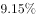，其中柴油内燃机功率同比增长”，可知仅有柴油内燃机功率的增长率，没有现期值，故不可推出2016年112月柴油内燃机累计完成功率；

②：定位图形材料，可知2017年第一季度内燃机累计销量为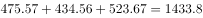，又已知2017年13月内燃机销量的同比增速，则2016年1月内燃机销量为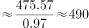 ，2016年2月内燃机销量为 ，2016年3月内燃机销量为 ，所以2016年第一季度内燃机累计销量为 ，则2017年第一季度内燃机累计销量的同比增速为，故可推出；

③：定位文字材料第一段，“2017年112月，全国内燃机累计销量5645.38万台，同比增长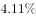”，可知2016年112月全国内燃机累计销量为 。又根据文字材料第三段，“从配套市场来看，···园林机械用内燃机平稳增长，累计销量分别为···341.29万台，同比增长分别为···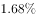”可知2016年园林机械用内燃机累计销量为，所以2016年园林机械用内燃机累计销量所占比重为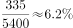 ，故可推出。

故能够从上述资料中直接推出的只有②③。 

故正确答案为B。

### 给定材料

根据所给资料，回答下列问题。

        2017年112月，全国内燃机累计销量5645.38万台，同比增长，累计完成功率266879.47万千瓦，同比增长，其中柴油内燃机功率同比增长。

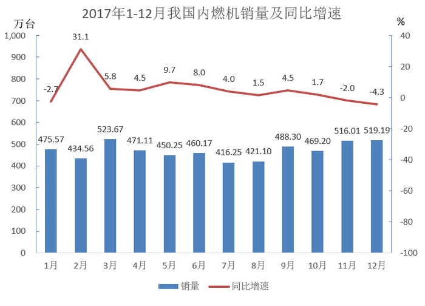

        从燃料类型来看，柴油机增幅明显高于汽油机，柴油机累计销量556万台，同比增长；汽油机累计销量5089万台。

        从配套市场来看，乘用车用、摩托车用、园林机械用、发电机组用内燃机平稳增长，累计销量分别为2205.40万台、2030.12万台、341.29万台和170.70万台，同比增长分别为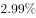、、和；商用车用、农业机械用、工程机械用内燃机增长明显，累计销量分别为398.57万台、381.69万台和73.84万台，同比增长分别为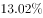、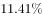和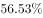；船用内燃机累计销量2.40万台，同比下降；通用机械用内燃机累计销量41.37万台，同比下降。

> [!warning] 疑点（官方解析可能有误，待人工复核）
> 本批材料文本中正文各处同比增速的具体百分数均缺失（'同比增长'后为空白），③的实际计算需依赖原卷中园林机械增速与总销量增速数值；官方解析按完整材料判定②③可推出，逻辑无误，不影响答案B。

<!-- CODEX-ANSWER-REVIEW:BEGIN -->
### 本次独立复核

**复核状态：** `resolved`（答案与解析已核定）

**计分答案：** B（可计分）

**复核解析：**

①材料只给柴油内燃机增速，没有该分项的现期功率，不能用总功率266879.47代替分项量，故不可推出。②2017年1—3月销量=475.57+434.56+523.67=1433.80万台；按三个月同比−2.7%、+31.1%、+5.8%还原2016同期为488.77+331.47+494.96=1315.20万台，合计增长约9.02%，可推出。③2016年园林机械销量=341.29÷1.0168≈335.65万台；全部机械销量=5645.38÷1.0411≈5422.51万台，占比约6.19%，可推出。故只有②③成立，选B。

**相关信息：**

资料分析—分项信息可推出性与基期加权增长率；各月同比率不同，应先逐月还原后加总，不能对三个同比率作简单平均。

**题源依据：** [固定版本原题](https://github.com/Mentat-Uran/kaogongzhentizhengliu/blob/84ab93d4b64b61d897bece8a1c0a5bab06b4feb2/10-%E7%9C%9F%E9%A2%98/%E8%B5%84%E6%96%99%E5%88%86%E6%9E%90/%E7%BB%BC%E5%90%88/2387628%20%E7%BB%BC%E5%90%88%E5%88%86%E6%9E%90%E4%B9%8B'%E8%83%BD%E5%90%A6%E6%8E%A8%E5%87%BA'%E5%88%A4%E6%96%AD%EF%BC%88%E6%95%B0%E6%8D%AE%E5%8F%AF%E5%BE%97%E6%80%A7%E6%A0%B8%E6%9F%A5%EF%BC%89.md)；固定内容 commit `84ab93d4b64b61d897bece8a1c0a5bab06b4feb2`，Markdown blob `dc0fde629a8dbba6a31083e847af39bec6fdb97b`。
<!-- CODEX-ANSWER-REVIEW:END -->
