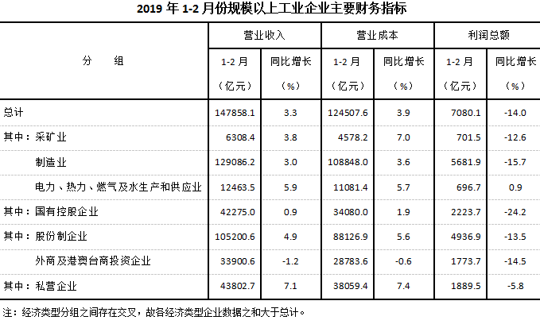

# 综合分析判断题（基期量还原＋数据可得性判断＋份额估算）

考点：[[20-考点/资料分析/综合/综合分析判断题（基期量还原＋数据可得性判断＋份额估算）|综合 / 综合分析判断题（基期量还原＋数据可得性判断＋份额估算）]]
材料：[[15-材料/资料分析/240007 2019年1-2月全国规模以上工业企|240007 2019年1-2月全国规模以上工业企]]

**问法模型**：'能够从以上资料中推出的是'的逐项正误判断型问法 → 对A/B/C/D四个命题分别用基期还原、时间口径核对、加减还原、截位估算验证，找唯一正确项

## 推理链
1. 第1步：A项提取条件——文字第四段'资产负债率为…（现期值），同比降低0.2个百分点'，先算现期资产负债率=负债÷资产=62.4÷109.7≈56.9%，则2018年2月末应为56.9%+0.2≈57.1%，A项数值不符（方向/数值错误），排除
2. 第2步：B项提取条件——表格中采矿业利润总额701.5亿元、电力热力燃气及水696.7亿元均为'2019年1-2月'累计值，而题干问'2019年2月'单月，材料无单月数据，无法推断，排除
3. 第3步：C项提取条件——文字第六段'2月末每百元资产实现的营业收入为80.9元，同比减少2.4元'，用基期还原公式：基期=现期+减少量
4. 第4步：代入计算——2018年2月末=80.9+2.4=83.3元，与C项完全一致
5. 第5步：D项验证——国有控股份额=2223.7÷7080.1≈31.4%，小于分界值1/3（约33.3%），'超过'不成立，排除
6. 第6步：结论——只有C项可从材料推出，故选C

**最快解法**：⚡ 考场最快解法：加减还原直除法——C项口算80.9+2.4=83.3直接锁定；排除法辅助：A项'降低0.2个百分点'求基期应加回（方向判断），B项单月数据不可得（口径排除），D项2223.7/7080.1截位≈2224/7080≈31%<33.3%（估算排除）

## 易错点
- ⚠ A项'个百分点'方向陷阱：同比降低0.2个百分点，求2018年基期值应在现期基础上加0.2个百分点，若顺着'降低'方向相减即错
- ⚠ B项时间口径陷阱：表格只有'1-2月累计'利润（采矿业701.5>电热气水696.7），题干问'2019年2月'单月，直接比较累计数即掉坑
- ⚠ D项份额估算与分组交叉：2223.7÷7080.1≈31.4%需与1/3这类分界值比较，且经济类型分组之和大于总计，不能凭感觉认为国有控股占大头

## 母题抽象
> 🧩 当题干出现'能够从以上资料中推出的是'时，四类验证套路固定：基期值=现期值±同比变动量（元/天/个百分点一律加减还原，注意方向）、题干时间口径必须在材料可得范围内（单月≠累计）、份额类用截位直除与分界值比较，逐项排错后锁定唯一正确项

**同类特征**：综合分析判断题、能够从以上资料中推出的是、同比减少2.4元的基期还原、2月单月与1-2月累计口径、同比降低0.2个百分点的方向、国有控股份额与分界值估算

## 相关题
- [[10-真题/资料分析/综合/2274528 综合分析判断（同比增长率验证+峰值年份定位+平均每场面积比较+年均每天平均数）|2274528]]（北京 2019，相关度1）
- [[10-真题/资料分析/综合/2145034 综合分析判断题（核心为两期占比变化比较，辅以年均投资额、年均增长量、定性推断排除）|2145034]]（深圳市考 2017，相关度1）
- [[10-真题/资料分析/综合/2187533 综合分析判断题（逐项验证-排除法），涉及增量趋势比较、增长贡献率与营收占比口径辨析|2187533]]（选调 2018，相关度1）
- [[10-真题/资料分析/综合/4737843 综合分析判断题（逐项验证：增长率时间口径、比值、倍数比较、部分量计算）|4737843]]（福建 2017，相关度1）

---

### 题干
能够从以上资料中推出的是：

### 选项
- A. 
2018年2月末，规模以上工业企业资产负债率为

- B. 
2019年2月，采矿业利润总额高于电力、热力、燃气及水生产和供应业

- C. 
2018年2月末，规模以上工业企业每百元资产实现的营业收入为83.3元
　✅
- D. 
2019年1-2月，规模以上工业企业利润总额中国有控股企业所占份额超过

### 官方解析
A项：定位文字材料第四段，“2月末，规模以上工业企业资产···资产负债率为，同比降低0.2个百分点。”，可知2018年2月末，规模以上工业企业资产负债率为，错误； 
B项：定位表格材料，可知2019年1-2月份，采矿业和电力、热力、燃气及水生产和供应业利润总额，但没有2月份相关数据，故无法推断2019年2月，采矿业利润总额是否高于电力、热力、燃气及水生产和供应业，错误；
C项：定位文字材料第六段，“2月末，规模以上工业企业每百元资产实现的营业收入为80.9元，同比减少2.4元”，可知2018年2月末，规模以上工业企业每百元资产实现的营业收入为，正确；
D项：定位文字材料第一段及表格材料，“2019年1-2月份，全国规模以上工业企业实现利润总额7080.1亿元；国有控股企业利润总额2223.7亿元”，可知2019年1-2月，规模以上工业企业利润总额中国有控股企业所占份额为，小于，错误。
故正确答案为C。

### 给定材料

        2019年1-2月份，全国规模以上工业企业实现利润总额7080.1亿元，同比下降。

        1-2月份，部分行业利润情况如下：专用设备制造业利润总额同比增长，电气机械和器材制造业增长，电力、热力生产和供应业增长，非金属矿物制品业增长，通用设备制造业增长，汽车制造业下降，化学原料和化学制品制造业下降，煤炭开采和洗选业下降，纺织业下降，石油和天然气开采业下降，农副食品加工业下降。

        1-2月份，规模以上工业企业实现营业收入14.8万亿元，同比增长；发生营业成本12.5万亿元，增长。

        2月末，规模以上工业企业资产总计109.7万亿元，同比增长；负债合计62.4万亿元，增长；所有者权益合计47.3万亿元，增长；资产负债率为，同比降低0.2个百分点。

        1-2月份，规模以上工业企业每百元营业收入中的成本为84.21元，同比增加0.52元；每百元营业收入中的费用为9.12元，同比增加0.29元。

        2月末，规模以上工业企业每百元资产实现的营业收入为80.9元，同比减少2.4元；人均营业收入为119.4万元，同比增加7.6万元；产成品存货周转天数为19.3天，同比增加0.4天；应收票据及应收账款平均回收期为57.5天，同比增加4.6天。

