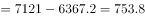
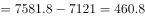
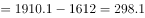
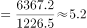
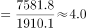

# 综合判断题（逐一验证：净增数比较+增速比较+比值变化）

考点：[[20-考点/资料分析/综合/综合判断题（逐一验证：净增数比较+增速比较+比值变化）|综合 / 综合判断题（逐一验证：净增数比较+增速比较+比值变化）]]
材料：[[15-材料/资料分析/240008 河北省2014—2018年年末电话用|240008 河北省2014—2018年年末电话用]]

**问法模型**：题干为'能够从上述资料中推出的是'的综合判断题 → 对四个选项分别套用'净增数=当年末-上年末、增速=(当年末-上年末)/上年末、比值=两序列直接相除'逐一验证，排除错误项

## 推理链
1. 第1步：从柱状图提取两序列2014—2018年末数据：移动电话6229.1、6367.2、7121.0、7581.8、8195.6万户；宽带1127.6、1226.5、1612、1910.1、2159.8万户
2. 第2步：A项验净增数（当年末-上年末）：移动电话2015年138.1、2016年753.8、2017年460.8、2018年613.8，2017<2016，并非逐年增加，排除
3. 第3步：B项验净增数：宽带2015年98.9、2016年385.5、2017年298.1、2018年249.7，2017<2016<，并非逐年增加，排除
4. 第4步：C项验增速（净增数/上年末，与题2减法结果复用）：移动电话增速2015≈138.1/6229.1≈2.2%、2016≈753.8/6367.2≈11.8%、2017≈460.8/7121.0≈6.5%、2018≈613.8/7581.8≈8.1%，仅2016年超过10%，只有一个年份而非两个，排除
5. 第5步：D项验比值（移动电话/宽带逐年直接相除）：2015年6367.2/1226.5≈5.19、2016年7121.0/1612≈4.42、2017年7581.8/1910.1≈3.97、2018年8195.6/2159.8≈3.80，逐年降低，正确
6. 第6步：对照选项，A、B、C均错误，D可推出，故选D

**最快解法**：⚡ 选项D优先验证——用'分子增速<分母增速则比值下降'判定：逐年比较移动电话增速（2.2%、11.8%、6.5%、8.1%）与宽带增速（≈8.8%、31.5%、18.4%、13.1%），每年分子增速均小于分母增速，比值必逐年降低，无需逐个算比值；A、B项用相邻差口算即见反例（移动753.8→460.8，宽带385.5→298.1）

## 易错点
- ⚠ 口径混淆：A/B考'净增数'（作差）、C考'增速'（差/基期）、D考'比值'（两序列直接相除），三模型不可互串；D若误按增速比较会错判
- ⚠ 基期遗漏：'2015~2018年净增'中2015年的基期是2014年（6229.1/1127.6），漏算2015年或误用其他基期会出错
- ⚠ C项计数错误：移动电话增速仅2016年（≈11.8%）超过10%，误把2018年8.1%或其他年份算成超阈值会误判为'有两个'；另注意2016年宽带图中数值'1612'无小数位，作分母/差值时勿读错

## 母题抽象
> 🧩 当题干出现'能够从资料中推出的是'且选项含'逐年增加/逐年降低/超过某阈值的年份'时，按'净增=差、增速=差/基期、比值=两数直除'对号入座逐项验证，优先用'分子增速与分母增速比大小'判定比值类选项、优先用相邻差口算找反例否定'逐年增加'类选项

**同类特征**：能够从上述资料中推出的是、年净增数逐年增加、增速超过（某阈值）的年份、同……之比逐年降低、2015～2018年区间表述、年末时点双序列柱状图

## 相关题
- [[10-真题/资料分析/综合/19283943 综合分析判断题（倍数比较+求和判断+隐含平均每场座位数反推）|19283943]]（国考 2025，相关度1）
- [[10-真题/资料分析/综合/1796162 综合判断（月均计算、平均运输距离、比重对比、增长量比较逐项验证）|1796162]]（贵州 2016，相关度1）
- [[10-真题/资料分析/综合/2133504 综合判断题（现期比重+现期平均数多项验证，一对三错）|2133504]]（国考 2018，相关度1）
- [[10-真题/资料分析/综合/2444706 综合判断题（增长量+比重+倍数逐项验证）|2444706]]（四川 2019，相关度1）
- [[10-真题/资料分析/综合/2571728 综合分析逐项判断（等差递推求和＋单位换算＋比值估算）|2571728]]（山东 2020，相关度1）

---

### 题干
能够从上述资料中推出的是：

### 选项
- A. 
2015～2018年移动电话用户年净增数逐年增加

- B. 
2015～2018年固定互联网宽带接入用户年净增数逐年增加

- C. 
2015～2018年中移动电话用户数量增速超过的年份有两个 

- D. 
2015～2018年移动电话用户数量同固定互联网宽带接入用户数量之比逐年降低
　✅

### 官方解析

A项：定位柱状图可得， 2016年移动电话用户年净增数万户，2017年移动电话用户年净增数万户，，并非逐年增加，错误；

B项：定位柱状图可得， 2016年固定互联网宽带接入用户年净增数万户，2017年固定互联网宽带接入用户年净增数万户，，并非逐年增加，错误；

C项：根据第114题计算结果，只有2016年移动电话用户数量增速超过，错误；

D项：定位柱状图可得，2015～2018年各年移动电话用户数量及固定互联网宽带接入用户数量，2015～2018年所求比例分别为：2015年，2016年，2017年，2018年，即比例逐年降低，正确。

故正确答案为D。

### 给定材料

2018年末，河北省电话用户总数8865.6万户，其中移动电话用户8195.6万户。

> [!warning] 疑点（官方解析可能有误，待人工复核）
> 官方解析因图片公式转文字导致数字缺失（A/B项净增具体值、C项阈值公式均显示为图），按材料数据复算C项阈值应为10%，仅2016年（≈11.8%）超过，官方结论'只有2016年超过'成立，不影响答案D的判定

<!-- CODEX-ANSWER-REVIEW:BEGIN -->
### 本次独立复核

**复核状态：** `resolved`（答案与解析已核定）

**计分答案：** D（可计分）

**复核解析：**

1. 第1步：从柱状图提取两序列2014—2018年末数据：移动电话6229.1、6367.2、7121.0、7581.8、8195.6万户；宽带1127.6、1226.5、1612、1910.1、2159.8万户
2. 第2步：A项验净增数（当年末-上年末）：移动电话2015年138.1、2016年753.8、2017年460.8、2018年613.8，2017<2016，并非逐年增加，排除
3. 第3步：B项验净增数：宽带2015年98.9、2016年385.5、2017年298.1、2018年249.7，2017<2016<，并非逐年增加，排除
4. 第4步：C项验增速（净增数/上年末，与题2减法结果复用）：移动电话增速2015≈138.1/6229.1≈2.2%、2016≈753.8/6367.2≈11.8%、2017≈460.8/7121.0≈6.5%、2018≈613.8/7581.8≈8.1%，仅2016年超过10%，只有一个年份而非两个，排除
5. 第5步：D项验比值（移动电话/宽带逐年直接相除）：2015年6367.2/1226.5≈5.19、2016年7121.0/1612≈4.42、2017年7581.8/1910.1≈3.97、2018年8195.6/2159.8≈3.80，逐年降低，正确
6. 第6步：对照选项，A、B、C均错误，D可推出，故选D

**最快解法**：⚡ 选项D优先验证——用'分子增速<分母增速则比值下降'判定：逐年比较移动电话增速（2.2%、11.8%、6.5%、8.1%）与宽带增速（≈8.8%、31.5%、18.4%、13.1%），每年分子增速均小于分母增速，比值必逐年降低，无需逐个算比值；A、B项用相邻差口算即见反例（移动753.8→460.8，宽带385.5→298.1）

**相关信息：**

考点：综合判断题（逐一验证：净增数比较+增速比较+比值变化）。来源：2019年河北省公务员录用考试《行测》题（县级+乡镇）（网友回忆版）；2019年。> 🧩 当题干出现'能够从资料中推出的是'且选项含'逐年增加/逐年降低/超过某阈值的年份'时，按'净增=差、增速=差/基期、比值=两数直除'对号入座逐项验证，优先用'分子增速与分母增速比大小'判定比值类选项、优先用相邻差口算找反例否定'逐年增加'类选项

**同类特征**：能够从上述资料中推出的是、年净增数逐年增加、增速超过（某阈值）的年份、同……之比逐年降低、2015～2018年区间表述、年末时点双序列柱状图

**题源依据：** [固定版本原题](https://github.com/Mentat-Uran/kaogongzhentizhengliu/blob/84ab93d4b64b61d897bece8a1c0a5bab06b4feb2/10-%E7%9C%9F%E9%A2%98/%E8%B5%84%E6%96%99%E5%88%86%E6%9E%90/%E7%BB%BC%E5%90%88/2388039%20%E7%BB%BC%E5%90%88%E5%88%A4%E6%96%AD%E9%A2%98%EF%BC%88%E9%80%90%E4%B8%80%E9%AA%8C%E8%AF%81%EF%BC%9A%E5%87%80%E5%A2%9E%E6%95%B0%E6%AF%94%E8%BE%83%2B%E5%A2%9E%E9%80%9F%E6%AF%94%E8%BE%83%2B%E6%AF%94%E5%80%BC%E5%8F%98%E5%8C%96%EF%BC%89.md)；固定内容 commit `84ab93d4b64b61d897bece8a1c0a5bab06b4feb2`，Markdown blob `3144ef98dd83f191e47d80bd4d661cfbd3dc5620`。
<!-- CODEX-ANSWER-REVIEW:END -->
