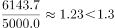

# 综合判断题（两地区加总比较＋无基期数据判断＋倍数计算＋两列排名一致性验证）

考点：[[20-考点/资料分析/综合/综合判断题（两地区加总比较＋无基期数据判断＋倍数计算＋两列排名一致性验证）|综合 / 综合判断题（两地区加总比较＋无基期数据判断＋倍数计算＋两列排名一致性验证）]]
材料：[[15-材料/资料分析/240202 2014年全国及11个省（自治区）的|240202 2014年全国及11个省（自治区）的]]

**问法模型**：'能够从上述资料中推出的是'的综合判断问法 → 对A/B/C/D四个选项逐项验证（加总比较、时间口径核查、倍数精算、双列排序对比），排除三个错误项锁定唯一正确项

## 推理链
1. 第1步：A项——从表中提取广东523.2、广西543.3万吨，两广合计1066.5万吨；湖北238.7、湖南854.8万吨，两湖合计1093.5万吨；1066.5＜1093.5，两广低于两湖，A错误
2. 第2步：B项——全表仅有2014年单年数据，虽可由总计行反推2014年播种面积3401.0÷5868.9×10000≈5795千公顷，但无2013年任何数据，无法比较'高于上年'，B错误
3. 第3步：C项——扫单产列找最值：最高为浙江6143.7公斤/公顷，最低为四川5000.0公斤/公顷（注意四川5000.0低于云南5329.2，勿找错），6143.7÷5000.0≈1.23，是'1.2倍多'而非'1.3倍多'，C错误
4. 第4步：D项——按播种面积列（千公顷）降序排前五：湖南1453.3、江西1394.6、广西917.6、广东893.2、湖北412.4
5. 第5步：按总产量列（万吨）降序排前五：湖南854.8、江西820.1、广西543.3、广东523.2、湖北238.7（四川'?'＝0.8×5000.0÷10000＝0.4万吨，居末位，不影响前五）
6. 第6步：两列前五省份均为'湖南、江西、广西、广东、湖北'且顺序完全相同，D正确，故选D

**最快解法**：⚡ 逐项排除＋双列并行排序法：A项口算加总（1066.5 vs 1093.5）即否；B项见'上年'但材料无基期数据直接否；C项截位直除6143.7÷5000≈1.23，不足1.3倍即否；D项先按播种面积列排出'湘→赣→桂→粤→鄂'，再对照总产量列验证同序，锁定答案

## 易错点
- ⚠ A项须两省加总比较，若只比单省（如广东523.2对湖南854.8）或漏加湖北238.7万吨，会误判两广更高
- ⚠ C项易把单产最低省误找为云南5329.2（忽视四川5000.0），或把1.23倍粗略估成'1.3倍多'，倍数表述须精算首位小数
- ⚠ B项时间口径陷阱：材料为单一现期2014年，凡涉及'上年/同比/高于上年水平'的表述，无基期数据一律'无法推出'，勿用反推值臆断增长
- ⚠ D项排序时勿看错列（播种面积列与总产量列数据不同），且福建113.9＞海南80.9＞浙江71.5但均在第六名之后，不干扰前五判定

## 母题抽象
> 🧩 当题干出现'能够从上述资料中推出的是'且材料为单年多列统计表时，优先验证'两列排名一致性'类选项（两列各自降序排列后逐位对比），并用排除法处理'上年比较'（无基期直接判否）与'倍数表述'（截位直除精算到首位小数）

**同类特征**：能够从上述资料中推出的是、综合判断四选项、两地区加总比较（两广vs两湖）、排名前五省份排序一致性、最高与最低单产倍数表述、无上年数据的可比性判断

## 相关题
- [[10-真题/资料分析/综合/4817780 综合判断题（基期量计算+倍数计算+逐行数值比较）|4817780]]（四川 2022，相关度2）
- [[10-真题/资料分析/综合/5510340 综合判断题（增长率比较+趋势判断+比重定性+三分之一倍数比较混合验证）|5510340]]（山东 2023，相关度2）
- [[10-真题/资料分析/综合/19283943 综合分析判断题（倍数比较+求和判断+隐含平均每场座位数反推）|19283943]]（国考 2025，相关度1）
- [[10-真题/资料分析/综合/1796162 综合判断（月均计算、平均运输距离、比重对比、增长量比较逐项验证）|1796162]]（贵州 2016，相关度1）
- [[10-真题/资料分析/综合/2133504 综合判断题（现期比重+现期平均数多项验证，一对三错）|2133504]]（国考 2018，相关度1）

---

### 题干
能够从上述资料中推出的是：

### 选项
- A. 2014年两广地区早稻产量高于两湖地区
- B. 2014年全国早稻播种面积高于上年水平
- C. 2014年早稻单位面积产量最高的省份，单位面积产量为最低省份的1.3倍多
- D. 2014年早稻总产量和播种面积排名前五的省份排名相同　✅

### 官方解析

A项：定位表格，可知：2014年广东、广西早稻产量分别为523.2万吨、543.3万吨，两广地区早稻产量为万吨；2014年湖北、湖南早稻产量分别为238.7万吨、854.8万吨，两湖地区早稻产量为万吨，故两广地区早稻产量低于两湖地区，错误；

B项：表格给的是2014年全国的单产和总产量，播种面积，可以求出2014年的全国早稻播种面积，但是并没有2013年相关的数据，无法进行比较，错误；

C项：定位表格，可知2014年早稻单位面积产量最高的省份为浙江省，单产6143.7公斤/公顷；2014年早稻单位面积产量最低的省份为四川省，单产5000.0公斤/公顷，列式：，错误；

D项：定位表格，根据104题可知“?”处为0.4万吨，2014年早稻总产量排名前五的省份为湖南、江西、广西、广东、湖北，2014年播种面积排名前五的省份为湖南、江西、广西、广东、湖北。这五个省份排名相同，正确。

故正确答案为D。

### 给定材料

