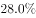
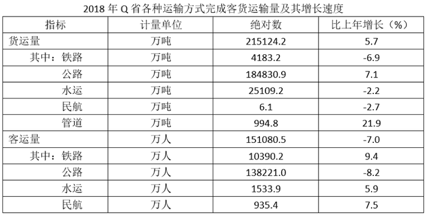

# 综合分析-逐项判断（基期量计算-增速方向比较-混合增长率-两数差值）

考点：[[20-考点/资料分析/综合/综合分析-逐项判断（基期量计算-增速方向比较-混合增长率-两数差值）|综合 / 综合分析-逐项判断（基期量计算/增速方向比较/混合增长率/两数差值）]]
材料：[[15-材料/资料分析/240290 Q省2018年客货运输情况：文字段给|240290 Q省2018年客货运输情况：文字段给]]

**问法模型**：题干出现'以下说法正确的是'→对四个选项逐项验证：A用基期量公式、B用增长/下降方向词比较、C用'各部分平均增长率=整体（混合）增长率'、D用表格两数直接相减，一对一错即得答案

## 推理链
1. 第1步：A项——文字段给出现期2018年客货运输换算周转量5096.9亿吨公里且'比上年增长'（增速为正），则基期2017年=5096.9÷(1+r)必小于5096.9，官方解析判定其非5000亿吨公里，A错误。
2. 第2步：B项——文字段明确铁路货物周转量729.6亿吨公里为'下降'、公路货物周转量2731.8亿吨公里为'增长'，一负一正，铁路增速小于公路增速，'大于'说法错误。
3. 第3步：C项——铁路、公路、水运、民航4种客运方式客运量的平均增长率即客运总量的混合增长率，等于表格中客运总量151080.5万人的整体增速-7.0%，为负增长，'平均增长…以上'不成立，错误。
4. 第4步：D项——表格直读2018年水运客运量1533.9万人、民航客运量935.4万人，1533.9-935.4=598.5万人，与选项数值完全一致。
5. 第5步：四项中仅D正确，故选D。

**最快解法**：⚡ 排除法+直算：综合分析题优先验证计算量最小的选项——D项表格直读两数相减1533.9-935.4=598.5万人成立；其余定性排除：A项现期5096.9为正增长，基期=5096.9÷(1+r)≠5000；B项铁路'下降'、公路'增长'方向相反即排除；C项平均增长率=整体混合增长率=-7.0%为负即排除

## 易错点
- ⚠ C项'4种方式平均增长率'勿误算成四个增速（9.4%、-8.2%、5.9%、7.5%）的算术平均或逐项加权，平均增长率=客运总量混合增长率，直接取表格整体增速-7.0%即可
- ⚠ B项易忽略文字段中的方向词：铁路货物周转量是'下降'、公路是'增长'，方向判断反了会误选B；表格增速列有正有负，比较时勿丢符号
- ⚠ 口径混淆：D项分子分母应取表格'客运量'（万人：1533.9、935.4），切勿误用文字段'旅客周转量'（亿人公里：767.3、132.3）；另文字段各增速百分数在给定材料中空缺，验算A项不能凭空补数

## 母题抽象
> 🧩 当题干出现'以下说法正确的是'的综合判断时，先锁定计算量最小的选项（表格两数直减或直读）验证，其余选项用定性规则快速排除：正增长时基期量<现期量、'下降vs增长'方向词直接比大小、各部分平均增长率=整体（混合）增长率

**同类特征**：以下说法正确的是、综合分析逐项判断、基期量与现期量关系（基期=现期÷(1+r)）、增长/下降方向词比较、平均增长率=混合增长率=整体增长率、表格两数直接相减

## 相关题
- [[10-真题/资料分析/综合/2172123 综合分析（当期值加总比较+负增长判基期高低+当月值序列判趋势+基期还原超阈值判断）|2172123]]（广州市考 2018，相关度2）
- [[10-真题/资料分析/综合/2776163 综合分析·逐项判断（比重判断-整体推算-倍数辨析-构成占比加和）|2776163]]（浙江 2021，相关度2）
- [[10-真题/资料分析/综合/10204448 综合分析-逐项判断（历史极值确认、两期比重比较、多期累计求和、基期比重）|10204448]]（广东 2024，相关度1）
- [[10-真题/资料分析/综合/10204453 综合分析判断（读数比较+增长量比较+年均增长率比较+区间增速比较）|10204453]]（广东 2024，相关度1）
- [[10-真题/资料分析/综合/2255788 综合分析—选非题（不能推出），混合定性增速判断、基期值估算、率差与'占比×城市数'部分量验证|2255788]]（江西 2016，相关度1）

---

### 题干
关于Q省客货运输情况，以下说法正确的是（    ）。

### 选项
- A. 
2017年，Q省客货运输换算周转量约为5000亿吨公里

- B. 
2018年，Q省铁路货物周转量增速大于公路货物周转量增速

- C. 
2018年，Q省4种客运方式客运量比上年平均增长以上

- D. 
2018年，Q省水运客运量比民航客运量多598.5万人
　✅

### 官方解析
A项：定位文字材料，Q省2018年客货运输换算周转量5096.9亿吨公里，比上年增长。根据，则2017年，Q省客货运输换算周转量亿吨公里，非5000亿吨公里，错误；
B项：定位文字材料，Q省铁路货物周转量增速下降；公路货物周转量增速为增长，则铁路货物周转量增速小于公路货物周转量增速，错误；
C项：定位表格材料，2018年，Q省4种客运方式客运量比上年的平均增长率，为4种客运方式客运量的混合增长率，即为客运量的整体增长率（），显然，则平均增长率非以上，错误；
D项：定位表格材料，2018年，Q省水运客运量1533.9万人，民航客运量935.4万人，前者比后者多万人，正确。
故正确答案为D。

### 给定材料

        Q省2018年客货运输换算周转量5096.9亿吨公里，比上年增长。货物周转量4143.3亿吨公里，增长。其中，铁路周转量729.6亿吨公里，下降；公路周转量2731.8亿吨公里，增长。旅客周转量1768.2亿人公里，增长。其中，铁路周转量865.6亿人公里，增长；公路周转量767.3亿人公里，下降；民航周转量132.3亿人公里，增长。

> [!warning] 疑点（官方解析可能有误，待人工复核）
> 材料文字段中各周转量的增速百分数显示为空缺（仅见'增长/下降'字样），官方解析中A项的基期具体计算数值亦被截断显示，A项'非5000亿吨公里'的判定需以原卷补全后的增速数值为准，凭本组空缺材料无法独立复算；按官方口径本题答案仍确定为D
