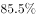
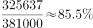
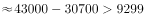
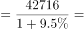
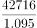

# 综合判断（①②③④逐句正误计数：比重计算+增速最大比较+基期值回推）

考点：[[20-考点/资料分析/综合/综合判断（①②③④逐句正误计数：比重计算+增速最大比较+基期值回推）|综合 / 综合判断（①②③④逐句正误计数：比重计算+增速最大比较+基期值回推）]]
材料：[[15-材料/资料分析/240291 2018年我国国民经济和社会发展主要|240291 2018年我国国民经济和社会发展主要]]

**问法模型**：“下列关于我国经济和社会发展情况描述正确的有几个”→逐句匹配模型（比重=部分÷总体；“增长最快”须在题干限定范围内比较增速；基期=现期÷(1+增速)），数出正确句数对照选项

## 推理链
1. 第1步：①取第三段数据：城镇消费品零售额325637亿元、社会消费品零售总额380987亿元，比重=325637/380987≈85.5%，与题干给定比重相符，①正确
2. 第2步：②“数据增长最快”即增速最大，但题干限定的是“我国经济和社会发展情况”这一超出材料的大范围，材料未给出（本版且全部留白）所有指标的增速，无法断定实物商品网上零售额增速最大，②错误
3. 第3步：③取第二段数据：2018年对“一带一路”出口46478亿元、进口37179亿元，顺差=46478-37179=9299亿元（与兄弟题第4题口径一致，勿误用全国顺差23304亿元）
4. 第4步：③按基期公式回推2017年顺差（2017年出口=46478÷(1+出口增速)、2017年进口=37179÷(1+进口增速)后相减，数值依赖原卷增速，本版留白），官方判定2017年顺差大于2018年的9299亿元，③正确
5. 第5步：④取第三段数据：2018年餐饮收入42716亿元，则2017年餐饮收入=42716÷(1+2018年餐饮增速)，以原卷增速代入后截位直除商的首位为3（上不到4），即小于40000亿元，④错误
6. 第6步：正确的描述为①③共2个，对照选项选B

**最快解法**：⚡ 综合判断“先简后繁+计数法”：①纯取数截位直除325637/380987≈85.5%秒判对；②抓题干范围关键词“我国经济和社会发展情况”＞材料范围，增速最大不可证，秒判错；③46478-37179=9299后用基期公式回推判对；④42716÷(1+增速)截位直除首位不上4判错；数出2个选B

## 易错点
- ⚠ ②范围陷阱：题干是“关于我国经济和社会发展情况”而非“根据上述材料”，材料内增速最大≠全国范围增速最大，不能照抄“网上零售增速最大”的直觉；本版增速全部留白更无从比较
- ⚠ ③口径陷阱：求“一带一路”顺差只能用46478-37179=9299亿元，误用全国顺差23304亿元或“减少5217亿元”倒推的28521亿元（全国口径）会算错对象
- ⚠ ④基期陷阱：2017年餐饮收入=42716÷(1+增速)，不能拿2018年的42716与40000直接比较；且本版增速留白，须以原卷增速代入，凭空代入或不代入都会误判

## 母题抽象
> 🧩 当题干出现“下列描述正确的有几个”且各句跨考点（比重/增速最大/基期值）时，先用纯材料内数据逐句定对错，依赖增速的句子用基期=现期÷(1+增速)回推，并警惕题干限定范围是否大于材料范围，最后数出正确句数对照选项

**同类特征**：描述正确的有（几个）、①②③④逐句判断、占社会消费品零售总额的比重、增长最快、贸易顺差2017年大于2018年、40000亿元以上

## 相关题
- [[10-真题/资料分析/增长/2377188 增长率比较（环比增长最快）|2377188]]（选调 2019，相关度1）
- [[10-真题/资料分析/增长/16592975 增长率比较（首尾年份隔点比较）|16592975]]（青海 2024，相关度1）
- [[10-真题/资料分析/增长/2188575 增长率（增幅）大小比较|2188575]]（黑龙江 2018，相关度1）
- [[10-真题/资料分析/增长/2578246 增长率比较（读表直查型）|2578246]]（内蒙古 2020，相关度1）

---

### 题干

下列关于我国经济和社会发展情况描述正确的有（    ）。

①2018年城镇消费品零售额占社会消费品零售总额的比重为

②相比2017年，2018年数据增长最快的是全年实物商品网上零售额

③我国对“一带一路”沿线国家的贸易顺差值，2017年大于2018年

④2017年我国餐饮收入额在40000亿元以上

### 选项
- A. 1个
- B. 2个　✅
- C. 3个
- D. 4个

### 官方解析

①：定位材料第三段可得，2018年城镇消费品零售额325637亿元，社会消费品零售总额380987亿元，则2018年城镇消费品零售额占社会消费品零售总额的比重为，正确；

②：数据增长最快即增速最大。若题干为“根据上述材料，下列描述正确的有”，则全年实物商品网上零售额的增速（）确实最大，但是，题干为“关于我国经济和社会发展情况描述正确的有”，我国经济和社会发展情况的范围过大，因此在不知其它相关信息增速的情况下，无法推出全年实物商品网上零售额的增速最大，错误；

③：定位材料第二段，2018年我国对“一带一路”沿线国家出口46478亿元，增长；进口37179亿元，增长。结合109题结论可知，2018年顺差值为9299亿元。根据“”，则2017年顺差值亿元，即2017年大于2018年，正确；

④：定位文字材料第三段，2018年我国餐饮收入额42716亿元，增长，根据“”，则2017年我国餐饮收入额，直除首位上不到4，即小于40000亿元，错误；

正确的描述有2项。

故正确答案为B。

### 给定材料

        2018年我国国内生产总值900309亿元，比上年增长，全国居民人均可支配收入28228元，比上年增长，全国居民恩格尔系数为。2018年我国总人口139538万人，比上年增加530万人，其中城镇常住人口83137万人，全年出生人口1523万人，死亡人口993万人。

        2018年我国货物进出口总额305050亿元，比上年增长。其中，出口164177亿元，增长；进口140873亿元，增长。货物进出口顺差23304亿元，比上年减少5217亿元。对“一带一路”沿线国家进出口总额83657亿元，比上年增长。其中，出口46478亿元，增长；进口37179亿元，增长。

        2018年社会消费品零售总额380987亿元，比上年增长。全年实物商品网上零售额70198亿元，比上年增长。按经营地统计，城镇消费品零售额325637亿元，增长；乡村消费品零售额55350亿元，增长。按消费类型统计，商品零售额338271亿元，增长；餐饮收入额42716亿元，增长。

注释：

> [!warning] 疑点（官方解析可能有误，待人工复核）
> 本版材料15处“比上年增长%”数值及①句中的比重数值均为留白，②③④（尤其③的2017年“一带一路”顺差具体值、④的2017年餐饮收入具体值）须以原卷完整增速代入方可硬算；官方解析按原卷完整数据判定①③正确、②④错误（并引用同材料第109题“一带一路”顺差9299亿元的结论），本笔记沿用官方结论，未凭空代入任何留白数值

<!-- CODEX-ANSWER-REVIEW:BEGIN -->
### 本次独立复核

**复核状态：** `resolved`（答案与解析已核定）

**计分答案：** B（可计分）

**复核解析：**

1. 第1步：①取第三段数据：城镇消费品零售额325637亿元、社会消费品零售总额380987亿元，比重=325637/380987≈85.5%，与题干给定比重相符，①正确
2. 第2步：②“数据增长最快”即增速最大，但题干限定的是“我国经济和社会发展情况”这一超出材料的大范围，材料未给出（本版且全部留白）所有指标的增速，无法断定实物商品网上零售额增速最大，②错误
3. 第3步：③取第二段数据：2018年对“一带一路”出口46478亿元、进口37179亿元，顺差=46478-37179=9299亿元（与兄弟题第4题口径一致，勿误用全国顺差23304亿元）
4. 第4步：③按基期公式回推2017年顺差（2017年出口=46478÷(1+出口增速)、2017年进口=37179÷(1+进口增速)后相减，数值依赖原卷增速，本版留白），官方判定2017年顺差大于2018年的9299亿元，③正确
5. 第5步：④取第三段数据：2018年餐饮收入42716亿元，则2017年餐饮收入=42716÷(1+2018年餐饮增速)，以原卷增速代入后截位直除商的首位为3（上不到4），即小于40000亿元，④错误
6. 第6步：正确的描述为①③共2个，对照选项选B

**最快解法**：⚡ 综合判断“先简后繁+计数法”：①纯取数截位直除325637/380987≈85.5%秒判对；②抓题干范围关键词“我国经济和社会发展情况”＞材料范围，增速最大不可证，秒判错；③46478-37179=9299后用基期公式回推判对；④42716÷(1+增速)截位直除首位不上4判错；数出2个选B

**相关信息：**

考點：综合判断（①②③④逐句正误计数：比重计算+增速最大比较+基期值回推）。來源：2019年青海省公务员录用考试《行测》题省市州级（A类）（网友回忆版）；2019年。> 🧩 当题干出现“下列描述正确的有几个”且各句跨考点（比重/增速最大/基期值）时，先用纯材料内数据逐句定对错，依赖增速的句子用基期=现期÷(1+增速)回推，并警惕题干限定范围是否大于材料范围，最后数出正确句数对照选项

**同类特征**：描述正确的有（几个）、①②③④逐句判断、占社会消费品零售总额的比重、增长最快、贸易顺差2017年大于2018年、40000亿元以上

**题源依据：** [固定版本原题](https://github.com/Mentat-Uran/kaogongzhentizhengliu/blob/84ab93d4b64b61d897bece8a1c0a5bab06b4feb2/10-%E7%9C%9F%E9%A2%98/%E8%B5%84%E6%96%99%E5%88%86%E6%9E%90/%E7%BB%BC%E5%90%88/2394017%20%E7%BB%BC%E5%90%88%E5%88%A4%E6%96%AD%EF%BC%88%E2%91%A0%E2%91%A1%E2%91%A2%E2%91%A3%E9%80%90%E5%8F%A5%E6%AD%A3%E8%AF%AF%E8%AE%A1%E6%95%B0%EF%BC%9A%E6%AF%94%E9%87%8D%E8%AE%A1%E7%AE%97%2B%E5%A2%9E%E9%80%9F%E6%9C%80%E5%A4%A7%E6%AF%94%E8%BE%83%2B%E5%9F%BA%E6%9C%9F%E5%80%BC%E5%9B%9E%E6%8E%A8%EF%BC%89.md)；固定内容 commit `84ab93d4b64b61d897bece8a1c0a5bab06b4feb2`，Markdown blob `557a69564874e5eae37f7d2a6f91c9f849860160`。
<!-- CODEX-ANSWER-REVIEW:END -->
