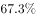
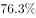

# 综合判断计数题（两期比重升降+期间和倍数+基期量比较+累计数首破位月份）

考点：[[20-考点/资料分析/综合/综合判断计数题（两期比重升降+期间和倍数+基期量比较+累计数首破位月份）|综合 / 综合判断计数题（两期比重升降+期间和倍数+基期量比较+累计数首破位月份）]]
材料：[[15-材料/资料分析/240395 2017年1-8月国内新能源汽车逐月|240395 2017年1-8月国内新能源汽车逐月]]

**问法模型**：题干问'能够从资料中推出的结论有几个'→对①~④逐条独立验证（①比重升降只比增速、②两组和相除、③基期量=现期/(1+r)后比较、④逐月累加找累计值首破10的月份），数出正确条数即答案

## 推理链
1. 第1步：①从表格取8月新能源汽车销量6.8万辆、同比增速76.3%，从文字段取汽车总销量218.6万辆及其同比增速（原题+5.3%）；部分增速76.3%＞整体增速5.3%，由两期比重结论'部分增速＞整体增速→比重上升'，①正确
2. 第2步：②从表格取第一季度产量0.7+1.8+3.3=5.8万辆、第二季度产量3.7+5.1+6.5=15.3万辆，15.3÷5.8≈2.6倍＜3倍多，②错误
3. 第3步：③用基期量公式：2016年8月销量=6.8/(1+76.3%)=6.8/1.763≈3.9万辆，2016年6月销量=5.9/(1+33.0%)=5.9/1.33≈4.4万辆，3.9＜4.4，2016年8月低于6月水平，③'高于'错误
4. 第4步：④逐月累加：累计产量1-4月=0.7+1.8+3.3+3.7=9.5＜10，加5月5.1得14.6＞10；累计销量1-4月=0.6+1.8+3.1+3.4=8.9＜10，加5月4.5得13.4＞10；产量与销量均在5月首次突破10万辆，'同一个月'成立，④正确
5. 第5步：正确的为①④共2个，对照选项B.2，得答案B

**最快解法**：⚡ 综合判断四步秒杀：①公式法两期比重——只比增速76.3%＞5.3%即判上升，无需计算比重值；②求和后截位直除15.3/5.8≈2.6；③基期量比较用交叉相乘免直除：5.9×1.763=10.4＞6.8×1.33=9.0→6月基期更大，③错误；④连续累加至5月（产量14.6、销量13.4）双双破10；正确2个选B

## 易错点
- ⚠ ①口径混淆：部分=新能源汽车销量（增速76.3%取自图表），整体=全口径汽车销量（增速来自文字段），勿把新能源汽车增速当整体增速、或误用产量增速67.3%；方向是部分增速＞整体增速→比重上升
- ⚠ ②③现期/基期混淆：②'3倍多'须精算（实为约2.6倍），勿凭Q2每月产量都高于Q1目测成3倍以上；③问的是2016年基期，现期6.8＞5.9不能直接推出基期高低，必须比较6.8/1.763与5.9/1.33
- ⚠ ④对象误用：8个单月产销值均＜10万辆，判断对象是'累计值'首破10的月份，须分别累加（产量5月14.6、销量5月13.4）且验证两者同月，勿用当月值或只累加一方

## 母题抽象
> 🧩 当题干出现'下列结论能从资料中推出的有几个'时，逐条套固定模型：比重升降只比部分/整体增速，倍数与基期比较用现期/(1+r)（分子分母交叉相乘免直除），'累计超过某值'逐月累加找首破月，计数即为答案

**同类特征**：能够从上述资料中推出的有（）个（多结论计数型）、占…比重同比上升（两期比重）、第二季度是第一季度的3倍多（季度和的倍数）、基期某月销量高于另一月（基期量比较）、累计产量和累计销量在同一个月内超过10万辆（累计破位）、逐月数据表读数比较

## 相关题
（暂无）

---

### 题干
下列结论中，能够从上述资料中推出的有（    ）个。
①2017年8月新能源汽车销量占汽车销量比重同比上升
②2017年第二季度新能源汽车产量是第一季度的3倍多 
③2016年8月新能源汽车销量高于6月水平 
④2017年1-8月新能源汽车累计产量和累计销量在同一个月内超过10万辆

### 选项
- A. 1
- B. 2　✅
- C. 3
- D. 4

### 官方解析
①：定位文字和表格材料可得，2017年8月新能源汽车销量同比增速为，2017年8月国内汽车销量同比增速为。根据两期比重结论，，比重上升，正确；
②：定位表格材料可得，2017年1-8月每月的新能源汽车产量，第一季度总产量万辆，第二季度产量万辆，2017年第二季度新能源汽车产量是第一季度的，错误；
③：定位表格材料可知，2017年8月新能源汽车销量6.8万辆，同比增速为，2017年6月新能源汽车销量5.9万辆，同比增速为,。根据公式：，可得2016年8月新能源汽车销量万辆，2016年6月新能源汽车销量万辆，2016年8月新能源汽车销量低于6月水平，错误；
④：定位表格材料可知，2017年1-8月每月的新能源汽车产量和销量，通过计算，前五个月的累计产量，前五个月的累计销量，则累计产量和累计销量均在5月内超过10万辆，正确。
故正确答案为B。

### 给定材料

        2017年8月，国内汽车产销分别完成209.3万辆和218.6万辆，产销量分别比上月增长和，同比分别增长和。当月新能源汽车产销分别完成7.2万辆和6.8万辆，同比分别增长和。

> [!warning] 疑点（官方解析可能有误，待人工复核）
> 本版文字段将汽车总量环比/同比增速挖空，①验证所需'8月汽车销量同比增速'（原题为+5.3%）在材料中无数据，官方解析该处亦为空值；严格按挖空材料①不可完整验证，但按原题数据5.3%判定①正确，答案B（2个）的结论不受影响。
