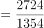
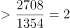
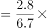
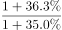
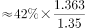

# 综合判断—'不能得出'型（口径范围识别与读数验证）

考点：[[20-考点/资料分析/综合/综合判断—'不能得出'型（口径范围识别与读数验证）|综合 / 综合判断—'不能得出'型（口径范围识别与读数验证）]]
材料：[[15-材料/资料分析/241019 2017年我国专利事业发展概况：发明|241019 2017年我国专利事业发展概况：发明]]

**问法模型**：'不能从给定资料中得出的是'选非题 → 逐项核对选项口径与材料口径是否一致、数据是否足以支撑，锁定口径被偷换或数据缺失的那一项

## 推理链
1. 第1步：题干为选非题，逐项验证；材料给出截至2017年底全国每万人口发明专利拥有量9.8件、北京94.5件（件/万人，同口径）
2. 第2步：A项验证：94.5与9.8同为人均强度口径，94.5/9.8≈9.6倍，近10倍差距支持'相差悬殊'的定性判断，A可得出
3. 第3步：B项验证：2017年在印度公开量2724件、俄罗斯1354件，2724÷1354≈2.01＞2，'两倍以上'成立，B可得出
4. 第4步：C项核口径：材料只给'在华申请专利的一带一路沿线国家数41个，较2016年增加4个'，最多推出2016年沿线国家为37个；而C项口径是'在我国（不含港澳台）申请专利的国家数'（全部国家总数），材料未提供该总数，沿线国家只是其子集，口径被偷换，C不能得出
5. 第5步：D项验证：2017年专利纠纷办案2.8万件、执法办案总量6.7万件，以基期比重公式[2.8/(1+a)]÷[6.7/(1+b)]代入两处同比增速（完整版材料补齐）可判定是否超过该比例，官方判定成立，D可得出
6. 第6步：本题为选非题，不能得出者为C，与官方答案一致

**最快解法**：⚡ 口径排除法：先攻C项——材料仅有'一带一路'沿线国家数（41个→2016年37个），C项却问'在我国（不含港澳台）申请专利的国家数'，范围由沿线国家扩大为全部国家，数据缺失，直接锁定C；再快速回验A（94.5 vs 9.8差约10倍）、B（2724≈1354×2）均可得出，验证无误

## 易错点
- ⚠ C项口径偷换陷阱：'一带一路沿线国家数37个'与'在我国（不含港澳台）申请专利的国家数'是子集与全集的关系，材料只有前者，误把37个安到全部国家头上即掉坑
- ⚠ 国别数与申请件数混淆：'41个、较2016年增加4个'是国家数口径，不能与在华申请量4319件（件数口径）混算，也不能由此推出2016年在华申请量
- ⚠ B项倍数临界陷阱：2724/1354≈2.01刚过2倍线，粗心估算可能误判为'不足两倍'而错选B

## 母题抽象
> 🧩 当'不能得出'型判断题的选项涉及'某年某口径数值'时，先比对选项口径与材料口径（如'沿线国家'≠'全部国家'、'国家数'≠'件数'、'存量'≠'流量'），口径不一致或数据缺失者即为答案，其余可计算项用简单倍数/差值快速回验

**同类特征**：不能从给定资料中得出、选非题、综合判断四选项、口径范围偷换（沿线国家vs全部国家）、国家数与件数口径区分、2016年基期数值推算

## 相关题
- [[10-真题/资料分析/综合/2047830 综合判断—选非题（无法得出项判定）|2047830]]（广东 2017，相关度2）
- [[10-真题/资料分析/综合/250219 综合分析选非题（图表数据可推断性判断）|250219]]（深圳市考 2008，相关度1）
- [[10-真题/资料分析/综合/10297333 综合分析选非题（同比增速逐年比较+年均增长量+比重百分点还原）|10297333]]（浙江 2025，相关度1）
- [[10-真题/资料分析/综合/14355349 综合分析-选非题（增长率计算比较+人均值计算）|14355349]]（浙江 2024，相关度1）
- [[10-真题/资料分析/综合/17097816 综合判断·选非题（增长率与增长量偷换）|17097816]]（山西 2024，相关度1）

---

### 题干
下列选项中，不能从给定资料中得出的是：

### 选项
- A. 
2017年，我国每万人口发明专利拥有量与北京的平均水平相差悬殊

- B. 
2017年，我国在印度专利申请公开量是在俄罗斯的两倍以上

- C. 
2016年，在我国（不含港澳台）申请专利的国家数为37个
　✅
- D. 
2016年，全国专利纠纷办案占专利行政执法办案总量超过

### 官方解析

A项：定位材料第二段，截至2017年底，我国每万人口发明专利拥有量达到9.8件，北京为94.5件，9.8与94.5有近10倍的差距，可以理解为相差悬殊，正确；

B项：定位材料第三段，2017年，我国在印度专利申请公开量为2724件，在俄罗斯专利申请公开量为1354件。倍数，即在两倍以上，正确；

C项：材料只给出在华申请专利的“一带一路”沿线国家数，未给出在我国（不含港澳台）申请专利的国家总数，无法计算，错误；

D项：定位材料最后一段，2017年，全国专利行政执法办案总量6.7万件，同比增长。其中，专利纠纷办案2.8万件，同比增长。代入基期比重公式，正确。

本题为选非题，故正确答案为C。

### 给定材料

        2017年，我国发明专利申请量为138.2万件，同比增长。共授权发明专利42.0万件，同比增长。其中，国内发明专利授权32.7万件，同比增长。在国内发明专利授权中，职务发明为30.4万件，占；非职务发明为2.3万件，占。

        截至2017年底，我国国内（不含港澳台）发明专利拥有量共计135.6万件，每万人口发明专利拥有量达到9.8件。我国每万人口发明专利拥有量排名前十位的省（区、市）依次为：北京（94.5件）、上海（41.5件）、江苏（22.5件）、浙江（19.7件）、广东（19.0件）、天津（18.3件）、陕西（8.9件）、福建（8.0件）、安徽（7.7件）和辽宁（7.6件）。

        2017年，我国在“一带一路”沿线国家（不含中国）专利申请公开量为5608件，同比增长。其中，在印度专利申请公开量为2724件，在俄罗斯专利申请公开量为1354件，专利申请初具规模。2017年，“一带一路”沿线国家在华申请专利4319件，同比增长；在华申请专利的“一带一路”沿线国家数达到41个，较2016年增加4个。

        2017年，全国专利行政执法办案总量6.7万件，同比增长。其中，专利纠纷办案2.8万件（包括专利侵权纠纷办案2.7万件），同比增长；查处假冒专利案件3.9万件，同比增长。

