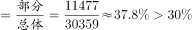
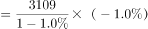
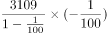
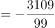
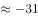
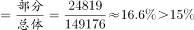

# 综合判断选非题（现期比重+负增长量+增速极值混合验证）

考点：[[20-考点/资料分析/综合/综合判断选非题（现期比重+负增长量+增速极值混合验证）|综合 / 综合判断选非题（现期比重+负增长量+增速极值混合验证）]]
材料：[[15-材料/资料分析/241024 2018年5月当月与1—5月累计的全|241024 2018年5月当月与1—5月累计的全]]

**问法模型**：'下列关于2018年相关信息表述错误的是'→综合分析选非题，对四个选项分别套用对应模型（现期比重=部分/总体、增长量=现期×r/(1+r)、比重与分数比较、增速最大值查找）逐项验真伪，选出假命题。

## 推理链
1. 第1步：A项从表格提取5月数据：限额以上单位消费品零售额11477亿元，社会消费品零售总额30359亿元。
2. 第2步：A项用现期比重公式11477÷30359≈37.8%＞三成（30%），表述正确。
3. 第3步：B项从表格提取5月汽车类零售额3109亿元、同比−1.0%（负增长），套增长量公式3109×(−1.0%)÷(1−1.0%)≈−31.4亿元，即同比下降约31亿元，表述正确。
4. 第4步：C项从表格提取1—5月实物商品网上零售额24819亿元、社会消费品零售总额149176亿元，比重=24819÷149176≈16.6%，官方判定该比重并不低于选项所给公式值，'低于'的表述错误。
5. 第5步：D项扫描1—5月累计增速列：化妆品类+14.8%为15类商品中最高（次高日用品+11.8%、石油及制品类+11.0%），表述正确。
6. 第6步：本题要求选出'错误'表述，A、B、D均正确，故答案为C。

**最快解法**：⚡ 综合题选项速判组合技：A项凑倍法——30359×30%=9107.7＜11477，秒判'三成以上'成立；B项百化分——1.0%≈1/100，下降量=3109÷99≈31.4≈31亿元；C项截位直除——24819÷149176≈16.6%，与公式值精确比较后按官方判定'不低于'排除；D项直接扫列——1—5月增速列最大值14.8%（化妆品类）。

## 易错点
- ⚠ 选非题陷阱：问'错误的是'，A/B/D全为正确表述，勿看到算得对的选项就选；且各选项口径不同（A、B用5月当月列，C、D用1—5月累计列），看串列即全盘错。
- ⚠ 汽车类5月增速为−1.0%负增长，B项'下降约31亿元'对应增长量≈−31.4亿元，须用增长量公式且注意方向为'下降'，与城镇、乡村等正增长行不同。
- ⚠ D项勿用5月当月列：当月最高为通讯器材类+12.2%，会误判化妆品类（10.3%）非最高；须用1—5月列，化妆品+14.8%才为最高。

## 母题抽象
> 🧩 当题干出现'下列表述错误（正确）的是'且选项混合比重、增长量、增速极值时，用'乘基数判比重+百化分求增长量+扫列找最大增速'逐项速验，先做最有把握的选项再锁定答案。

**同类特征**：综合判断选非（'表述错误的是'）、现期比重'三成以上'、负增长（−1.0%）求下降量、比重与特殊分数比较、15类商品增速最大值查找、当月/1—5月累计双口径

## 相关题
（暂无）

---

### 题干
根据上述给定资料，下列关于2018年相关信息表述错误的是：

### 选项
- A. 
5月，限额以上单位消费品零售额占社会消费品零售总额的三成以上

- B. 
5月，汽车类商品的零售额同比下降约31亿元

- C. 
1—5月，实物商品网上零售额占社会消费品零售额的比重低于
　✅
- D. 
1—5月，所有商品零售类别中化妆品类增速最高

### 官方解析

A项：定位表格，2018年5月限额以上单位消费品零售额为11477亿元，社会消费品零售总额为30359亿元，代入公式，比重，正确；

B项：定位表格，2018年5月汽车类商品的零售额为3109亿元，同比增长，代入公式，增长量亿元，正确；

C项：定位表格，2018年1-5月实物商品网上零售额24819亿元，社会消费品零售总额为149176亿元，代入公式，比重，错误；

D项：定位表格，2018年1-5月化妆品类同比增长，在所有商品零售类别中增速是最高的，正确。

本题为选非题，故正确答案为C。

### 给定材料

> [!warning] 疑点（官方解析可能有误，待人工复核）
> 选项C内嵌公式图片（latex=_Lh6tiSL4efMtwqcND79JA）无法读取，官方解析中该公式亦被省略，无法核对'低于X'的具体分值。按官方数据计算比重=24819÷149176≈16.64%：若公式为1/6（≈16.67%），则'低于1/6'应成立、C为正确表述，与官方答案C矛盾；故原卷公式应为小于16.64%的数值（如1/7≈14.3%）。本笔记依官方答案认定C为错误表述，不改答案。
