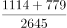
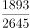
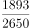
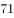
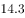
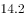

# 综合判断（选非题）——增速方向判断+比重计算+混合增速验证

考点：[[20-考点/资料分析/综合/综合判断（选非题）——增速方向判断+比重计算+混合增速验证|综合 / 综合判断（选非题）——增速方向判断+比重计算+混合增速验证]]
材料：[[15-材料/资料分析/241028 2018年1-5月我国软件和信息技术|241028 2018年1-5月我国软件和信息技术]]

**问法模型**：题干'下列描述错误的是'（选非）→ 逐项与材料方向词、数值、口径比对，锁定与'增速同比回落'方向矛盾的选项

## 推理链
1. 第1步：题干为选非题，要求找出错误描述，需对A/B/C/D逐项核对。
2. 第2步：A项——正文仅给出利润总额2822亿元、'增速同比回落0.9个百分点'（增速数值空缺），'回落'表明2018年利润增幅低于2017年，与选项'增幅稳定上升'方向直接矛盾，错误。
3. 第3步：B项——表2前10位中的西部省份为四川1114亿元、陕西779亿元，合计1893亿元；西部地区总收入2645亿元，1893÷2645≈71.6%＞70%，占七成以上，说法正确。
4. 第4步：C项——图1折线四地区累计增速为东部14.30%、中部19.40%、西部13.90%、东北部8.60%，中部19.40%最高，'增势最为突出'成立，说法正确。
5. 第5步：D项——图1东部增速14.30%，结合题4按收入加权（(18747×14.3%+976×19.4%+2645×13.9%+960×8.6%)÷23328≈14.2%），两者基本持平，说法正确。
6. 第6步：仅A与材料方向矛盾，选非题故选A。

**最快解法**：⚡ 方向词秒杀：A项'增幅稳定上升'与正文'增速同比回落0.9个百分点'方向相反，直接判错选A，无需算出利润增速具体数值；B/C/D用直除与读图快速复核（1893/2645≈71.6%＞70%、中部19.4%为四地区最高、东部14.3%≈全国加权14.2%）

## 易错点
- ⚠ 正文利润增速数值空缺不代表A无法判断——'同比回落0.9个百分点'的方向信息已足以否定'稳定上升'，误以为必须先补出增速值而卡壳浪费时间
- ⚠ 把'回落0.9个百分点'误解为增速相对下降0.9%（百分点与百分比混淆），或把'回落'方向看反
- ⚠ B项跨图表归属陷阱：表2标题写'前十位城市'实为省（直辖市），须识别四川/陕西属西部（辽宁属东北）；C/D项须读图1双轴图的折线（增速%）而非柱（收入亿元），全国平均增速须按收入加权而非四地区简单平均

## 母题抽象
> 🧩 当综合判断选项含'稳定上升/持续提高'等方向词，而材料对应位置给出'同比回落N个百分点'时，方向矛盾即可秒判该项错误，无须知道增速具体数值；其余选项按比重直除、增速排序、加权平均逐项验证。

**同类特征**：选非题：下列描述错误的是、增速同比回落0.9个百分点、增幅稳定上升（方向词矛盾）、占西部地区七成以上（比重）、增势最为突出（增速比较）、与全国平均水平基本持平（加权增速）

## 相关题
- [[10-真题/资料分析/增长/2402497 基期增速换算（由'增速同比回落N个百分点'求上年同期增速）|2402497]]（重庆 2018，相关度1）

---

### 题干
关于2018年1-5月我国软件业务情况的描述，下列错误的是：

### 选项
- A. 全行业利润保持两位数增长，并且增幅稳定上升　✅
- B. 软件业务收入居全国前10位的西部省份，其软件业务收入占到了西部地区该业务收入的七成以上
- C. 中部地区软件业务收入增势最为突出
- D. 东部地区软件业务收入增速与全国平均水平基本持平

### 官方解析

A项，定位文字材料第一段，2018年1-5月，我国软件和信息技术服务业全行业实现利润总额2822亿元，同比增长，增速同比回落0.9个百分点。增幅低于去年，并没有稳定上升，错误；

B项，定位表格材料，2018年1-5月软件业务收入居全国前10位的西部省份为四川和陕西，其软件业务收入分别为1114亿元和779亿元；定位文字材料第二段，2018年1-5月西部地区完成软件业务收入2645亿元。根据，因此所求比重，大于七成，正确；

C项，定位折线图，中部地区软件业务收入的增长率为，在四个地区中排名第一，即增势最为突出，正确；

D项，定位折线图，2018年1-5月东部地区软件业务收入的增速为。并且结合119题可知全国平均水平为，两者比较接近、基本持平，正确。

本题为选非题，故正确答案为A。

### 给定材料

        2018年1-5月，我国软件和信息技术服务业完成软件业务收入23328亿元。1-5月，全行业实现利润总额2822亿元，同比增长，增速同比回落0.9个百分点。

        从分地区运行情况来看，2018年1-5月，中部地区完成软件业务收入976亿元，增长，增速同比提高3.3个百分点；其中河南、安徽、湖北软件业务收入增速持续高于全国平均水平。西部地区完成软件业务收入2645亿元，增长，增速同比回落4个百分点，近年来西部地区首次出现增速低于全国平均水平的情况。东部地区完成软件业务收入18747亿元，同比增长，增速同比提高1.2个百分点；总量居前5名的广东、江苏、北京、浙江、山东完成软件业务收入累计占全国比重为，其中北京和浙江增速分别高出全国平均增速5.3、6.1个百分点。东北地区完成软件业务收入960亿元，同比增长，增速同比提高2.8个百分点，高于1-4月1.7个百分点。

> [!warning] 疑点（官方解析可能有误，待人工复核）
> 官方答案与解析逻辑无误（'回落0.9个百分点'与'稳定上升'方向矛盾足以判错）；但A项'保持两位数增长'所需的利润增速具体数值在所给正文与图中均空缺，官方解析亦未补该值，'两位数'仅能回原文补读验证，此口径缺口不影响本题答案。

<!-- CODEX-ANSWER-REVIEW:BEGIN -->
### 本次独立复核

**复核状态：** `resolved`（答案与解析已核定）

**计分答案：** A（可计分）

**复核解析：**

1. 第1步：题干为选非题，要求找出错误描述，需对A/B/C/D逐项核对。
2. 第2步：A项——正文仅给出利润总额2822亿元、'增速同比回落0.9个百分点'（增速数值空缺），'回落'表明2018年利润增幅低于2017年，与选项'增幅稳定上升'方向直接矛盾，错误。
3. 第3步：B项——表2前10位中的西部省份为四川1114亿元、陕西779亿元，合计1893亿元；西部地区总收入2645亿元，1893÷2645≈71.6%＞70%，占七成以上，说法正确。
4. 第4步：C项——图1折线四地区累计增速为东部14.30%、中部19.40%、西部13.90%、东北部8.60%，中部19.40%最高，'增势最为突出'成立，说法正确。
5. 第5步：D项——图1东部增速14.30%，结合题4按收入加权（(18747×14.3%+976×19.4%+2645×13.9%+960×8.6%)÷23328≈14.2%），两者基本持平，说法正确。
6. 第6步：仅A与材料方向矛盾，选非题故选A。

**最快解法**：⚡ 方向词秒杀：A项'增幅稳定上升'与正文'增速同比回落0.9个百分点'方向相反，直接判错选A，无需算出利润增速具体数值；B/C/D用直除与读图快速复核（1893/2645≈71.6%＞70%、中部19.4%为四地区最高、东部14.3%≈全国加权14.2%）

**相关信息：**

考點：综合判断（选非题）——增速方向判断+比重计算+混合增速验证。來源：2018年重庆市公务员录用考试《行测》题（下半年）；2018年。> 🧩 当综合判断选项含'稳定上升/持续提高'等方向词，而材料对应位置给出'同比回落N个百分点'时，方向矛盾即可秒判该项错误，无须知道增速具体数值；其余选项按比重直除、增速排序、加权平均逐项验证。

**同类特征**：选非题：下列描述错误的是、增速同比回落0.9个百分点、增幅稳定上升（方向词矛盾）、占西部地区七成以上（比重）、增势最为突出（增速比较）、与全国平均水平基本持平（加权增速）

**题源依据：** [固定版本原题](https://github.com/Mentat-Uran/kaogongzhentizhengliu/blob/84ab93d4b64b61d897bece8a1c0a5bab06b4feb2/10-%E7%9C%9F%E9%A2%98/%E8%B5%84%E6%96%99%E5%88%86%E6%9E%90/%E7%BB%BC%E5%90%88/2402501%20%E7%BB%BC%E5%90%88%E5%88%A4%E6%96%AD%EF%BC%88%E9%80%89%E9%9D%9E%E9%A2%98%EF%BC%89%E2%80%94%E2%80%94%E5%A2%9E%E9%80%9F%E6%96%B9%E5%90%91%E5%88%A4%E6%96%AD%2B%E6%AF%94%E9%87%8D%E8%AE%A1%E7%AE%97%2B%E6%B7%B7%E5%90%88%E5%A2%9E%E9%80%9F%E9%AA%8C%E8%AF%81.md)；固定内容 commit `84ab93d4b64b61d897bece8a1c0a5bab06b4feb2`，Markdown blob `b24b030817223367ad937eb379cc26210be05ab0`。
<!-- CODEX-ANSWER-REVIEW:END -->
