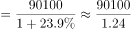
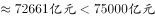
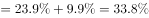
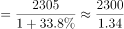
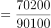
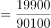
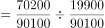
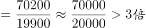

# 综合分析选非题（基期量计算证伪＋现期比重倍数＋无法判断项识别）

考点：[[20-考点/资料分析/综合/综合分析选非题（基期量计算证伪＋现期比重倍数＋无法判断项识别）|综合 / 综合分析选非题（基期量计算证伪＋现期比重倍数＋无法判断项识别）]]
材料：[[15-材料/资料分析/242945 2018年全国网络零售规模与结构：全|242945 2018年全国网络零售规模与结构：全]]

**问法模型**：题干以'根据给定资料，无法推出的是'设问（选非型综合分析）→对四个选项分别套用基期量=现期÷(1+增速)、比重倍数=两现期部分额之比、百分点增速差等模型逐项验算，优先锁定可被直接计算证伪的选项。

## 推理链
1. 第1步：第1段取数：2018年全国网络零售额90100亿元（同比增速g以原卷为准），其中实物商品网上零售额70200亿元、非实物商品网上零售额19900亿元，70200+19900=90100构成关系自洽
2. 第2步：D项验证（现期比重倍数）：实物占比=70200/90100，非实物占比=19900/90100，倍数=70200÷19900≈3.5倍，'约是3倍多'成立，D可推出
3. 第3步：A项验证（基期量）：2017年全国网络零售额=90100÷(1+g)，只需g＞90100/75000−1≈20.1%即基期不足75000亿元，官方代入原卷增速判定A'正确'，可推出
4. 第4步：B项验证（基期量＋百分点差）：由第4段，2018年农产品网络零售额2305亿元，其增速=全国网络零售额增速g＋9.9个百分点，则2017年值=2305÷(1+g+9.9%)；要超过1800亿元需增速g+9.9%＞2305/1800−1≈28.1%，官方代入原卷数据判定结果不足1800亿元，'超过1800亿元'被计算证伪
5. 第5步：C项核验（口径缺口）：第2段仅给出农村实物商品（基数10900亿元）前三品类的占比与增速，农村非实物商品2800亿元无分品类数据，故无法确定'全国农村网络零售额（13700亿元口径）前三位品类'及增速最慢者，C属信息缺失无法判断
6. 第6步：选非定性收口：B是可用公式直接算出并证伪的确定错误项，C是材料信息不足的无法判断项，官方以'可直接得出计算错误'的B为唯一正确答案

**最快解法**：⚡ 综合分析选非'先算后判'：①直除秒判D——70200/19900≈3.5倍即'3倍多'；②截位直除验证A、B两个基期式——90100÷(1+g)与2305÷(1+g+9.9%)（'高9.9个百分点'先加到全国增速上再套基期公式）；③B代入后结果不足1800亿元被证伪，直接锁定B，不必在C的信息缺口上纠缠。

## 易错点
- ⚠ '高9.9个百分点'是增速差不是增速：农产品增速=全国网络零售额增速＋9.9个百分点，若误当作增速直接算2305÷1.099≈2097亿元，会误判B'超过1800'成立而错选
- ⚠ 选非题定性陷阱：C项确实也推不出（农村非实物商品2800亿元无分品类数据），但它属'信息缺失无法判断'，B属'可计算证伪的确定错误'，官方以可直接证伪的B作答，勿因C同样推不出而误选C或纠结耗时
- ⚠ 口径混淆：'全国实物商品网上零售额70200亿元'与'农村实物商品网络零售额10900亿元'名称相近基数不同；第3段品类占比基数为10900亿元而非农村网络零售额13700亿元，核对C项时勿把实物前三品类增速当作农村整体前三品类增速

## 母题抽象
> 🧩 当综合分析选非题问'无法推出的是'时，先对带具体数值的选项用现期直除（比重倍数）与基期公式'现期÷(1+增速)'逐项验算，优先锁定'能算出且算错'的选项作为答案，'信息无法判断'类选项仅在没有可直接证伪项时才作为备选。

**同类特征**：无法推出的是（选非型设问）、不到/超过＋具体数值的基期量判断、高9.9个百分点（增速百分点差）、约是……3倍多（现期比重倍数）、前三位品类＋增速最慢（实物/非实物口径陷阱）、四选项跨段落取数、覆盖多种模型

## 相关题
（暂无）

---

### 题干
根据给定资料，无法推出的是：

### 选项
- A. 2017年全国网络零售额不到75000亿元
- B. 2017年全国农产品网络零售额超过1800亿元　✅
- C. 2018年全国农村网络零售额前三位品类中，增速最慢的是日用品
- D. 2018年全国网络零售额中，实物商品占比约是非实物商品的3倍多

### 官方解析

A项：定位材料第一段可得“2018年全国网络零售额90100亿元，同比增长”，根据公式：，可得2017年全国网络零售额，正确；

B项：定位材料第三段可得“2018年全国农产品网络零售额达2305亿元，比全国网络零售额同比增速高9.9个百分点。”定位材料第一段“2018年全国网络零售额······同比增长”，可得2018年全国农产品网络零售额增长率。根据公式：，可得2017年全国农产品网络零售额，错误；

C项：定位材料第二段可得农村实物商品网络零售额前三位增速，而非实物商品网络零售额各品类增速未知，故无法推出全国农村网络零售额前三位品类，无法判断；

D项：定位材料第一段，可得2018年全国网络零售额90100亿元，实物商品网上零售额为70200亿元，非实物商品网上零售额19900亿元。根据公式：，可得实物商品占比，非实物商品占比，故所求倍数，正确。

本题为选非题，故正确答案为B。

注：本题C项存在争议，材料中农村非实物商品网络零售额并没有给出具体品类的数据，无法判断全国农村网络零售额前三位的品类，故粉笔认为本题C项也无法推出，但B项可直接得出计算错误，因此粉笔推荐本题优先选择B项。

### 给定材料

        2018年全国网络零售额90100亿元，同比增长。其中，实物商品网上零售额为70200亿元，同比增长；非实物商品网上零售额19900亿元，同比增长。

        2018年全国农村网络零售额为13700亿元。其中，农村实物商品网络零售额为10900亿元，同比增长；农村非实物商品网络零售额2800亿元，同比增长。分品类看，农村实物商品零售额前三位的品类分别为服装鞋帽针织品、日用品、粮油食品及饮料烟酒，分别占农村实物商品零售额的、和，同比增速分别为、和。

        2018年全国农产品网络零售额达2305亿元，比全国网络零售额同比增速高9.9个百分点。其中，休闲食品、茶叶、滋补食品零售额排名前三，占比分别为、和，同比增速分别为、和。

> [!note] 复核版本状态
> 原题不可计分（genuine_multi_answer；来源记录的答案键/竞争项：B、C）；仅当前明确标注的编辑版按答案B计分。
> 详细原题疑点、修订题面、解析和证据见下方独立复核记录。

<!-- CODEX-ANSWER-REVIEW:BEGIN -->
### 本次独立复核

**复核结论：** `resolved`（答案与解析已核定）

**原题计分状态：** 不计分（`genuine_multi_answer`：多个答案均成立）。来源中记录的答案键/竞争项：B、C；这些记录不代表原题已核准答案。

**原题疑点与处理：**

原题B：公式图给出农产品增速=全国网络零售增速23.9%+9.9个百分点=33.8%，故2017年农产品网络零售额2305/1.338≈1722.7亿元，未超过1800。原题C问农村全部网络零售额前三品类，但材料仅给农村实物商品前三品类数据，不能推出。因此原题B、C均为不能推出项。题库编辑版只把C限定为农村实物商品前三品类以形成唯一答案B；不得将编辑版结论当成原题唯一答案。

**当前计分版本：** 明确标注的编辑版；未列出的题干、材料或选项沿用固定题源。答案不回填为原题答案。

**计分答案：** B（可计分）

**复核解析：**

【原题与编辑版分开计分】固定题源公式图显示全国网络零售额增速23.9%，农产品增速比其高9.9个百分点，即33.8%。A：90100÷1.239≈72720.7亿元，不到75000。B：2305÷1.338≈1722.7亿元，未超过1800，所以B无法推出。C按原文“全国农村网络零售额前三位品类”理解时，材料只给农村实物商品前三品类的增速，未给农村非实物品类的分项增速，因此原C也无法推出。D：70200÷19900≈3.53，成立。原题应为B、C双答案，不适合单选计分。编辑版将C的范围明确收窄为“农村实物商品网络零售额前三位品类”，由30%、28%、35%可知日用品增速最慢，编辑版唯一不能推出项为B。商务部和农业农村部资料分别核验网络零售、农村/农产品总量背景；原题各精确选项计算使用固定题源图表与公式图。

**修订题干：**

【编辑修订】根据给定资料，下列选项中无法推出的是：

**修订材料：**

固定题图（相关数据按题面取整）给出：2018年全国网络零售额约90100亿元、同比增长23.9%；农产品网络零售额2305亿元、增长33.8%；农村网络零售额约1.37万亿元、增长30.4%；农村实物商品和非实物商品网络零售额分别约7020亿元、1990亿元。题图列出的农村实物商品前三位品类增速为服装30%、日用品28%、粮油食品及饮料烟酒35%。商务部公布的全国精确数据为网络零售额90065亿元、增长23.9%，实物商品网络零售额70198亿元、增长25.4%；农业农村部报告公布农村网络零售额1.37万亿元及农产品网络零售额2305亿元、增长33.8%。

**修订/采用选项：**

A. 2017年全国网络零售额不到75000亿元
B. 2017年全国农产品网络零售额超过1800亿元
C. 2018年全国农村实物商品网络零售额前三位品类中，增速最慢的是日用品。
D. 2018年全国网络零售额中，实物商品占比约是非实物商品的3倍多

**相关信息：**

基期量=现期量÷(1+增长率)。原题“无法推出”存在两个成立选项时，须把原题留作不计分，并把改过统计范围的题目明确标为编辑版。农村实物商品品类增速不能直接代表农村全部网络零售品类增速。

**核对依据与来源边界：**

- 固定题源：[原题文件](https://github.com/Mentat-Uran/kaogongzhentizhengliu/blob/84ab93d4b64b61d897bece8a1c0a5bab06b4feb2/10-%E7%9C%9F%E9%A2%98/%E8%B5%84%E6%96%99%E5%88%86%E6%9E%90/%E7%BB%BC%E5%90%88/2423345%20%E7%BB%BC%E5%90%88%E5%88%86%E6%9E%90%E9%80%89%E9%9D%9E%E9%A2%98%EF%BC%88%E5%9F%BA%E6%9C%9F%E9%87%8F%E8%AE%A1%E7%AE%97%E8%AF%81%E4%BC%AA%EF%BC%8B%E7%8E%B0%E6%9C%9F%E6%AF%94%E9%87%8D%E5%80%8D%E6%95%B0%EF%BC%8B%E6%97%A0%E6%B3%95%E5%88%A4%E6%96%AD%E9%A1%B9%E8%AF%86%E5%88%AB%EF%BC%89.md)；内容版本 `84ab93d4b64b61d897bece8a1c0a5bab06b4feb2`，源 Markdown blob `a9ecc10cc4a89480db15ea86a6d980a61b055c81`.
- [商务部全国网络零售额系列；本题精确增速按固定题源图所示23.9%。](https://data.mofcom.gov.cn/article/zxtj/201901/46734.html)
- [农业农村部《2019年中国数字乡村发展报告》载明2018年农村网络零售额1.37万亿元、同比30.4%，农产品网络零售额2305亿元、同比33.8%。](https://scs.moa.gov.cn/gzdt/201911/P020191119505821675490.pdf)
- 固定题图/公式图：`90-图片/公式图/formula-415097237f7d7bac.png`, `90-图片/公式图/formula-19ba88b137207660.png`, `90-图片/公式图/formula-76b20663a80b85f5.png`, `90-图片/公式图/formula-8dc8f358646b9a92.png`, `90-图片/公式图/formula-ed5729ec9611d307.png`, `90-图片/公式图/formula-1a66db25fc01b72b.png`, `90-图片/公式图/formula-7129160c163ab570.png`, `90-图片/公式图/formula-559eb90e5c098b46.png`, `90-图片/公式图/formula-0b18d25c12ba9f40.png`, `90-图片/公式图/formula-8864dcd7c84f3974.png`, `90-图片/公式图/formula-31f6b233e788154e.png`, `90-图片/公式图/formula-fd522e1e11c7fa11.png`, `90-图片/公式图/formula-db1a060e1e3180ad.png`, `90-图片/公式图/formula-14fc43a1ef595322.png`, `90-图片/公式图/formula-03ea1265ba85ddb2.png`, `90-图片/公式图/formula-a4bff6c37f3ca592.png`, `90-图片/公式图/formula-96e0db1db3dd6806.png`, `90-图片/公式图/formula-f73d3b53d2d6d43f.png`, `90-图片/公式图/formula-80c999474255e307.png`, `90-图片/公式图/formula-2f29ab37e5278826.png`, `90-图片/公式图/formula-f79c2fbcc45b4e4c.png`, `90-图片/公式图/formula-798548a34beb5738.png`, `90-图片/公式图/formula-b3bb74ffeb2f250f.png`, `90-图片/公式图/formula-1baf383620261b64.png`, `90-图片/公式图/formula-96cf11a60e68b78e.png`, `90-图片/公式图/formula-670a724854268c12.png`, `90-图片/公式图/formula-77b555c87799c796.png`, `90-图片/公式图/formula-92d43e0d7499267a.png`.

<!-- CODEX-ANSWER-REVIEW:END -->
