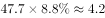
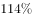
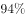
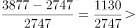
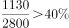
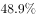
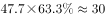
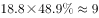
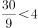

# 综合分析逐项判断（现期部分量=总量×占比、增速趋势、同比增速、跨图倍数）

考点：[[20-考点/资料分析/综合/综合分析逐项判断（现期部分量=总量×占比、增速趋势、同比增速、跨图倍数）|综合 / 综合分析逐项判断（现期部分量=总量×占比、增速趋势、同比增速、跨图倍数）]]
材料：[[15-材料/资料分析/242946 2013～2018年中国数字音乐的用|242946 2013～2018年中国数字音乐的用]]

**问法模型**：“由上述资料能够推出的是”的综合分析问法 → 对A/B/C/D逐项定位对应图表验算，优先验证“总量×占比”型一步乘法项，排除三项锁定答案

## 推理链
1. 第1步：A项需跨图拼接——图2给2017年市场收入规模47.7亿元，图3给2017年版权运营收入占比8.8%
2. 第2步：部分量=总量×占比，47.7×8.8%≈4.2亿元＞4亿元，A项成立
3. 第3步：B项读图2增速线：2015年114%、2016年94%、2017年31%、2018年60%，先降后升，并非持续下降，排除
4. 第4步：C项读图1：2018年付费用户3877万人、2017年2747万人（同为万人可直接相除），同比增速=(3877-2747)/2747=1130/2747≈41%，并非约30%，排除
5. 第5步：D项跨图乘法：2017年内容付费收入=47.7×63.3%≈30.2亿元，2015年=18.8×48.9%≈9.2亿元，倍数≈30.2/9.2≈3.3倍＜4倍，排除
6. 第6步：仅A项能由资料推出，故选A

**最快解法**：⚡ 综合题先易后难：A项是“收入规模×结构占比”一步乘法，用百化分8.8%≈1/11，47.7×8.8%≈47.7/11≈4.3（精确约4.2）＞4，一步锁定A；B项扫图2增速线末端2018年上翘至60%即排除；C项(3877-2747)/2747≈41%排除；D项粗算30.2/9.2≈3.3倍排除

## 易错点
- ⚠ B项易漏看2018年增速60%：图2中2018年无收入柱、只有增速点，若只看到114%→94%→31%会误判“持续下降”成立
- ⚠ 图1双轴单位陷阱：付费用户为万人、总用户为亿人；C项分子分母同为万人可直接相除，勿误代入7.4亿总用户；图1中2016年数据点'2017'是2017万人而非年份
- ⚠ D项倍数验证须两期各自跨图相乘再相除：占比倍数63.3%/48.9%≈1.3与收入倍数47.7/18.8≈2.5相乘≈3.3倍，只比占比或只比收入规模都会误判

## 母题抽象
> 🧩 当题干出现“能够推出的是”综合分析特征时，先验证“总量×占比”型一步乘法可判定的选项（如收入规模×收入结构占比），再用增速序列排趋势项、(现期-基期)/基期排增长率项、两期“总量×占比”相除排倍数项，先易后难逐项排除

**同类特征**：由上述资料能够推出的是、综合分析四选一、跨图拼接：市场收入规模×收入结构占比、增速趋势“持续下降”判断、付费用户规模同比增速、两期收入倍数比较

## 相关题
- [[10-真题/资料分析/综合/2188892 综合分析推断题（无中生有排除+平均每机构场次验证）|2188892]]（甘肃 2018，相关度1）
- [[10-真题/资料分析/综合/2031178 综合分析题（逐项验证：增长量计算、基期量反推、比重阈值判断）|2031178]]（北京 2017，相关度1）
- [[10-真题/资料分析/综合/2051204 综合判断题（两期比重比较＋增速计数＋区间求和比较＋涨幅比较）|2051204]]（黑龙江 2017，相关度1）
- [[10-真题/资料分析/综合/13255455 综合分析题-逐项验证（基期量换算比较、增长率计算与比较）|13255455]]（选调 2023，相关度1）
- [[10-真题/资料分析/综合/1797646 综合分析（比重变化判断+月均数+读图增速比较+现期比重估算）|1797646]]（山东 2016，相关度1）

---

### 题干
关于中国数字音乐市场，由上述资料能够推出的是：

### 选项
- A. 2017年版权运营收入超过4亿元　✅
- B. 2015～2018年中国数字音乐市场收入规模增速持续下降
- C. 2018年付费用户规模同比增长约30%
- D. 内容付费收入2017年是2015年的4倍多

### 官方解析

A项：定位图2可得，2017年中国数字音乐市场收入规模为47.7亿元，定位图3可得，2017年版权运营收入占比为。则2017年版权运营收入为亿元，超过4亿元，正确；

B项：定位图2可得，2015～2018年中国数字音乐市场收入规模增速分别为、、、，增速先下降后上升，并非持续下降，错误；

C项：定位图1可得，2018年付费用户规模为3877万人，2017年为2747万人，则2018年付费用户规模同比增长,并非约，错误；

D项：定位图2可得，2017年中国数字音乐市场收入规模为47.7亿元，2015年为18.8亿元；定位图3可得，2017年内容付费收入占比为，2015年为。亿元，亿元，， 2017年内容付费收入不到2015年的4倍，错误。

故正确答案为A。

### 给定材料

> [!warning] 疑点（官方解析可能有误，待人工复核）
> 官方解析中占比数值与算式被图片占位符吞失（如A项“占比为。”缺8.8%，D项缺63.3%、48.9%及算式）；按图3数据复算：A项47.7×8.8%≈4.2亿元＞4亿元、D项≈3.3倍＜4倍，结论与官方答案A一致，非实质矛盾

<!-- CODEX-ANSWER-REVIEW:BEGIN -->
### 本次独立复核

**复核状态：** `confirmed`（独立复算确认答案）

**计分答案：** A（可计分）

**复核解析：**

2017年版权运营收入=数字音乐市场规模47.7亿元×8.8%≈4.20亿元，超过4亿元。其余选项：市场增速并非持续下降；付费用户增速不等于约30%；内容付费收入2017/2015≈(47.7×63.3%)/(18.8×51.1%)≈3.14，未超过4倍。

**相关信息：**

独立复核：按题干定义逐项检验，关键基数、比值、增速与图表读数写明以便复算。

**题源依据：** [固定版本原题](https://github.com/Mentat-Uran/kaogongzhentizhengliu/blob/84ab93d4b64b61d897bece8a1c0a5bab06b4feb2/10-%E7%9C%9F%E9%A2%98/%E8%B5%84%E6%96%99%E5%88%86%E6%9E%90/%E7%BB%BC%E5%90%88/2423346%20%E7%BB%BC%E5%90%88%E5%88%86%E6%9E%90%E9%80%90%E9%A1%B9%E5%88%A4%E6%96%AD%EF%BC%88%E7%8E%B0%E6%9C%9F%E9%83%A8%E5%88%86%E9%87%8F%3D%E6%80%BB%E9%87%8F%C3%97%E5%8D%A0%E6%AF%94%E3%80%81%E5%A2%9E%E9%80%9F%E8%B6%8B%E5%8A%BF%E3%80%81%E5%90%8C%E6%AF%94%E5%A2%9E%E9%80%9F%E3%80%81%E8%B7%A8%E5%9B%BE%E5%80%8D%E6%95%B0%EF%BC%89.md)；固定内容 commit `84ab93d4b64b61d897bece8a1c0a5bab06b4feb2`，Markdown blob `081683b470b13eacedb507941f963915256cbff5`。
<!-- CODEX-ANSWER-REVIEW:END -->
