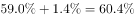
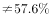
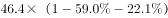
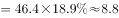

# 综合分析逐项判断（增长正负定性判定＋基期比重逆推＋比重余量计算＋数据充分性检验）

考点：[[20-考点/资料分析/综合/综合分析逐项判断（增长正负定性判定＋基期比重逆推＋比重余量计算＋数据充分性检验）|综合 / 综合分析逐项判断（增长正负定性判定＋基期比重逆推＋比重余量计算＋数据充分性检验）]]
材料：[[15-材料/资料分析/242954 2018年全国能源消费总量（46.4|242954 2018年全国能源消费总量（46.4]]

**问法模型**：题干为'根据给定资料，可以推出的是'→ 综合分析四选一：逐项检验——A看消费量增速正负、B检验'只有占比无总量'的数据充分性、C用'下降1.4个百分点'逆推2017年占比、D用总量×占比余量精算，唯一无缺陷项即答案。

## 推理链
1. 第1步：从文字提取条件：2018年能源消费总量46.4亿吨标准煤；煤炭、原油、天然气、电力消费量各有同比增速（卷面给数，其中煤炭增速为正值）；煤炭占比比上年下降1.4个百分点；清洁能源占比上升1.3个百分点。
2. 第2步：A项用定性规则'消费量增速>0 ⟺ 消费量比上年上升'：卷面煤炭消费量增速为正（增长），故2018年煤炭消费量比上年上升，A可推出。
3. 第3步：B项检验数据充分性：清洁能源消费量=当年占比×当年总量，图1只有2014-2018年占比17.0%→18.0%→19.5%→20.8%→22.1%逐年上升，但缺各年能源消费总量，占比升推不出消费量逐年上升，B不可推出。
4. 第4步：C项用基期比重逆推公式：2018年煤炭占比比上年下降1.4个百分点，故2017年煤炭占比=2018年占比+1.4个百分点，计算结果与选项所给数值不符，C错误。
5. 第5步：D项用占比余量公式：其他能源消费量=46.4×(1−煤炭占比−清洁能源占比22.1%)，代入卷面占比算得约8.8亿吨标准煤，未超过9亿吨，D错误。
6. 第6步：综上仅A可推出，与官方答案A一致。

**最快解法**：⚡ 定性排除法＋数据充分性检验：先扫B——材料只有占比（17.0%→22.1%）没有各年总量，'占比≠消费量'直接排除；再看A——卷面煤炭消费量增速为正，'增长即上升'直接锁定；C只需方向核验（2017年占比=2018年占比+1.4个百分点，做加法）、D只需46.4×(1−煤炭占比−22.1%)≈8.8<9的估算对照，全程无需精算。

## 易错点
- ⚠ B项数据充分性陷阱：占比逐年上升（17.0%→22.1%）≠消费量逐年上升，缺2014-2018各年能源消费总量，从占比无法推出消费量变化，切勿把图1柱状图升高误读为消费量上升。
- ⚠ C项基期逆推方向与单位：2018年占比'下降1.4个百分点'，逆推2017年占比应做加法（=2018年占比+1.4个百分点），方向弄反或将'个百分点'混同'%'均会误判；卷面占比具体数值空白处须以实际试卷给数为准，勿凭常识补数。
- ⚠ D项余量计算陷阱：其他能源量=46.4×(1−煤炭占比−清洁能源占比22.1%)，结果约8.8亿吨、接近但未超过9亿吨，勿凭直觉判'超过'；清洁能源占比22.1%必须从图1读取，不能用文字'上升1.3个百分点'拼凑。

## 母题抽象
> 🧩 当题干出现'根据给定资料，可以推出的是'且选项混有定性增长判断、基期比重、余量计算时，用'数据充分性＋口径校验'逐项排除：只有占比缺总量推不出消费量，由'下降/上升X个百分点'逆推基期要反向加回变化量，'除…外'余量=总量×(1−各占比)须精算对照阈值。

**同类特征**：根据给定资料，可以推出的是、消费量比上年有所上升（增速正负定性判断）、逐年上升（占比vs消费量的充分性陷阱）、下降1.4个百分点（逆推基期占比）、除煤炭、清洁能外超过9亿吨标准煤（占比余量计算）、文字与统计图交叉验证

## 相关题
（暂无）

---

### 题干
根据给定资料，可以推出的是：

### 选项
- A. 
2018年，全国煤炭的消费量比上年有所上升
　✅
- B. 
2014-2018年，全国清洁能源消费量逐年上升

- C. 
2017年，煤炭消费量约占能源消费总量的

- D. 
2018年，除煤炭、清洁能源外，其他能源消费量超过9亿吨标准煤

### 官方解析

A项：定位文字材料可得，2018年全年煤炭消费量增长，可知2018年煤炭的消费量比上年有所上升，正确；

B项：定位材料可知，只给出2014-2018年清洁能源消费量占能源消费总量的比重，但并未给出2014-2018年每一年的能源消费总量，无法判断清洁能源消费量是否逐年上升，错误；

C项：定位文字材料可得，2018年煤炭消费量占能源消费总量的，比上年下降1.4个百分点。则2017年，煤炭消费量约占能源消费总量的，错误；

D项：定位文字材料可得，2018年全年能源消费总量46.4亿吨标准煤，煤炭消费量占能源消费总量的，清洁能源消费量占能源消费总量的。则其他能源消费量为亿吨标准煤，并未超过9亿吨标准煤，错误。

故正确答案为A。

### 给定材料

        2018年全年能源消费总量46.4亿吨标准煤，比上年增长。其中，煤炭消费量增长，原油消费量增长，天然气消费量增长，电力消费量增长。煤炭消费量占能源消费总量的，比上年下降1.4个百分点；天然气、水电、核电、风电等清洁能源消费量占能源消费总量的，上升1.3个百分点。

