# 综合分析选非题（基期计算+比重判断+单价比较+增速最值对应混合验证）

考点：[[20-考点/资料分析/综合/综合分析选非题（基期计算+比重判断+单价比较+增速最值对应混合验证）|综合 / 综合分析选非题（基期计算+比重判断+单价比较+增速最值对应混合验证）]]
材料：[[15-材料/资料分析/242955 2018年第一季度我国水产品进出口情|242955 2018年第一季度我国水产品进出口情]]

**问法模型**：题干问'无法推出的是'为选非题→对四个选项分别套用基期公式(77.15/(1+r))、单价(出口额÷数量)、比重(一般贸易÷整体出口)、增速最值四个小模型逐项验证，锁定错误项

## 推理链
1. 第1步：选非题需逐项验证；B项从统计表取数计算各品种单价=出口额÷数量：鳗鱼2.46/1.05≈2.34、淡水小龙虾0.03/0.02=1.50、蟹类2.02/1.44≈1.40、对虾3.81/3.01≈1.27（亿美元/万吨）
2. 第2步：全表单价最高是鳗鱼（≈2.34），蟹类（≈1.40）仅排第三，'平均单价最高的是蟹类'不成立，B无法推出，符合选非题要求
3. 第3步：A项：2018Q1进出口总额77.15亿美元且同比增加，基期值=77.15/(1+同比增速)（该增速为原文字段、当前版本显示空缺，官方解析按完整原文代入），所得2017Q1总额超过65亿美元，A可推出
4. 第4步：C项：一般贸易出口量占比71.18/98.04≈72.6%，出口额占比36.71/48.41≈75.8%，两项占比均超过题给阈值（阈值公式图片缺失，官方解析判定成立），C可推出
5. 第5步：D项：表中数量增速最大为大黄鱼71.75%，其出口额增速60.88%同为出口额列最大（次高为鳗鱼26.05%），数量增速最快者出口额增速也最快，D可推出
6. 第6步：四项中仅B错误，故无法推出的是B

**最快解法**：⚡ 单价'额/量'截位直除+盯'额大量小'行：先算鳗鱼2.46/1.05≈2.3与蟹类2.02/1.44≈1.4，2.3>1.4即锁定B错误；再用增速列扫最值（71.75%与60.88%同在大黄鱼行）复核D、比重直除（71.18/98.04、36.71/48.41）复核C、基期公式77.15/(1+r)复核A，全程口算可完成

## 易错点
- ⚠ 单价直觉陷阱：蟹类出口额2.02亿美元居全表第二，易凭'额大=价高'误判其单价最高；单价=出口额÷数量，量小的鳗鱼(2.46/1.05≈2.34)才是最高——B正是命题人预设的错误项
- ⚠ 单位量级陷阱：亿美元÷万吨=万美元/吨，若换算成'美元/吨'需再乘1万，比较单价大小无需换算，硬换算易错量级
- ⚠ 口径与缺失陷阱：C项分母是水产品整体出口(98.04万吨/48.41亿美元)而非一般贸易口径，层级不能混；D项增速列正负相邻(如鲭鱼-30.71%与头足类21.99%)易串行漏负号；A项依赖的原文增速数值当前版本空缺，需以完整原文为准

## 母题抽象
> 🧩 当题干出现'无法推出的是/能够推出的是'的综合分析特征时，按'基期=现期/(1+r)→比重=部分/整体→单价=额/量→增速最值定位'四模型逐项验证；比较单价先扫'出口额大而数量小'的行，比较增速先在正负混排列中锁定最大正值并核对同行对应列

**同类特征**：无法推出的是（选非）、四选项分属基期/单价/比重/最值四模型、平均单价最高的是蟹类、占比均超过（比例阈值）、数量增速最快…出口额增速也最快、基期总额超过65亿美元

## 相关题
（暂无）

---

### 题干
根据给定资料，无法推出的是：

### 选项
- A. 
2017年第一季度，我国水产品进出口总额超过65亿美元

- B. 
2018年第一季度，我国水产品一般贸易主要出口品种中平均单价最高的是蟹类
　✅
- C. 
2018年第一季度，我国水产品一般贸易出口量和出口额在水产品中的占比均超过

- D. 
2018年第一季度，我国水产品一般贸易主要出口品种中数量增速最快的种类，出口额增速也最快

### 官方解析

A项：定位材料第一段：“2018年第一季度我国水产品······进出口总额77.15亿美元，同比增加”，根据，可得2017年第一季度我国水产品进出口总额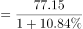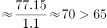亿美元，正确；

B项：定位表格材料可知，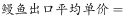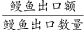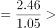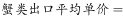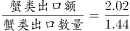，因此，蟹类出口平均单价不是最高的，错误；

C项：定位材料第二段：“出口方面，2018年第一季度我国水产品出口量98.04万吨，同比减少，出口额48.41亿美元，增加。一般贸易出口量71.18万吨，同比减少；出口额36.71亿美元，同比增加”，可知一般贸易出口量在水产品的占比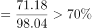，一般贸易出口额在水产品的占比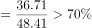，正确；

D项：定位表格材料，我国水产品一般贸易主要出口品种中数量增速最快的是大黄鱼（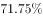），其出口额的增速（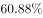）也是最快的，正确。

本题为选非题，故正确答案为B。

### 给定材料

        2018年第一季度我国水产品进出口192.67万吨，同比减少，增速较上年同期减少21.97个百分点；进出口总额77.15亿美元，同比增加。贸易顺差19.66亿美元，同比减少2.15亿美元。

        出口方面，2018年第一季度我国水产品出口量98.04万吨，同比减少，出口额48.41亿美元，增加。一般贸易出口量71.18万吨，同比减少；出口额36.71亿美元，同比增加。

> [!warning] 疑点（官方解析可能有误，待人工复核）
> 官方解析中A、B、C项的计算公式与具体数值因图片公式未解析而显示为空（如C项占比阈值）；按材料数据复算（鳗鱼单价≈2.34>蟹类≈1.40；占比72.6%/75.8%；大黄鱼71.75%/60.88%双列最大）与官方结论完全一致，不影响答案B；另A项验证所依赖的原文字段增速数值在当前材料版本中空缺

<!-- CODEX-ANSWER-REVIEW:BEGIN -->
### 本次独立复核

**复核状态：** `confirmed`（独立复算确认答案）

**计分答案：** B（可计分）

**复核解析：**

题问“无法推出”。2018年一季度蟹类平均单价=2.02/1.44≈1.40，低于鳗鱼2.46/1.05≈2.34，故“蟹类单价最高”不能成立。其余可由表中进出口合计、一般贸易占比及黄鱼数量/金额增速直接核验。

**相关信息：**

独立复核：按题干定义逐项检验，关键基数、比值、增速与图表读数写明以便复算。

**题源依据：** [固定版本原题](https://github.com/Mentat-Uran/kaogongzhentizhengliu/blob/84ab93d4b64b61d897bece8a1c0a5bab06b4feb2/10-%E7%9C%9F%E9%A2%98/%E8%B5%84%E6%96%99%E5%88%86%E6%9E%90/%E7%BB%BC%E5%90%88/2423372%20%E7%BB%BC%E5%90%88%E5%88%86%E6%9E%90%E9%80%89%E9%9D%9E%E9%A2%98%EF%BC%88%E5%9F%BA%E6%9C%9F%E8%AE%A1%E7%AE%97%2B%E6%AF%94%E9%87%8D%E5%88%A4%E6%96%AD%2B%E5%8D%95%E4%BB%B7%E6%AF%94%E8%BE%83%2B%E5%A2%9E%E9%80%9F%E6%9C%80%E5%80%BC%E5%AF%B9%E5%BA%94%E6%B7%B7%E5%90%88%E9%AA%8C%E8%AF%81%EF%BC%89.md)；固定内容 commit `84ab93d4b64b61d897bece8a1c0a5bab06b4feb2`，Markdown blob `98470430929653a11142bf0619739ecb9145f7e0`。
<!-- CODEX-ANSWER-REVIEW:END -->
