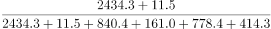
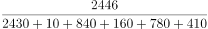
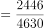
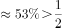

# 综合判断题（比重超半判断＋减少量符号核验＋区间最值定位＋年均增长率正负判断）

考点：[[20-考点/资料分析/综合/综合判断题（比重超半判断＋减少量符号核验＋区间最值定位＋年均增长率正负判断）|综合 / 综合判断题（比重超半判断＋减少量符号核验＋区间最值定位＋年均增长率正负判断）]]
材料：[[15-材料/资料分析/244991 2009～2018年全国高中阶段在校|244991 2009～2018年全国高中阶段在校]]

**问法模型**：题干为'根据上述资料可以推出的是'的逐项验证型综合判断 → 对A/B/C/D分别套用最轻量模型（趋势符号、部分与整体一半的等价比较、区间最值扫描、增长率正负）逐一排除

## 推理链
1. 第1步：验证B项，从表中取2009年数据：高中两列=普通高中2434.3+成人高中11.5=2445.8万人；中职四列=840.4+161.0+778.4+414.3=2194.1万人
2. 第2步：用等价转化规则：'某部分占总数一半以上'⟺该部分>其余部分之和，即只需比较2445.8与2194.1的大小，无需计算比重
3. 第3步：2445.8>2194.1（比重约2445.8÷4639.9≈52.7%），B成立，锁定答案
4. 第4步：排除A项，成人中专2010年212.4→2011年238.7→2012年254.3为连续两年正增长，2012→2013年才减少254.3-230.0=24.3万人，'减少量'在2010-2012年根本不存在，A错误
5. 第5步：排除C项，2014-2018年中等专业学校最少为2018年699.4万人，技工学校最少为2015年321.5万人（2017-2018年回升至338.2、341.6），两列最低点不在同一年，C错误
6. 第6步：排除D项，成人中专2016-2018年为141.2→127.2→113.1万人逐年递减，几何平均增长率为负值，不可能超过选项中的正百分数，D错误
7. 第7步：仅B可推出，故正确答案为B

**最快解法**：⚡ 等价转化＋符号快判：B项把'占一半以上'转化为'高中合计2445.8 vs 中职合计2194.1'的大小比较，两次小加和即定答案；A项先看增减符号序列（212.4→238.7→254.3为增），C项区间内找最值年份（2018 vs 2015），D项看趋势定增长率正负（递减⟹负⟹必小于正数），四项均可在1分钟内清完

## 易错点
- ⚠ 口径陷阱：'高中'仅含普通高中+成人高中两列，'高中阶段'才是6列全加；B项分子取2列、分母取6列，误把分子按'高中阶段'或分母漏加中职列都会错判
- ⚠ 思维定势陷阱：A项默认'逐年减少'直接算减少量，实际2010-2012年成人中专在增长，'减少量'前提不成立；D项同理，人数递减则年均增长率为负，'超过'正增长率必错，先判方向再算数值
- ⚠ 最值扫描陷阱：C项技工学校整体趋降但2015年321.5为最低、2017-2018年回升，凭'逐年下降'印象会把最少年份误判为2018年

## 母题抽象
> 🧩 当题干出现'可以推出的是'的综合判断时，逐项用最省力验证法：'占一半以上'转化为两部分之和比大小、'减少量逐年增加'先核验逐年增减符号、'最少的年份……也最少'做区间最值定位、'年均增长率超过'先用增减方向定正负，往往一项等价比较即可锁定答案

**同类特征**：可以推出的是（综合判断）、占……一半以上、减少量（绝对值）逐年增加、最少的一年……也最少、年平均增长率超过、多个分项逐年扫描验证

## 相关题
- [[10-真题/资料分析/综合/4737726 综合判断题（基期量反推＋比重倍数比较＋总量×占比差放缩估算）|4737726]]（福建 2017，相关度1）

---

### 题干
根据上述资料可以推出的是（    ）。

### 选项
- A. 
2010～2013年，成人中专在校生人数的减少量绝对值逐年增加

- B. 
2009年，高中在校生人数占高中阶段在校生总人数一半以上
　✅
- C. 
2014～2018年，中等专业学校在校生人数最少的一年，技工学校在校生人数也最少

- D. 
2016～2018年，成人中专在校生人数年平均增长率超过

### 官方解析

A项，定位表格材料第五列，2010年、2011年成人中专在校生人数分别为212.4万人、238.7万人。可以看出2011年的人数2010年的人数，增长量为正，不存在减少量。错误；

B项，定位表格材料第三行，2009年普通高中、成人高中在校生人数分别为2434.3万人、11.5万人；中等专业学校、成人中专、职业高中、技工学校在校生人数分别为840.4万人、161.0万人、778.4万人、414.3万人。根据公式：比重，则2009年，高中在校生人数占高中阶段在校生总人数。正确；

C项，定位表格材料第四列，2014-2018年，中等专业学校在校生人数最少的一年是2018年（699.4万人）。定位表格材料最后一列，2014-2018年，技工学校在校生人数最少的一年是2015年（321.5万人），并非同一年。错误；

D项，定位表格材料第五列，2016-2018年，成人中专在校生人数分别为141.2万人、127.2万人、113.1万人。人数在减少，年平均增长率为负，应小于。错误。

故正确答案为B。

### 给定材料

根据以下资料，回答111～115题。

