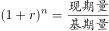
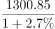
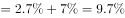

# 综合分析·数据可推出性判断（选非题）

考点：[[20-考点/资料分析/综合/综合分析·数据可推出性判断（选非题）|综合 / 综合分析·数据可推出性判断（选非题）]]
材料：[[15-材料/资料分析/244994 2018年A省财政收支（公共财政预算|244994 2018年A省财政收支（公共财政预算]]

**问法模型**：题干出现'哪个指标不能从上述资料中推出'→对每个选项做'现期值+增速→基期/均值'的数据链闭环检查，链条断裂（缺所需年份的增速或数值）的即为答案

## 推理链
1. 第1步：题干为选非题，四个选项分别涉及年均增长率、同比增长量、基期比重、基期比值，先逐项核对所需数据是否齐全
2. 第2步：A项：材料给出一般公共预算支出2012年603.2亿元、2018年958.41亿元，跨度n=6年，两端点与年份数均已知
3. 第3步：A项代入围栏公式(1+r)^6=958.41/603.2即可解出年均增长率→可推出
4. 第4步：B项：农行存款2018年末1300.85亿元及其2018年同比增速r已知，'比上年同期下降7个百分点'即r(2017)=r+7个百分点，则2017年值=1300.85/(1+r)，2017年同比增量=2017年值×r(2017)/(1+r(2017))→可推出
5. 第5步：D项：2018年A省个人贷款311.99亿元与农行个人贷款103.52亿元及各自同比增速均已知，分别反推2017年值后作比→可推出
6. 第6步：C项：求2016年占比需分子分母同回溯两年——农行贷款662.92亿元有'下降19个百分点'关联可还原2017年增速进而得2016年值，但A省辖区贷款余额2574.10亿元只能用2018年增速还原出2017年值，材料未提供其2017年增速或2016年值→数据链断裂
7. 第7步：故C项2016年占比无法推出，选非题选C

**最快解法**：⚡ 基期回溯链闭环筛查：先盯C项——2016年比现期2018年早两年，回溯两年需两个增速（或'百分点'关联补链），而辖区贷款余额2574.10亿元只有2018年一个增速、又无任何百分点关联→断链锁定C；再快速验证A（两端点603.2与958.41+年数6）、B（降7个百分点可补2017年增速）、D（两个增速均给出）链条完整，确认选C

## 易错点
- ⚠ 基期年份误判：C项需回到2016年（比2018年早两年），误以为'现期+一个增速'就能还原任意基期；实际上每往前多一年就多需要一个增速，辖区贷款恰好缺2017年增速
- ⚠ 把'下降7/19个百分点'当成增速本身弃用——它恰是连接2018与2017年增速的唯一桥梁，B项及C项中农行一侧全靠它补链，弃用会误判B也不可推
- ⚠ 口径与公式混淆：D项'A省个人贷款311.99'为全辖区口径、'农行个人贷款103.52'为单一银行口径，分子分母勿混；A项误以为年均增长率需要各年增速（实际两端点+年数即可），从而误判A不可推

## 母题抽象
> 🧩 当题干出现'哪个（不）能从资料中推出'时，把每个选项当作数据链闭环检查：回溯1年需'现期+增速'，回溯2年还需第二个增速（可由'上升/下降N个百分点'关联补上），年均增长率只需'两端点+年份数'；第一个断链项即为选非题答案，其余项抽验即可

**同类特征**：'不能从上述资料中推出'（选非/不可计算判断）、选项横跨年均增长率、同比增量、基期比重、基期比值多考点、所求基期比现期早两年（2016 vs 2018）、'比上年同期下降N个百分点'用于关联上年增速、同名指标两套口径：A省辖区 vs 农行A省分行、现期值与增速已知性逐项不齐，需逐项核对数据链

## 相关题
（暂无）

---

### 题干
下列哪个指标不能从上述资料中推出？（    ）

### 选项
- A. 2012年到2018年A省一般公共预算支出的平均增长率
- B. 2017年农行A省分行年末各项本外币存款余额的同比增长量
- C. 2016年农行A省分行年末各项贷款余额占A省辖区各项贷款余额的比重　✅
- D. 2017年A省个人贷款额和农行A省分行个人贷款额的比值

### 官方解析

A项：定位材料第一段“A省一般公共预算支出从2012年的603.2亿元增加到2018年的958.41亿元”，结合年均增长率公式：，由于现期2018年数据、基期2012年数据以及年份差均已知，故年均增长率可以推出（此处平均增长率即为年均增长率）；

B项：定位材料第三段“2018年，农行A省分行年末各项本外币存款余额1300.85亿元，同比增长，比上年同期下降7个百分点”， 则2017年农行A省分行年末各项本外币存款余额=亿元，又可得2017年农行A省分行年末各项本外币存款余额同比增速，因此其2017年的现期量和同比增速均已知，故其同比增长量可以推出；

C项：定位材料第二段“2018年A省辖区各项贷款余额2574.10亿元，同比增长”，仅能得到2017年A省辖区各项贷款余额的量，缺少同比增速或同比增长量，无法得到其2016年的值，因此2016年的占比无法推出；

D项：定位材料第二三段“2018年末，A省个人贷款311.99亿元，下降；农行A省分行个人贷款103.52亿元，增长”，即2018年两者的现期量和同比增长率均已知，故2017年的比值可以推出。

本题为选非题，故正确答案为C。

### 给定材料

        2018年，A省公共财政预算收入1180.07亿元，比上年增长。其中，一般公共预算收入103.82亿元，比上年下降。全年A省实际完成地方税收收入104亿元，中央财政返还68.60亿元，增长。A省一般公共预算支出从2012年的603.2亿元增加到2018年的958.41亿元，2018年同比增长。

        2018年末，A省辖区各项存款余额3051.06亿元，同比增长。其中，个人存款1491.89亿元，增长；单位存款1531.38亿元，下降；代理财政性存款25.38亿元，增长17.9倍。A省辖区各项贷款余额2574.10亿元，同比增长。其中，个人贷款311.99亿元，下降；单位贷款2202.74亿元，增长；含票据融资59.38亿元，增长。

        2018年，农行A省分行年末各项本外币存款余额1300.85亿元，同比增长，比上年同期下降7个百分点。其中，个人存款645.62亿元，增长；单位存款653.96亿元，下降；同业存款1.26亿元，下降。年末各项贷款余额662.92亿元，同比增长，比上年同期下降19个百分点。其中，个人贷款103.52亿元，增长；单位贷款484.65亿元，下降；贸易融资57.59亿元，增长；贴现及转贴现净值17.16亿元，增长155.0倍。

> [!warning] 疑点（官方解析可能有误，待人工复核）
> 所给材料文本中绝大多数同比增速为空白（B项所需的2018年农行存款增速、D项所需的两项个人贷款增速在文本中不可读），官方解析判定B、D'可推出'依赖原题图片附件中的完整增速数值；若仅按纯文本口径，B、D同样无法推出。在完整材料口径下，官方关于C项不可推（辖区贷款余额2574.10亿元缺2017年增速、无法回溯至2016年）的结论成立，答案C无疑义。

<!-- CODEX-ANSWER-REVIEW:BEGIN -->
### 本次独立复核

**复核状态：** `confirmed`（独立复算确认答案）

**计分答案：** C（可计分）

**复核解析：**

恢复公式图后，A、B、D均可计算，而C缺少把2017年全省贷款规模回推到2016年所需的2017年同比增速。A：2012至2018共6年，平均增长量=(958.41−603.20)/6≈59.20亿元。B：2018年农行存款1300.85亿元、同比增长2.7%，故2017年存款基数=1300.85/1.027≈1266.65亿元；2017年增速比2018年高7个百分点，为9.7%，对应增长量=1266.65×9.7%≈112.00亿元。D：2017年全省个人贷款=311.99/(1−2.6%)≈320.32亿元，农行个人贷款=103.52/(1+6%)≈97.66亿元，前者约为后者3.28倍。C要求比较2016年全省贷款比重，但题面只有2018现期与同比，且缺2017年增速/规模，无法跨越缺失年份回推；所以C是唯一不能推出项。

**相关信息：**

资料分析—平均增长量、基期量、倍数与跨年度数据链；仅有2018年现期及同比只能回推2017，不能越过缺失年份求2016。

**题源依据：** [固定版本原题](https://github.com/Mentat-Uran/kaogongzhentizhengliu/blob/84ab93d4b64b61d897bece8a1c0a5bab06b4feb2/10-%E7%9C%9F%E9%A2%98/%E8%B5%84%E6%96%99%E5%88%86%E6%9E%90/%E7%BB%BC%E5%90%88/2434316%20%E7%BB%BC%E5%90%88%E5%88%86%E6%9E%90%C2%B7%E6%95%B0%E6%8D%AE%E5%8F%AF%E6%8E%A8%E5%87%BA%E6%80%A7%E5%88%A4%E6%96%AD%EF%BC%88%E9%80%89%E9%9D%9E%E9%A2%98%EF%BC%89.md)；固定内容 commit `84ab93d4b64b61d897bece8a1c0a5bab06b4feb2`，Markdown blob `9dd6b67e0dc3ead45cde32f7b7af377966e7a692`。
<!-- CODEX-ANSWER-REVIEW:END -->
