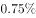
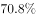
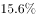

# 综合判断（正确表述类）——核心计算项为平均数（销售单价=销售额÷销售面积）四地区比较，辅以同比-环比口径辨析与环比减少量比大小

考点：[[20-考点/资料分析/综合/综合判断（正确表述类）——核心计算项为平均数（销售单价=销售额÷销售面积）四地区比较，辅以同比-环比口径辨析与环比减少量比大小|综合 / 综合判断（正确表述类）——核心计算项为平均数（销售单价=销售额÷销售面积）四地区比较，辅以同比/环比口径辨析与环比减少量比大小]]
材料：[[15-材料/资料分析/246136 2018年1-10月全国房地产开发投|246136 2018年1-10月全国房地产开发投]]

**问法模型**：'下列说法正确的是'综合判断题 → 逐项验证：可计算项用'单价=销售额÷销售面积'（亿元/万㎡=万元/㎡）截位直除比大小定正误，无数据项（材料只有环比减少量、缺同比基期）直接排除

## 推理链
1. 第1步：定位第5段待售面积数据——10月末商品房待售面积52789万平方米，比9月末减少401万平方米（环比减少量），材料无2017年10月数据
2. 第2步：判A、B——题干要求'同比增量不变''同比下降'，而材料只给'比9月末减少'的环比口径，缺同比基期，A、B均无法推出，直接排除
3. 第3步：判D——分项环比减少量为住宅321万平方米、办公楼19万平方米、商业营业用房46万平方米，变化最小的是办公楼（19），不是住宅（321），排除D
4. 第4步：判C——定位第4段四地区数据：东部销售面积53545万平方米、销售额61680亿元；中部37733万平方米、25380亿元；西部35430万平方米、24165亿元；东北6409万平方米、4688亿元
5. 第5步：套公式'单价=销售额÷销售面积'（亿元/万㎡=万元/㎡）：东部≈61680/53545≈1.15万元/㎡，中部≈25380/37733≈0.67，西部≈24165/35430≈0.68，东北≈4688/6409≈0.73
6. 第6步：与选项对照——东部单价约1.15万元/㎡显著高于其余三地区（均低于0.75），C'东部地区商品房销售单价最高'成立，故选C

**最快解法**：⚡ 截位直除比大小：四地区单价只看首位商——东部61680/53545≈1.15，其余25380/37733≈0.67、24165/35430≈0.68、4688/6409≈0.73，东部断层式最高，C秒定；A、B见'同比'对'比9月末减少（环比）'口径缺基期数据一票排除；D比较321/19/46三个减少量，最小为办公楼19

## 易错点
- ⚠ 单价换算陷阱：亿元÷万㎡=万元/㎡无需再换算，公式方向为'销售额÷销售面积'，勿除反；四地区不必精算，首位商即可分出胜负
- ⚠ 环比≠同比：第5段只给'比9月末减少401万平方米'的环比绝对量，A项'同比增量'、B项'同比下降'均无2017年10月末基期数据，不能拿环比月减少量冒充同比增量外推跌破时点
- ⚠ '变化最小'比的是绝对减少量：住宅减少321万平方米是分项中最大的，最小的是办公楼19万平方米；且分项和386<总减少量401，不能加总凑数

## 母题抽象
> 🧩 当综合判断题选项混有'单价/平均数比较'与'同比/环比口径'时，先做可计算项（两数之比=销售额÷销售面积，截位直除首位定大小），再核查无数据项口径（材料只有环比绝对量时，凡'同比'表述一律判推不出）

**同类特征**：下列说法正确的是（综合判断四选一）、商品房销售单价=销售额÷销售面积（亿元/万㎡=万元/㎡）、四地区单价横向比较、待售面积'比9月末减少'为环比，选项问同比、住宅/办公楼/商业营业用房待售面积环比减少量比大小、缺同比基期数据→相关选项推不出

## 相关题
- [[10-真题/资料分析/综合/2060672 环形结构图读数与占比综合判断（逐项验证）|2060672]]（深圳市考 2017，相关度1）
- [[10-真题/资料分析/综合/2604302 两期比重变化判断（部分增速vs总体增速），兼查增长倍数、平均数、基期占比定性反推|2604302]]（广东 2020，相关度1）

---

### 题干
根据材料，下列说法正确的是：

### 选项
- A. 
如果保持2018年10月末的同比增量不变，商品房待售面积将在2019年下半年跌破5亿平方米

- B. 
2018年10月末，商品房待售面积同比下降

- C. 
2018年1-10月，在我国四个区域中，东部地区的商品房销售单价最高
　✅
- D. 
2018年10月末，在商品房待售面积中，住宅待售面积环比变化最小

### 官方解析
A项，定位文字材料最后一段，“10月末，商品房待售面积52789万平方米，比9月末减少401万平方米。”材料给出比9月末减少，属于10月末的环比数据，而题干是“保持2018年10月末的同比增量不变，”没有2017年10月的数据，无法推出，错误；
B项，定位文字材料最后一段，“10月末，商品房待售面积52789万平方米，比9月末减少401万平方米。”材料给出比9月末减少，属于10月末的环比数据，而题干是“同比下降”，没有2017年10月的数据，无法推出，错误；
C项，定位文字材料第四段，“1-10月份，东部地区商品房销售面积53545万平方米，···；销售额61680亿元，···。中部地区商品房销售面积37733万平方米，···；销售额25380亿元，···。西部地区商品房销售面积35430万平方米，···；销售额24165亿元，···。东北地区商品房销售面积6409万平方米，···；销售额4688亿元，···。”。根据公式销售单价，可计算出东部地区销售单价万元/平方米；中部地区销售单价万元/平方米；西部地区销售单价万元/平方米；东北地区销售单价万元/平方米。由此可知，东部地区的商品房销售单价最高。正确；
D项，定位文字材料最后一段，“10月末，商品房待售面积52789万平方米，比9月末减少401万平方米。其中，住宅待售面积减少321万平方米，办公楼待售面积减少19万平方米，商业营业用房待售面积减少46万平方米。”比较上述数字，办公楼待售面积减少19万平方米是环比变化最小的，而非住宅待售面积，错误。
故正确答案为C。

### 给定材料

        2018年1-10月份，全国房地产开发投资99325亿元，同比增长，增速比1-9月份回落0.2个百分点。其中，住宅投资70370亿元，增长，增速回落0.3个百分点。住宅投资占房地产开发投资的比重为。

        1-10月份，东部地区房地产开发投资53136亿元，同比增长，增速比1-9月份回落0.2个百分点；中部地区投资20755亿元，增长，增速回落1.3个百分点；西部地区投资21254亿元，增长，增速提高0.9个百分点；东北地区投资4180亿元，增长，增速回落0.9个百分点。

        1-10月份，商品房销售面积133117万平方米，同比增长，增速比1-9月份回落0.7个百分点。其中，住宅销售面积增长，办公楼销售面积下降，商业营业用房销售面积下降。商品房销售额115913亿元，增长，增速回落0.8个百分点。其中，住宅销售额增长，办公楼销售额下降，商业营业用房销售额增长。

        1-10月份，东部地区商品房销售面积53545万平方米，同比下降，降幅比1-9月份扩大0.4个百分点；销售额61680亿元，增长，增速回落0.6个百分点。中部地区商品房销售面积37733万平方米，增长，增速回落1.5个百分点；销售额25380亿元，增长，增速回落1.6个百分点。西部地区商品房销售面积35430万平方米，增长，增速回落0.3个百分点；销售额24165亿元，增长，增速回落0.6个百分点。东北地区商品房销售面积6409万平方米，下降，降幅扩大1.2个百分点；销售额4688亿元，增长，增速回落2.5个百分点。

        10月末，商品房待售面积52789万平方米，比9月末减少401万平方米。其中，住宅待售面积减少321万平方米，办公楼待售面积减少19万平方米，商业营业用房待售面积减少46万平方米。

