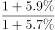
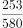
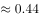
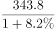
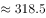

# 综合判断（能推出型）＋基期平均数（每户市场主体对应人口）

考点：[[20-考点/资料分析/综合/综合判断（能推出型）＋基期平均数（每户市场主体对应人口）|综合 / 综合判断（能推出型）＋基期平均数（每户市场主体对应人口）]]
材料：[[15-材料/资料分析/246297 辽宁省2018年各类市场主体（存量户|246297 辽宁省2018年各类市场主体（存量户]]

**问法模型**：‘能够从上述资料中推出的是’→四个选项逐一验证：先用定性规则排除‘贡献额无法分解/原因无法归因/所需增速缺失’三类不可推项，再对剩余项用基期量=现期量÷(1+增速)链式还原后相除验证

## 推理链
1. 第1步：C项需2017年人口与2017年市场主体数，从右栏取2018年生产总值25315.4亿元（+5.7%）、年人均生产总值58008元（+5.9%），从左栏取2018年市场主体343.8万户（+8.2%）
2. 第2步：基期还原公式：基期量=现期量÷(1+增速)，得2017年GDP=25315.4/1.057≈23951亿元，2017年人均GDP=58008/1.059≈54776元
3. 第3步：2017年人口=23951亿元÷54776元≈4372万人（亿元需×10^8换算成元）
4. 第4步：2017年市场主体=343.8/1.082≈317.7万户
5. 第5步：2017年平均每户主体对应人口=4372万÷317.7万≈13.8人/户，与C项‘约13.8人拥有一户’吻合
6. 第6步：排除A——GDP增加额25315.4−23951≈1364.7亿元并非全部由新登记主体贡献（贡献率未知），且即便硬除1364.7亿÷66.1万户≈2.06万元/户，也与360亿元不符
7. 第7步：排除B、D——农民专业合作社同比增速为'—'，无法还原2016年数量故无法比较两年占比；D项税收增速5.1%低于利润增速41.8%虽可算，但'减税政策'这一因果原因材料未提供，不可推出

**最快解法**：⚡ 综合判断'能推出'题先定性排雷：A（GDP增量贡献无法分解到新登记主体）、D（政策归因无数据支撑）、B（合作社增速为'—'，隔年基期无法还原）三项不可推直接划掉；C用基期平均数模型，截位直除：25315.4/1.057≈23950亿，58008/1.059≈54780元，两商相除得2017年人口≈4372万人，再除以343.8/1.082≈317.7万户得≈13.8人/户，锁定C

## 易错点
- ⚠ '同比增速（百分点）'列干扰：C项只需用现期增速8.2%直接还原2017年，勿误用8.2−1.1=7.1%当作2018年增速（7.1%实为2017年增速，会多还原一层）
- ⚠ A项陷阱：误把GDP增加额全部归给66.1万新登记主体，忽视'贡献率未知'这一不可推性，且量级也对不上（≈2.06万元/户≠360亿元）
- ⚠ B项陷阱：见合作社增速5.8%<市场主体增速8.2%就想当然判断占比变化，但比较2016年占比需2017年增速，该数据为'—'缺失
- ⚠ 单位换算：人口=GDP÷人均GDP时须把亿元换算成元（×10^8），万户与万人可直接相除，差一个量级即全错

## 母题抽象
> 🧩 当综合判断题出现'能够推出的是'且选项涉及政策归因、贡献分解或所需增速标'—'时，直接判定不可推；剩余选项用基期量=现期量÷(1+增速)分别还原两个总量与平均指标，相除验证平均数/户均结论

**同类特征**：能够从上述资料中推出的是、平均约13.8人拥有一户市场主体、基期平均数（人口=总量÷人均）、增速列出现'—'无法还原基期、贡献额/因果归因类不可推选项、四选项跨左右两栏分取不同行数据

## 相关题
- [[10-真题/资料分析/综合/19283943 综合分析判断题（倍数比较+求和判断+隐含平均每场座位数反推）|19283943]]（国考 2025，相关度1）
- [[10-真题/资料分析/综合/1796162 综合判断（月均计算、平均运输距离、比重对比、增长量比较逐项验证）|1796162]]（贵州 2016，相关度1）
- [[10-真题/资料分析/综合/2133504 综合判断题（现期比重+现期平均数多项验证，一对三错）|2133504]]（国考 2018，相关度1）
- [[10-真题/资料分析/综合/2444706 综合判断题（增长量+比重+倍数逐项验证）|2444706]]（四川 2019，相关度1）
- [[10-真题/资料分析/综合/2571728 综合分析逐项判断（等差递推求和＋单位换算＋比值估算）|2571728]]（山东 2020，相关度1）

---

### 题干
能够从上述资料中推出的是：

### 选项
- A. 2018年平均每个新登记市场主体贡献地区生产总值增加额约为360亿元
- B. 2016年农民专业合作社在全部市场主体中的占比高于2018年
- C. 2017年平均约13.8人拥有一户市场主体　✅
- D. 规模以上工业主营业务纳税总额增速低于利润总额增速是因为实行了减税政策

### 官方解析

A项：地区生产总值的增加额并不一定都是由新登记市场主体所贡献的，根据表格信息，无法计算新登记市场主体贡献了多少地区生产总值，因此无法得出平均每个新登记市场主体贡献地区生产总值增加额，错误；

B项：根据表格，无法得出2017年农民专业合作社数量同比增长率，即无法得出2016年农民专业合作社数量，因此无法得出2016年农民专业合作社在全部市场主体中的占比，错误；

C项：根据表格，2018年生产总值25315.4亿元，同比增长，年人均生产总值为58008元，同比增长，则2017年人口数为：亿人。2018年市场主体有343.8万户，同比增长，则2017年有市场主体万户，则题目所求为人/户，即平均约13.8人拥有一户市场主体，正确；

D项：根据表格信息，规模以上工业主营业务纳税总额增速低于利润总额增速的原因是无法得知的，错误。

故正确答案为C。

### 给定材料

