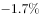
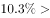
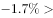
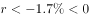
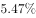
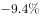

# 综合判断题（混合增长率方向判断为主，辅以隔年基期两步折算、图表缺项可求性、无据归因排查）

考点：[[20-考点/资料分析/综合/综合判断题（混合增长率方向判断为主，辅以隔年基期两步折算、图表缺项可求性、无据归因排查）|综合 / 综合判断题（混合增长率方向判断为主，辅以隔年基期两步折算、图表缺项可求性、无据归因排查）]]
材料：[[15-材料/资料分析/246299 2019年1-8月（重点8月当月）辽|246299 2019年1-8月（重点8月当月）辽]]

**问法模型**：'下列说法正确的是'综合判断 → 四类模型逐项排查：隔年基期两步连环除验数值、混合增长率'居中'定增速方向、折线图缺月判不可求、材料无价格数据判不可归因。

## 推理链
1. 第1步：A项取数——表格给出2019年8月社零总额1280.7亿元、同比+5.73%，折线图给出2018-08当月同比+2.65%，求2017年8月需两步折算。
2. 第2步：A项验证——1280.7÷(1+5.73%)÷(1+2.65%)≈1211÷1.0265≈1180亿元≠1208亿元；且误用1-8月累计增速6%才会得1280.7÷1.06≈1208亿元，A为口径错配设错，A错误。
3. 第3步：B项取数——表格烟酒类8月零售额3.5亿元、同比+10.3%，1-8月零售额29.8亿元、同比-1.7%。
4. 第4步：B项规则——混合增长率居中：1-8月的-1.7%是8月+10.3%与1-7月增速r的加权平均，因-1.7%<+10.3%，必有r<-1.7%<0。
5. 第5步：B项结论——1-7月同比负增长，2019年1-7月烟酒类零售额少于2018年同期，B正确；数字验证：1-7月现期=29.8-3.5=26.3亿元<2018年同期29.8÷0.983-3.5÷1.103≈30.3-3.2=27.1亿元。
6. 第6步：C项验证——折线图横轴'2019-01、02'合并点为5.47%，缺2019年1月单月增速，无法与4月的5.01%比较大小，C不可判即错误。
7. 第7步：D项验证——表格确认汽车类1-8月-9.4%（减少）、石油及其制品类+1.7%（增加）属实，但材料只有零售额与增速、无任何价格数据，'因涨价'归因无据，D错误；故选B。

**最快解法**：⚡ 混合增长率'居中偏移'口诀直判B：1-8月增速-1.7%介于8月+10.3%与1-7月增速r之间，因-1.7%远低于+10.3%，r必为负→1-7月同比减少，锁定B；其余排除：A项隔年基期1280.7÷1.0573÷1.0265≈1180≠1208，C项折线图缺2019-01单月数据不可判，D项材料无价格信息不可归因。

## 易错点
- ⚠ A项设错点：误用1-8月累计增速6%去除8月当月值1280.7亿元得≈1208亿元（当月值须配当月增速5.73%），且隔年基期须连环除两次（再除1+2.65%），只除一次得≈1211仍不对。
- ⚠ C项陷阱：把折线图合并点'2019-01、02'=5.47%当作1月单月增速与4月5.01%比较；材料缺2019-01单月数据，属不可判而非可比较。
- ⚠ B项易反向误判：只看1-8月的-1.7%而不看8月的+10.3%，无法用'居中'确定1-7月增速为负；D项把'同比增加'默认为涨价所致，材料无价格数据不能归因。

## 母题抽象
> 🧩 当综合判断题同时出现'隔年基期数值、多月增速混合、折线图缺月、因果归因'四类选项时，优先用混合增长率'居中'定增速方向锁定可判项，再用两步基期折算验数、缺项不可判、无据不归因三把尺子排除其余。

**同类特征**：下列说法正确的是（综合判断）、隔年基期两步折算（2017年8月）、混合增长率居中定方向（当月增速与累计增速夹逼）、折线图缺2019-01单月增速、无价格数据不可归因、当月值配累计增速的口径错配设错

## 相关题
- [[10-真题/资料分析/综合/2385119 综合判断题（进出口总额加总+增长量计算+趋势-倍数-增速逐项验证）|2385119]]（深圳市考 2019，相关度1）
- [[10-真题/资料分析/综合/1752634 综合判断题（混合比重居中定单月比重+折线图累计增速读图比较）|1752634]]（北京 2016，相关度1）
- [[10-真题/资料分析/综合/2187804 综合判断题（基期差值＋增长率比较＋部分差值＋混合居中多模型混合验证）|2187804]]（黑龙江 2018，相关度1）
- [[10-真题/资料分析/综合/2166222 综合判断题·倍数关系验证与顺逆差符号辨析|2166222]]（深圳市考 2018，相关度1）
- [[10-真题/资料分析/综合/2188508 综合分析-说法正确判断（现期比重+增长量比较+净资产生成增速+净资产计算）|2188508]]（黑龙江 2018，相关度1）

---

### 题干
根据上述材料，下列说法正确的是：

### 选项
- A. 2017年8月社会消费品零售总额约为1208亿元
- B. 2019年1-7月烟酒类实现消费品零售总额少于2018年同期　✅
- C. 2019年1-8月，1月的社会消费品零售总额同比增速高于4月同比增速
- D. 2019年1-8月汽车类零售总额同比减少，而石油及其制品类零售总额同比增加是因为石油及其制品涨价

### 官方解析

A项：根据116题计算得2017年8月辽宁省社会消费品零售总额，错误；

B项：定位表格数据可知“2019年8月全省限额以上烟酒类实现零售额为3.5亿元，同比增长，1-8月零售额为29.8亿元，同比增长”，设1-7月增长率为r。根据混合增长率的口诀“混合增长率居中”，8月增长率1-8月增长率1-7月增长率r，解得：，即2019年1-7月少于2018年同期，正确；

C项：定位折线图数据可知2019年1-2月增速为，4月增速为，但无法求出1月份增速，无法判断1月和4月增速大小关系，错误；

D项：定位表格数据可知“2019年1-8月全省限额以上汽车类同比增长，石油及其制品类同比增长”，但无法判断石油及其制品类零售总额同比增加的原因，错误。

故正确答案为B。

### 给定材料

        2019年1-8月，辽宁省社会消费品零售总额9846.6亿元，比上年同期增长，增速回落1.6个百分点。限额以上单位消费品零售额实现2254.6亿元，同比下降，增速回落6.5个百分点。

        又知2019年1-7月全省限额以上批发业，零售业，住宿业和餐饮业实现零售额同比分别增长、、和。

