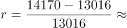
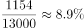
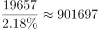
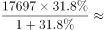
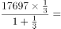
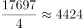

# 综合判断·正误个数验证（环比增速计算＋占比反推总量＋同比增速求增长量）

考点：[[20-考点/资料分析/综合/综合判断·正误个数验证（环比增速计算＋占比反推总量＋同比增速求增长量）|综合 / 综合判断·正误个数验证（环比增速计算＋占比反推总量＋同比增速求增长量）]]
材料：[[15-材料/资料分析/246351 2018年我国科技事业发展情况：以R|246351 2018年我国科技事业发展情况：以R]]

**问法模型**：题干为'①②③说法不正确的有几个'逐条验证型综合判断 → 对每条小说法分别套对应模型（环比增速=(当年−上年)/上年、总量=分量÷比重、增长量=现期−现期÷(1+r)），数出错误个数对照选项0~3

## 推理链
1. 第1步：①需2015年同比增速，正文只有2018年数据，必须从附表取2015年14170亿元、2014年13016亿元
2. 第2步：①套环比增速公式 (14170−13016)÷13016 = 1154÷13016 ≈ 8.9%，说法①成立
3. 第3步：②从正文取2018年R&D经费19657亿元、'与国内生产总值之比2.18%'，套总量=分量÷比重：GDP=19657÷2.18%≈901697亿元，说法②成立
4. 第4步：③从正文取2018年技术合同成交金额17697亿元、同比+31.8%，先还原2017年基期：17697÷1.318≈13427亿元（必须÷(1+r)）
5. 第5步：③增长量=17697−13427≈4270亿元≠2400.9亿元，说法③不成立
6. 第6步：仅③1个说法不正确，对照选项B（1个）

**最快解法**：⚡ 截位直除＋公式法逐条速验：①1154/13016首位商8→8.9%成立；②19657÷0.0218改写为1965700÷2.18≈90万量级→901697亿元成立；③增长量=现期×r/(1+r)=17697×0.318/1.318≈4270亿元，与'2400.9亿元'量级明显不符直接判错，无需精算，秒选B

## 易错点
- ⚠ 基期还原方向：③求2017年基期须17697÷1.318，误用×(1−31.8%)方向必错；若误算增长量≈5627.6亿元或错配2400.9亿元也会误判
- ⚠ 百分比未化小数：②若把2.18%当2.18去除，得19657÷2.18≈9017亿元，量级差百倍即误判②错误
- ⚠ 数据来源陷阱：①的2015年增速只能用附表13016→14170验证，正文11.6%是2018年同比不能挪用；③勿将技术合同17697亿元与R&D经费19657亿元混用（近似数字易混）

## 母题抽象
> 🧩 当题干出现'①②③说法不正确的有几个'特征时，逐条匹配模型：逐年增速用附表相邻两年当期值相除、占比反推总量用分量÷比重(化小数)、增长量用现期−现期÷(1+r)，数出错误条数直接选对应个数选项

**同类特征**：说法不正确的有、①②③逐条验证、同比增长（环比增速）、与国内生产总值之比（反推总量）、较上年增加（增长量）、选项为0~3个

## 相关题
（暂无）

---

### 题干
①2015年R&D经费支出同比增长8.9%
②2018年国内生产总值901697亿元
③2018年技术合同成交金额较2017年增加2400.9亿元
上述说法不正确的有

### 选项
- A. 0个
- B. 1个　✅
- C. 2个
- D. 3个

### 官方解析

①：定位表格材料，2015年R&amp;D经费支出14170亿元，2014年R&amp;D经费支出13016亿元，可得增长率，正确；

②：定位文字材料，“2018年我国全年研究与试验发展（R&amp;D）经费支出19657亿元，比上年增长11.6%，与国内生产总值之比为2.18%”，可得2018年国内生产总值=亿元，正确；

③：定位文字材料，“技术合同成交金额17697亿元，比上年增长31.8%”，可得增长量=亿元，错误。

故正确答案为B。

### 给定材料

        2018年我国全年研究与试验发展（R&amp;D）经费支出19657亿元，比上年增长11.6%，与国内生产总值之比为2.18%，其中基础研究经费1118亿元。全年国家重点研发计划共安排1052个项目，国家科技重大专项共安排563个课题，国家自然科学基金共资助44504个项目。截至年底，正在运行的国家重点实验室501个，累计建设国家工程研究中心132个，国家工程实验室217个，国家企业技术中心1480家。国家科技成果转化引导基金累计设立21支子基金，资金总规模313亿元。全年境内外专利申请432.3万件，比上年增长16.9%；授予专利权244.7万件，增长33.3%；PCT专利申请受理量为5.5万件。截至年底，有效专利838.1万件，其中境内有效发明专利160.2万件，每万人口发明专利拥有量11.15件。全年共签订技术合同41.2万项，技术合同成交金额17697亿元，比上年增长31.8%。

