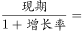
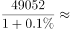
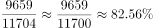
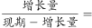
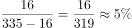

# 多说法正误判定（基期计算+现期比重+增长率+单位口径辨析）

考点：[[20-考点/资料分析/综合/多说法正误判定（基期计算+现期比重+增长率+单位口径辨析）|综合 / 多说法正误判定（基期计算+现期比重+增长率+单位口径辨析）]]
材料：[[15-材料/资料分析/246352 C国2018年农作物种植面积与粮食产|246352 C国2018年农作物种植面积与粮食产]]

**问法模型**：题干出现'上述说法正确的有（几个）'的逐条判定问法 → 对①②③④逐条核对单位口径后套用基期=现期−增减量或现期/(1+r)、比重=部分/总体、增长率=增长量/基期，数出正确条数对照选项

## 推理链
1. 第1步：①定位第1段'糖料种植面积163万公顷，增加9万公顷'，2017年糖料面积=163−9=154万公顷，而说法写成'154万吨'——数值对但单位错（面积单位是万公顷），①错误
2. 第2步：②定位第2段'秋粮产量49052万吨，增产0.1%'，基期=49052/(1+0.1%)≈49052−49≈49003万吨，与说法49003万吨一致，②正确
3. 第3步：③定位第1段面积数据，小麦2427+稻谷3019+玉米4213=9659万公顷，占粮食总面积11704万公顷的比重=9659/11704≈82.5%，③正确
4. 第4步：④定位第1段'棉花种植面积335万公顷，增加16万公顷'，增长率=16/(335−16)=16/319≈5.0%≠5.8%，④错误
5. 第5步：正确说法为②③共2个，对照选项选B

**最快解法**：⚡ 混合速算法：①零计算排除（只核单位'万吨vs万公顷'即判错）；②基期化除为近似'现期−现期×r'：49052−49052×0.1%≈49052−49≈49003；③截位直除9659/11704，首两位82即可锁定82.5%；④直除16/319≈5.0%与5.8%不符；全程锁定'种植面积（万公顷）'口径取第1段数据

## 易错点
- ⚠ ①是典型的'数值对≠说法对'陷阱：154计算正确但单位写成'万吨'，种植面积单位应为万公顷，不核单位即误判①正确
- ⚠ ④增长率分母须用基期335−16=319，误用现期335或其他基数会得出约4.8%/5.8%等错误值；且棉花符号为'+16'（增加），方向读反会算错基期
- ⚠ 双口径陷阱：稻谷/小麦/玉米在第1段是种植面积（万公顷）、第2段是产量（万吨），③问'种植面积之和占粮食种植面积'必须用第1段数据（9659/11704），误用第2段产量数据（60089/61019谷物口径）即落入陷阱

## 母题抽象
> 🧩 当题干出现'上述说法正确的有几个'时，对每条先核'单位与口径'再套公式：给增减量用基期=现期−增减量、给增速用基期=现期/(1+r)、比重=部分/总体、增长率=增长量/基期，最后数正确条数对照选项个数

**同类特征**：上述说法正确的有、①②③④逐条正误判定、基期值（增减量与增速两种给法并存）、现期比重82.5%、同比增长率验证、万公顷与万吨单位辨析

## 相关题
（暂无）

---

### 题干
①2017年糖料种植面积为154万吨
②2017年秋粮产量49003万吨
③2018年小麦、稻谷和玉米的种植面积之和占该年粮食种植面积的82.5%
④2018年棉花种植面积同比增长5.8%
上述说法正确的有

### 选项
- A. 1个
- B. 2个　✅
- C. 3个
- D. 4个

### 官方解析

①：定位文字材料第一段“糖料种植面积163万公顷，增加9万公顷”，则2017年糖料种植面积=163-9=154万公顷，而非154万吨，错误；

②：定位文字材料第二段“秋粮产量49052万吨，增产0.1%”，根据基期=万吨，正确；

③：定位文字材料“2018年C国全年粮食种植面积11704万公顷，比上年减少95万公顷。其中，小麦种植面积2427万公顷，减少24万公顷；稻谷种植面积3019万公顷，减少56万公顷；玉米种植面积4213万公顷，减少27万公顷”，则2018年小麦、稻谷、玉米产量之和=万公顷，则其占2018年粮食种植面积的比重=，正确。

④定位文字材料第一段“棉花种植面积335万公顷，增加16万公顷”根据增长率=，错误。

故正确答案为B。

### 给定材料

        2018年C国全年粮食种植面积11704万公顷，比上年减少95万公顷。其中，小麦种植面积2427万公顷，减少24万公顷；稻谷种植面积3019万公顷，减少56万公顷；玉米种植面积4213万公顷，减少27万公顷；棉花种植面积335万公顷，增加16万公顷；油料种植面积1289万公顷，减少33万公顷；糖料种植面积163万公顷，增加9万公顷。

        2018年C国全年粮食产量65789万吨，比上年减少371万吨，减产0.6%。其中，夏粮产量13878万吨，减产2.1%；早稻产量2859万吨，减产4.3%；秋粮产量49052万吨，增产0.1%。全年谷物产量61019万吨，比上年减产0.8%。其中，稻谷产量21213万吨，减产0.3%；小麦产量13143万吨，减产2.2%；玉米产量25733万吨，减产0.7%。

> [!warning] 疑点（官方解析可能有误，待人工复核）
> 官方解析中②③④的计算公式在原文显示不完整（如'基期=万吨'处疑缺公式排版），但按残缺信息复核：①单位错、②≈49003对、③≈82.5%对、④16/319≈5.0%错，结论与正确答案B（2个）一致，无实质矛盾

<!-- CODEX-ANSWER-REVIEW:BEGIN -->
### 本次独立复核

**复核状态：** `confirmed`（独立复算确认答案）

**计分答案：** B（可计分）

**复核解析：**

四句逐项检验：(1)种植面积单位是万公顷，选项写万吨，错；(2)2017秋粮=(49052/1.001)≈49003万吨，对；(3)(2427+3019+4213)/11704≈82.53%，对；(4)棉花增量16、基期约319，增幅约5.02%而非5.8%。共2句，选B。

**相关信息：**

独立复核：按题干定义逐项检验，关键基数、比值、增速与图表读数写明以便复算。

**题源依据：** [固定版本原题](https://github.com/Mentat-Uran/kaogongzhentizhengliu/blob/84ab93d4b64b61d897bece8a1c0a5bab06b4feb2/10-%E7%9C%9F%E9%A2%98/%E8%B5%84%E6%96%99%E5%88%86%E6%9E%90/%E7%BB%BC%E5%90%88/2444074%20%E5%A4%9A%E8%AF%B4%E6%B3%95%E6%AD%A3%E8%AF%AF%E5%88%A4%E5%AE%9A%EF%BC%88%E5%9F%BA%E6%9C%9F%E8%AE%A1%E7%AE%97%2B%E7%8E%B0%E6%9C%9F%E6%AF%94%E9%87%8D%2B%E5%A2%9E%E9%95%BF%E7%8E%87%2B%E5%8D%95%E4%BD%8D%E5%8F%A3%E5%BE%84%E8%BE%A8%E6%9E%90%EF%BC%89.md)；固定内容 commit `84ab93d4b64b61d897bece8a1c0a5bab06b4feb2`，Markdown blob `d20dd1f6cf9d4938224c9555f04c442eaee0403f`。
<!-- CODEX-ANSWER-REVIEW:END -->
