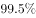
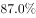
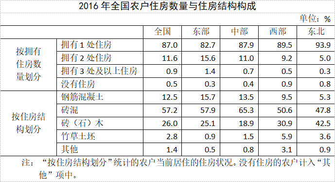

# 综合判断题（容斥交集下界+分数性质比较+比重最值+跨图表反推总户数）

考点：[[20-考点/资料分析/综合/综合判断题（容斥交集下界+分数性质比较+比重最值+跨图表反推总户数）|综合 / 综合判断题（容斥交集下界+分数性质比较+比重最值+跨图表反推总户数）]]
材料：[[15-材料/资料分析/246392 2016年末（全国农业普查口径）全国|246392 2016年末（全国农业普查口径）全国]]

**问法模型**：题干为'能够从上述资料可以推出'的四选一综合判断 → 对每个选项分别套用模型：地区总户数=商品房户数÷比重、'每N个中有1个'=比重1/N、交集下界=a%+b%-100%、最值直接查表比对

## 推理链
1. 第1步：A项比较西部与中部农户总数，材料未直接给出各地区总户数，由图2反推：总户数=商品房户数÷商品房比重，西部=577/8.0%≈7213万户，中部=557/8.1%≈6877万户
2. 第2步：西部分子577＞中部557且分母8.0%＜8.1%，由分数性质'分子大、分母小则分数大'，西部户数＞中部，A项'西部少于中部'错误
3. 第3步：B项'每70个农户中有1个以上拥有3处及以上住房'等价于该类比重＞1/70≈1.43%，查表1中部'3处及以上'仅0.7%＜1.43%（0.7%×70=0.49个＜1个），B项错误
4. 第4步：C项'仅拥有1处砖混结构住房'是'拥有1处住房'与'砖混结构'两个集合的交集，查表1东北列：前者93.9%、后者47.8%，两比重基数为同一'当地农户总数'
5. 第5步：由容斥原理，交集下界=93.9%+47.8%-100%=41.7%，即该类农户占当地农户总数至少41.7%＞40%（4成），C项正确
6. 第6步：D项查表1四个地区列：砖混比重最高为中部65.3%，钢筋混凝土比重最高为东部15.7%，两个最值不在同一地区，D项错误
7. 第7步：综上仅C项能够推出，与官方答案C一致

**最快解法**：⚡ 容斥下界法一步锁定C：东北93.9%+47.8%=141.7%，超出100%的41.7%即交集下界＞40%，直接证实；A项不精算，用'分子大分母小'比较577/8.0%与557/8.1%即知西部＞中部；B项将条件化为1/70≈1.43%与中部0.7%对比即否定；D项扫表找两列最大值（中部65.3%与东部15.7%）即否定

## 易错点
- ⚠ C项两个比重相加得141.7%超过100%时易慌乱或误当并集处理，须识别'仅拥有1处且砖混'是交集问题，必须用容斥下界a%+b%-100%求最小值
- ⚠ A项各地区农户总户数材料未直接给出，须跨图表用图2'商品房户数÷该地比重'反推，且图2是双轴图（柱=万户左轴、折线=%右轴），读错轴则分子分母全错
- ⚠ B项'每70个农户中有1个以上'必须转化为比重1/70≈1.43%再与0.7%比较（或算0.7%×70=0.49个＜1），跳过转化直接比较易误判

## 母题抽象
> 🧩 当综合判断题出现'某地总户数未给'时用'部分÷比重=总体'借商品房数据反推；出现'每N个中有M个'时化为比重M/N与表值对比；出现'同时满足两种属性（交集）是否超过某成数'时用容斥下界a%+b%-100%快速验证

**同类特征**：能够从上述资料可以推出、四选一综合判断、每70个农户中有1个以上、占当地农户总数4成以上、比重最高的地区是同一个、地区总户数需跨图表反推

## 相关题
- [[10-真题/资料分析/综合/1797644 综合判断——各选项数据可得性（分子-分母-基期齐备性）验证|1797644]]（山东 2016，相关度1）
- [[10-真题/资料分析/综合/1746812 综合判断题（逐项验证：比重计算、双指标排序比较、同比方向判断）|1746812]]（国考 2016，相关度1）
- [[10-真题/资料分析/综合/2049348 综合判断题（单产比较为主，兼含面积占比、产销读图、趋势外推多重验证）|2049348]]（河南 2017，相关度1）
- [[10-真题/资料分析/综合/10942304 综合判断（增长量计算+单位换算；两期比重比较；下降速度比较）|10942304]]（山东 2024，相关度1）
- [[10-真题/资料分析/综合/12536418 综合判断题（基期量计算+增长量计算+差额变化比较+两期比重比较混合考查）|12536418]]（四川 2024，相关度1）

---

### 题干
根据2016年末全国农户住房情况，能够从上述资料可以推出：

### 选项
- A. 西部地区农户数量少于中部地区
- B. 中部地区平均每70个农户中，就有1个以上拥有3处及以上住房
- C. 东北地区仅拥有1处砖混结构住房的农户占当地农户总数4成以上　✅
- D. 砖混住房和钢筋混凝土住房分别占该地区所有住房比重最高的地区是同一个

### 官方解析
A项：西部地区农户数量，中部地区农户数量，前者分子大于后者，分母小于后者，则前者数据大，即西部地区农户数量高于中部地区，错误；
B项：平均每70个农户中，就有1个以上拥有3处及以上住房，即拥有3处及以上住房的农户占总数的比重大于；表格中中部地区对应数据为，错误；
C项：东北地区仅拥有1处住房的农户比重为，砖混结构住房的农户比重为，根据容斥原理:，；，则所求比重至少为，是4成以上，正确；
D项：定位表格材料，砖混住房占该地区所有住房比重最高的地区为中部地区，钢筋混凝土住房比重最高的为东部地区，不是同一地区，错误。
故正确答案为C。

### 给定材料

        2016年末，全国23027万农户中，的农户拥有自己的住房。其中，拥有1处住房的20030万户，占；拥有2处住房的2677万户，占；拥有3处及以上住房的196万户，占；拥有商品房的1997万户，占。

 

