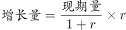
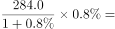
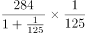
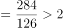
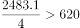
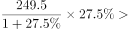
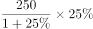
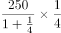
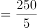
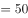

# 综合判断题（增长量计算为主，兼季度平均数比较与'产量vs销量'计数比较）

考点：[[20-考点/资料分析/综合/综合判断题（增长量计算为主，兼季度平均数比较与'产量vs销量'计数比较）|综合 / 综合判断题（增长量计算为主，兼季度平均数比较与'产量vs销量'计数比较）]]
材料：[[15-材料/资料分析/246393 我国乘用车（总量及轿车、MPV、SU|246393 我国乘用车（总量及轿车、MPV、SU]]

**问法模型**：'关于2017年一季度…能够从上述资料中推出的是'→综合判断逐项验证模型：增长量类选项用'现期×g/(1+g)'，平均数类用'全年值÷4'，计数类逐行比较产量与销量

## 推理链
1. 第1步：A项定位表格：2017年一季度轿车销量284.0万辆、同比增速0.8%（0.8%是增速，不是增长量）
2. 第2步：用增长量公式：增长量=现期×g/(1+g)=284.0×0.8%/1.008；百化分0.8%≈1/125，增长量≈284.0/126≈2.25万辆
3. 第3步：2.25万辆落在'2万多辆'区间，A项成立，可锁定答案
4. 第4步：B项验证：文字段2017年全年乘用车产量2483.1万辆，各季度平均=2483.1÷4≈620.8万辆，而一季度产量610.7<620.8，'高于平均水平'不成立
5. 第5步：C项验证：逐行比较2017年一季度产量与销量：轿车291.3>284.0、MPV 55.5>55.3、SUV 249.5>238.6、交叉型14.5<16.9，满足的有3种，3/4=75%≠'正好占一半'
6. 第6步：D项验证：SUV产量249.5万辆、同比+27.5%，增长量=249.5×27.5%/1.275≈53.8万辆>50万辆，'不到50万辆'不成立
7. 第7步：四项中仅A能推出，对照选项确定答案为A

**最快解法**：⚡ 综合判断题按A→D逐项快验：A项用百化分（0.8%=1/125）套增长量公式'现期/(n+1)'：284.0/126≈2.2万辆，'2万多辆'秒成立即选A（考场策略：综合题首项验证通过且为精确区间表述时可直接锁定）；B项口算2483.1/4≈620.8与610.7比大小；C项纯读表计数；D项27.5%≈2/7，增长量≈249.5×2/9≈55万辆>50

## 易错点
- ⚠ 增速与增长量混淆：A项0.8%是同比增速，须除以(1+g)换算，直接用284.0×0.8%≈2.27万辆虽方向一致但属概念错误（本数恰仍>2万，不易暴露）
- ⚠ B项口径跨段：'各季度平均水平'必须用文字段2017年全年产量2483.1万辆÷4≈620.8万辆，勿误用全年销量2474.4或与表格610.7比错方向；610.7与620.8很接近，需精算不能目测
- ⚠ C项计数边界：只比四类'其中'项（轿车/MPV/SUV/交叉型）的产量与销量，勿把总量行'乘用车'计入类型；MPV产量55.5与销量55.3仅差0.2，读数前须先核对'产量/销量'标签，交叉型14.5<16.9是唯一不满足项，漏看会误判为4/4
- ⚠ D项负向验证：27.5%较大，增长量≈53.8万辆，粗算249.5×27.5%≈68.6会高估但均>50万辆；若误把'不到50万辆'反向理解或忘记除以1.275易错判

## 母题抽象
> 🧩 当综合判断题干出现'能够从上述资料中推出的是'且选项混合'增加了X辆'（增长量）、'平均水平'（全年÷4）、'正好占一半'（计数/比重）、'不到X'（区间否定）时，先用百化分增长量公式'现期/(n+1)'验证增长量选项，再用全年值÷4和逐行读数计数排除其余，遇到精确成立的选项即可提前锁定

**同类特征**：能够从上述资料中推出的是、2017年一季度（表内对照列时段）、增加了2万多辆（增长量现期表述）、全年各季度平均水平、正好占一半（类型计数）、产量增加了不到50万辆

## 相关题
- [[10-真题/资料分析/综合/19283943 综合分析判断题（倍数比较+求和判断+隐含平均每场座位数反推）|19283943]]（国考 2025，相关度1）
- [[10-真题/资料分析/综合/1796162 综合判断（月均计算、平均运输距离、比重对比、增长量比较逐项验证）|1796162]]（贵州 2016，相关度1）
- [[10-真题/资料分析/综合/2133504 综合判断题（现期比重+现期平均数多项验证，一对三错）|2133504]]（国考 2018，相关度1）
- [[10-真题/资料分析/综合/2444706 综合判断题（增长量+比重+倍数逐项验证）|2444706]]（四川 2019，相关度1）
- [[10-真题/资料分析/综合/2571728 综合分析逐项判断（等差递推求和＋单位换算＋比值估算）|2571728]]（山东 2020，相关度1）

---

### 题干
关于2017年一季度我国乘用车产销量，能够从上述资料中推出的是：

### 选项
- A. 轿车销量增加了2万多辆　✅
- B. 该季度产量高于全年各季度平均水平
- C. 四种类型乘用车中，产量高于销量的类型正好占一半
- D. 运动型多用途乘用车(SUV)产量增加了不到50万辆

### 官方解析

A项：定位表格材料，2017年一季度，轿车销量为284.0万辆，同比增长。根据公式：，则其销量增加了万辆，正确；

B项：定位文字材料和表格，2017年一季度，乘用车产量为610.7万辆，全年各季度平均水平为万辆，一季度产量并未高于全年各季度平均水平，错误；

C项：定位表格材料，产量高于销量的有：轿车、多功能乘用车（MPV）、运动型多用途乘用车（SUV），共3种类型，则占比为，并非正好占一半，错误；

D项：定位表格材料，2017年一季度，运动型多用途乘用车(SUV)产量为249.5万辆，同比增长。根据公式：，则其产量增加了万辆，并非不到，错误。

故正确答案为A。

### 给定材料

        2017年全年，我国乘用车产量为2483.1万辆，同比增长，销量为2474.4万辆，同比增长。

