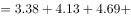
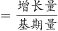
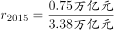
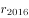

# 综合判断题（五年加总求和、两期增速比较、等增量外推年份，逐项验证）

考点：[[20-考点/资料分析/综合/综合判断题（五年加总求和、两期增速比较、等增量外推年份，逐项验证）|综合 / 综合判断题（五年加总求和、两期增速比较、等增量外推年份，逐项验证）]]
材料：[[15-材料/资料分析/247099 2013～2018年中国旅游业总收入|247099 2013～2018年中国旅游业总收入]]

**问法模型**：题干为'能够从上述资料中推出的是'→对A/B/C/D四个选项分别建模验证：加总比大小、增量÷基期比增速、（目标值−现期）÷年增量向上取整数年

## 推理链
1. 第1步：A项从表格第二列取2014~2018年旅游业总收入3.38、4.13、4.69、5.40、5.97万亿元，逐年加总=23.57万亿元
2. 第2步：23.57万亿元<25万亿元，A项'超过25万亿元'不成立，排除A
3. 第3步：B项算2014~2016年同比增量：3.38−2.95=0.43、4.13−3.38=0.75、4.69−4.13=0.56万亿元，增长率分别为0.43/2.95≈14.6%、0.75/3.38≈22.2%、0.56/4.13≈13.6%
4. 第4步：2016年增速13.6%低于2015年22.2%，并非逐年递增，排除B
5. 第5步：C项算在线交通预订收入增量：2015年3325.15−2271.57≈1053.6亿元，2016年5385.42−3325.15≈2060.3亿元
6. 第6步：增速比较：2015年1053.6/2271.57≈46.4%，2016年2060.3/3325.15≈62.0%（分子翻倍而基期仅扩约1.5倍，增速必升），2016年快于上年，C项正确
7. 第7步：D项2018年在线住宿预订增量=1881.49−1586.19≈295亿元，需再增3000−1881.49≈1118.5亿元，1118.5/295≈3.8，向上取整需4年，即2022年首超3000亿元而非2023年，排除D

**最快解法**：⚡ 综合验证+分子分母比较法：A项口算加总23.57<25直接秒杀；C项不精算增速，只比'增量倍数vs基期倍数'——2016年增量2060约为2015年1053的2倍，而基期3325仅约为2272的1.5倍，分子涨得快则增速必升，锁定C即可收卷；D项（3000−1881.49）÷295≈3.8向上取整为4年，2022年首超

## 易错点
- ⚠ B项'增量递增'与'增速递增'混淆：只看增量0.43→0.75→0.56会误判，0.56<0.75本身已说明2016年增量下降，再除以更大的基期4.13后增速必然下滑，两个层次都会否定B
- ⚠ C项两期增速比较时分母应分别用各自基期（2014年2271.57、2015年3325.15），误用现期值作分母会算错方向
- ⚠ D项外推年数必须向上取整（3.8年→4年），'首超'年份=2018+4=2022年，选项故意设为2023年；另注意A项求和范围是2014~2018共5年，勿把2013年2.95计入

## 母题抽象
> 🧩 当题干出现'能够从上述资料中推出的是'且四个选项分别涉及'多年合计超某值'、'增速逐年递增'、'今年增速快于上年'、'保持增量几年后达某值'时，用'加总看量级、增量与基期同比较增速、（目标−现期）÷年增量向上取整'三套模型逐项快验

**同类特征**：能够从上述资料中推出的是、总收入超过25万亿元（多年加总）、同比增速逐年递增、同比增速快于上年水平、如保持2018年同比增量、将在某年首超某值

## 相关题
- [[10-真题/资料分析/综合/5101658 综合判断题——同比增速计算与比较（辅以倍数判断与增长量比较）|5101658]]（云南 2022，相关度2）
- [[10-真题/资料分析/综合/19283943 综合分析判断题（倍数比较+求和判断+隐含平均每场座位数反推）|19283943]]（国考 2025，相关度1）
- [[10-真题/资料分析/综合/1796162 综合判断（月均计算、平均运输距离、比重对比、增长量比较逐项验证）|1796162]]（贵州 2016，相关度1）
- [[10-真题/资料分析/综合/2133504 综合判断题（现期比重+现期平均数多项验证，一对三错）|2133504]]（国考 2018，相关度1）
- [[10-真题/资料分析/综合/2444706 综合判断题（增长量+比重+倍数逐项验证）|2444706]]（四川 2019，相关度1）

---

### 题干
能够从上述资料中推出的是：

### 选项
- A. 2014～2018年，中国旅游业总收入超过25万亿元
- B. 2014～2016年，中国旅游业总收入同比增速逐年递增
- C. 2016年中国在线交通预订收入同比增速快于上年水平　✅
- D. 如保持2018年同比增量，中国在线住宿预订收入将在2023年首超3000亿元

### 官方解析

A项：定位表格第二列数据可得：“2014年~2018年旅游业总体收入依次为3.38万亿元、4.13万亿元、4.69万亿元、5.40万亿元、5.97万亿元”，故题干所求总收入，错误。

B项：根据本篇第4题计算数据可得：“2014年~2016年中国旅游业总收入增长量分别为0.43万亿元、0.75万亿元、0.56万亿元”，代入公式：增长率，则，，两者比较分子大分母小，明显，即2016年增速下降，错误。

C项：根据本篇第4题计算数据可得：“2015年、2016年中国在线交通预订收入增长量分别约为1053亿元、2060亿元”，代入公式：增长率 ，，，明显，即2016年增速快于2015年，正确。

D项：根据本篇第4题计算数据可得：“2018年中国在线住宿预订收入增长量约为295亿元”，代入公式：现期量，，年，向上取整，需要4年，故在年住宿预订收入已超过3000亿元，错误。

故正确答案为C。

### 给定材料

> [!warning] 疑点（官方解析可能有误，待人工复核）
> 官方解析D项文字存在缺字（'故在年住宿预订收入已超过3000亿元'中年份缺失），但按数据推算2018+4=2022年首超3000亿元，与D项'2023年'表述矛盾、判定D错误的结论无误，不影响正确答案C

<!-- CODEX-ANSWER-REVIEW:BEGIN -->
### 本次独立复核

**复核状态：** `resolved`（答案与解析已核定）

**计分答案：** C（可计分）

**复核解析：**

1. 第1步：A项从表格第二列取2014~2018年旅游业总收入3.38、4.13、4.69、5.40、5.97万亿元，逐年加总=23.57万亿元
2. 第2步：23.57万亿元<25万亿元，A项'超过25万亿元'不成立，排除A
3. 第3步：B项算2014~2016年同比增量：3.38−2.95=0.43、4.13−3.38=0.75、4.69−4.13=0.56万亿元，增长率分别为0.43/2.95≈14.6%、0.75/3.38≈22.2%、0.56/4.13≈13.6%
4. 第4步：2016年增速13.6%低于2015年22.2%，并非逐年递增，排除B
5. 第5步：C项算在线交通预订收入增量：2015年3325.15−2271.57≈1053.6亿元，2016年5385.42−3325.15≈2060.3亿元
6. 第6步：增速比较：2015年1053.6/2271.57≈46.4%，2016年2060.3/3325.15≈62.0%（分子翻倍而基期仅扩约1.5倍，增速必升），2016年快于上年，C项正确
7. 第7步：D项2018年在线住宿预订增量=1881.49−1586.19≈295亿元，需再增3000−1881.49≈1118.5亿元，1118.5/295≈3.8，向上取整需4年，即2022年首超3000亿元而非2023年，排除D

**最快解法**：⚡ 综合验证+分子分母比较法：A项口算加总23.57<25直接秒杀；C项不精算增速，只比'增量倍数vs基期倍数'——2016年增量2060约为2015年1053的2倍，而基期3325仅约为2272的1.5倍，分子涨得快则增速必升，锁定C即可收卷；D项（3000−1881.49）÷295≈3.8向上取整为4年，2022年首超

**相关信息：**

考点：综合判断题（五年加总求和、两期增速比较、等增量外推年份，逐项验证）。来源：2020年国家公务员录用考试《行测》题（地市级网友回忆版）；2020年。> 🧩 当题干出现'能够从上述资料中推出的是'且四个选项分别涉及'多年合计超某值'、'增速逐年递增'、'今年增速快于上年'、'保持增量几年后达某值'时，用'加总看量级、增量与基期同比较增速、（目标−现期）÷年增量向上取整'三套模型逐项快验

**同类特征**：能够从上述资料中推出的是、总收入超过25万亿元（多年加总）、同比增速逐年递增、同比增速快于上年水平、如保持2018年同比增量、将在某年首超某值

**题源依据：** [固定版本原题](https://github.com/Mentat-Uran/kaogongzhentizhengliu/blob/84ab93d4b64b61d897bece8a1c0a5bab06b4feb2/10-%E7%9C%9F%E9%A2%98/%E8%B5%84%E6%96%99%E5%88%86%E6%9E%90/%E7%BB%BC%E5%90%88/2448424%20%E7%BB%BC%E5%90%88%E5%88%A4%E6%96%AD%E9%A2%98%EF%BC%88%E4%BA%94%E5%B9%B4%E5%8A%A0%E6%80%BB%E6%B1%82%E5%92%8C%E3%80%81%E4%B8%A4%E6%9C%9F%E5%A2%9E%E9%80%9F%E6%AF%94%E8%BE%83%E3%80%81%E7%AD%89%E5%A2%9E%E9%87%8F%E5%A4%96%E6%8E%A8%E5%B9%B4%E4%BB%BD%EF%BC%8C%E9%80%90%E9%A1%B9%E9%AA%8C%E8%AF%81%EF%BC%89.md)；固定内容 commit `84ab93d4b64b61d897bece8a1c0a5bab06b4feb2`，Markdown blob `ac6eb30afcffc6d518b4bd83042991ce5745f7b2`。
<!-- CODEX-ANSWER-REVIEW:END -->
