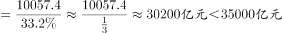
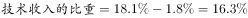
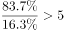
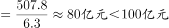

# 综合判断（基期倍数·比重差法、两期比重比较、增长量估算、总量反推）

考点：[[20-考点/资料分析/综合/综合判断（基期倍数·比重差法、两期比重比较、增长量估算、总量反推）|综合 / 综合判断（基期倍数·比重差法、两期比重比较、增长量估算、总量反推）]]
材料：[[15-材料/资料分析/247103 2018年B市新经济发展情况：从新经|247103 2018年B市新经济发展情况：从新经]]

**问法模型**：题干为'能够从上述资料中推出的是'的四选一综合判断问法→逐项匹配公式验证：A用'总量=部分÷比重'反推GDP，B用'基期占比=现期占比−1.8个百分点'配同总体倍数(1−p)÷p，C用两期比重比较a与b，D用'增长量=现期×r/(1+r)'，结论与选项一致且可算者即为答案。

## 推理链
1. 第1步：A项定位第一段：新经济增加值10057.4亿元及其占全市GDP比重（原始数据给定），用'总量=部分÷比重'反推2018年全市GDP，结果不足35000亿元，A排除。
2. 第2步：B项定位末段：技术收入10629.4亿元、占总收入的比重比上年提高1.8个百分点，故2017年技术收入占比=2018年占比−1.8个百分点（占比差≠增速）。
3. 第3步：B项关键：2017年'非技术收入'与'技术收入'同以2017年总收入为总体（总体量相同），收入倍数可直接换成比重之比=(1−2017占比)÷2017占比，无需用到增速和收入绝对值。
4. 第4步：B项：代入2017占比算得倍数为5倍多（倍数>5等价于2017占比<1/6≈16.7%），与选项'5倍多'吻合，B正确。
5. 第5步：C项定位第一、二段：两期比重比较——战略性新兴产业增加值增速a小于新经济增加值增速b（原始增速数据），故2018年占新经济比重低于上年而非高于，C排除。
6. 第6步：D项定位第三段：投资507.8亿元、同比增速r（原始数据），增长量=507.8×r/(1+r)，算得不足100亿元，D排除。

**最快解法**：⚡ 秒杀顺序先验B：比重差法+同总体倍数——2017年占比=2018年占比−1.8pp，倍数=(1−p)÷p，只需与1/6临界值比较（p<16.7%即'5倍多'成立），全程不用10629.4亿元、不用增速，口算锁定B；再看其余项：A用'10057.4÷比重'截位直除验证未超35000亿，C用两期比重口诀'a小则降'，D用增长量=507.8×r/(1+r)（百化分）估出不足100亿。

## 易错点
- ⚠ 占比差与增速混淆：'提高1.8/0.4/0.1/0.9个百分点'是比重差值不是增速，B项必须先用2018年占比−1.8个百分点得2017年占比；且本材料增速与占比大量以空缺呈现，须回原始数据/兄弟题补值，切勿脑补数值代入。
- ⚠ 忽略'总体量相同'前提：非技术收入与技术收入必须同除以2017年总收入，倍数才是(1−p)÷p；若误用2018年总量当总体，或先算基期收入绝对值再相除（绕远易错），口径即乱。
- ⚠ 方向与公式双坑：C项两期比重口诀a<b⇒比重下降，勿因'占GDP比重提高0.1个百分点'误判'占新经济比重'也提高（两者整体不同）；D项增长量=现期×r/(1+r)，漏除(1+r)会把增量高估到100亿以上；A项'新经济增加值÷占比'中占比须用2018年现期比重。

## 母题抽象
> 🧩 当综合判断题干出现'某指标占总体比重比上年提高X个百分点'+'基期A是B的N倍'组合时，用'基期占比=现期占比−Xpp、同总体倍数=(1−基期占比)÷基期占比'对照临界值（p<1/6即5倍多）直接秒杀该选项；其余选项按'总量=部分÷比重''两期比重比a与b定升降''增长量=现期×r/(1+r)'逐一排除。

**同类特征**：'能够从上述资料中推出的是'（四选一综合判断）、'比上年提高1.8个百分点'（占比差求基期占比）、'非技术收入是技术收入的5倍多'（同总体倍数=比重之比）、'占新经济增加值的比重高于上年'（两期比重比较a与b）、'增长了100亿元以上'（增长量=现期×r/(1+r)）、'超过35000亿元'（部分÷比重反推总量）

## 相关题
（暂无）

---

### 题干
能够从上述资料中推出的是：

### 选项
- A. 2018年B市地区生产总值超过35000亿元
- B. 2017年B市高新技术示范区规模以上高新技术企业非技术收入是技术收入的5倍多　✅
- C. 2018年B市战略性新兴产业增加值占新经济增加值的比重高于上年水平
- D. 2018年B市高技术服务业完成投资比上年增长了100亿元以上

### 官方解析

A项：定位文字材料第一段，“2018年，B市新经济实现增加值10057.4亿元，比上年增长，占全市地区生产总值的比重为，比上年提高0.4个百分点。”。根据，可计算出2018年B市地区生产总值。错误；

B项：定位文字材料最后一段，“2018年，B市高新技术示范区规模以上高新技术企业实现技术收入10629.4亿元，比上年增长，占高新技术示范区规模以上高新技术企业总收入的比重为，比上年提高1.8个百分点。”。2017年，；则。由于总体量相同，可直接用比重计算。则2017年B市高新技术示范区规模以上高新技术企业非技术收入是技术收入的倍。正确；

C项：定位文字材料第一、二段，“2018年，B市新经济实现增加值10057.4亿元，比上年增长，······。2018年，······战略性新兴产业实现增加值4893.4亿元，增长，占地区生产总值的比重为，比上年提高0.1个百分点。”。根据两期比重比较的结论，战略性新兴产业增加值的增长率a（）新经济增加值的增长率b（），可判定比重低于上年水平，而非高于。错误；

D项：定位文字材料第三段，“2018年，B市高技术服务业完成投资507.8亿元，同比增长。”根据，可计算出2018年B市高技术服务业完成投资比上年增长。错误。

故正确答案为B。

### 给定材料

        2018年，B市新经济实现增加值10057.4亿元，比上年增长，占全市地区生产总值的比重为，比上年提高0.4个百分点。全年全市新设立的企业中，信息服务业、科技服务业企业合计达到70661家，占比为，注册资本达到7311.4亿元，同比增长。

        2018年，B市高技术产业实现增加值6976.8亿元，比上年增长，占地区生产总值的比重为，比上年提高0.2个百分点。战略性新兴产业实现增加值4893.4亿元，增长，占地区生产总值的比重为，比上年提高0.1个百分点。信息产业实现增加值4940.7亿元，增长，占地区生产总值的比重为，比上年提高0.9个百分点。

        2018年，B市高技术服务业完成投资507.8亿元，同比增长。其中，信息服务业投资增长，科技服务业投资增长。

        2018年，B市限额以上批发零售业网上零售额达到2632.9亿元，比上年增长，占全市零售额比重为，对全市零售额增长的贡献率（限额以上批发零售业网上零售额同比增量在全市零售额同比增量中占的比重）达到。限额以上住宿餐饮企业通过公共网络实现的餐费收入为124.7亿元，比上年增长，对全市餐费收入增长的贡献率达到。

        2018年，B市高新技术示范区规模以上高新技术企业实现技术收入10629.4亿元，比上年增长，占高新技术示范区规模以上高新技术企业总收入的比重为，比上年提高1.8个百分点。

