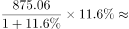
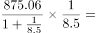
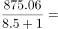
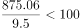
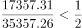
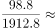
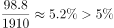

# 综合判断题（现期比重直验+增长量验证）

考点：[[20-考点/资料分析/综合/综合判断题（现期比重直验+增长量验证）|综合 / 综合判断题（现期比重直验+增长量验证）]]
材料：[[15-材料/资料分析/247106 2018年前三季度S省物流运行情况：|247106 2018年前三季度S省物流运行情况：]]

**问法模型**：“能够从上述资料中推出的是”→逐项验证型综合判断：优先用无需增速的现期数据直接判定（与总额一半比、与总收入×阈值比），增速依赖型选项（增量、两期比较）后置核验

## 推理链
1. 第1步：提取现期量：社会物流总额35357.26亿元、外部流入（含进口）17357.31亿元、农产品875.06亿元、行业总收入1912.8亿元、配送加工包装收入98.8亿元、收入线运输环节1321.9亿元、费用线运输环节1854.6亿元
2. 第2步：C项判定规则：占一半以上等价于17357.31与35357.26÷2=17678.63比较
3. 第3步：17357.31<17678.63，占比≈49.1%<50%，C项“一半以上”不成立，排除C
4. 第4步：D项判定规则：98.8÷1912.8与阈值比较，1912.8×5%=95.64<98.8，即占比≈5.2%超过5%，D项成立
5. 第5步：A项用增长量公式：增长量=875.06×r/(1+r)，要超100亿元需r>约12.9%，按原卷增速代入增量远小于100亿元，排除A
6. 第6步：B项用增长量比较口诀“大大则大”：费用现期1854.6>收入现期1321.9且费用增速更大，费用同比增量更大，收入增量不会高于费用增量，排除B
7. 第7步：仅D项能推出，对照选项确认答案为D

**最快解法**：⚡ 现期直验法（不动任何增速）：C项一眼看35357.26÷2=17678.63>17357.31，秒排除；D项算1912.8×5%=95.64<98.8（或截位直除98.8/1912.8≈5.2%），秒确认；答案D，A、B仅在D存疑时才需调增速核验

## 易错点
- ⚠ C项近似陷阱：17357.31与总额一半17678.63仅差约321亿元、占比约49.1%，粗看像“约一半”就误判为超一半，实际未过50%
- ⚠ B项串线陷阱：‘运输环节’在收入线（1321.9亿元）与费用线（1854.6亿元）同名不同义、数值不同；且比较增量须‘现期量大+增速大’同时成立（大大则大），只比现期量或串用两条线都会误判
- ⚠ A项公式陷阱：增长量=现期×r/(1+r)，把875.06×r%直接当增量（漏除1+r）会高估；D项阈值以图片公式呈现，须看清约为5%而非其他数值，且本题各增速在文本中空缺，增速型选项须以原卷数值代入

## 母题抽象
> 🧩 当综合判断题出现‘能够推出的是’且选项混合‘占比超阈值/占一半/增量超某值/两增量比大小’时，先挑无需增速的现期量选项直接验证（一半=总量÷2、阈值线=分母×阈值），常一两步即可锁定答案，增速型选项留作备核

**同类特征**：能够从上述资料中推出的是、综合判断四选一、占一半以上、比重超过某阈值、同比增量高低比较、现期数据直接验证

## 相关题
- [[10-真题/资料分析/综合/4628161 综合判断题（基期量+比重+结构差额+平均数四模型逐项验证）|4628161]]（新疆 2021，相关度2）
- [[10-真题/资料分析/综合/2448411 综合判断题（两期平均数比较+区间累计求和+同比增量比较+增长量验算）|2448411]]（国考 2020，相关度2）
- [[10-真题/资料分析/综合/2097116 综合判断题（基期量估算+数据缺口排除）|2097116]]（四川 2017，相关度2）
- [[10-真题/资料分析/综合/2097178 综合判断题（现期比重+比重比较+多期求和+趋势判断混合验证）|2097178]]（重庆 2017，相关度2）
- [[10-真题/资料分析/综合/2448546 综合判断题（翻番验证+单产最低比较+同比增速连续下降+比重与'两成'比较）|2448546]]（国考 2020，相关度2）

---

### 题干
关于2018年前三季度S省物流情况，能够从上述资料中推出的是：

### 选项
- A. 
农产品物流总额同比增长了100多亿元

- B. 
物流运输环节收入同比增量高于该环节费用同比增量

- C. 
外部流入（含进口）货物物流总额占社会物流总额的一半以上

- D. 
配送、加工、包装业收入占物流相关行业总收入的比重超过
　✅

### 官方解析

A项：定位文字材料第一段可知，2018年前三季度，农产品物流总额875.06亿元，同比增长。根据公式：增长量=，则农产品物流总额增长量=亿元，错误；

B项：定位文字材料第二段和第三段可知，运输环节收入1321.9亿元，同比增长；物流运输环节总费用1854.6亿元，同比增长；根据增长量比较口诀“大大则大”可知，物流运输环节总费用现期量大，增长率大，则增长量也大，错误；

C项：定位文字材料第一段可知，2018年前三季度，S省社会物流总额35357.26亿元，外部流入（含进口）货物物流总额17357.31亿元。根据公式：比重=，则所求比重=，错误；

D项：定位文字材料第二段可知，2018年前三季度，S省物流相关行业实现总收入1912.8亿元，其中，配送、加工、包装业收入98.8亿元。根据公式：比重=，则所求比重=，正确。

故正确答案为D。

### 给定材料

        2018年前三季度，S省社会物流总额35357.26亿元，同比增长，增速比上半年放缓0.7个百分点。其中，工业品物流总额16636.15亿元，同比增长，增速比上半年放缓2.1个百分点；外部流入（含进口）货物物流总额17357.31亿元，同比增长，增速比上半年加快0.8个百分点；农产品物流总额875.06亿元，同比增长，增速比上半年加快0.5个百分点；单位与居民物品物流总额457.86亿元，同比增长，增速比上半年放缓3个百分点；再生资源物流总额30.88亿元，同比下降，降幅比上半年扩大4.3个百分点。

        2018年前三季度，S省物流相关行业实现总收入1912.8亿元，同比增长。其中：运输环节收入1321.9亿元，同比增长；保管环节收入226.2亿元，同比增长；邮政业收入82.8亿元，同比增长；配送、加工、包装业收入98.8亿元，同比增长。

        2018年前三季度，S省社会物流总费用2682.1亿元，同比增长，比上半年放缓0.9个百分点。其中：物流运输环节总费用1854.6亿元，同比增长；保管环节总费用612.4亿元，同比增长；管理环节总费用214.9亿元，同比增长。

> [!warning] 疑点（官方解析可能有误，待人工复核）
> 材料文本与官方解析中所有同比增速百分数、增长量/比重公式数值及D项阈值（图片公式）均未显示，A、B的排除与D阈值确认只能依据官方解析结论记录；按98.8÷1912.8≈5.17%反推D项阈值应为5%，若原卷阈值不同需回卷核对，但官方答案D本身无矛盾

<!-- CODEX-ANSWER-REVIEW:BEGIN -->
### 本次独立复核

**复核状态：** `resolved`（答案与解析已核定）

**计分答案：** D（可计分）

**复核解析：**

1. A项：农产品物流总额875.06亿元，同比增11.6%；增长量=875.06×11.6%/111.6%≈90.9亿元，未超过100亿元。
2. B项：运输收入1321.9亿元、增速6.0%；运输费用1854.6亿元、增速6.3%。费用现期量更大且增速更高，费用增长量高于收入增长量，故B错误。
3. C项：外部流入物流额/社会物流总额=17357.31/35357.26≈49.1%，不到一半。
4. D项：配送、加工、包装收入占比=98.8/1912.8≈5.16%，高于原题公式图阈值5%。仅D成立。

**相关信息：**

考点：综合判断题（现期比重直验+增长量验证）。来源：2020年国家公务员录用考试《行测》题（副省级网友回忆版）；2020年。> 🧩 当综合判断题出现‘能够推出的是’且选项混合‘占比超阈值/占一半/增量超某值/两增量比大小’时，先挑无需增速的现期量选项直接验证（一半=总量÷2、阈值线=分母×阈值），常一两步即可锁定答案，增速型选项留作备核

**同类特征**：能够从上述资料中推出的是、综合判断四选一、占一半以上、比重超过某阈值、同比增量高低比较、现期数据直接验证

**题源依据：** [固定版本原题](https://github.com/Mentat-Uran/kaogongzhentizhengliu/blob/84ab93d4b64b61d897bece8a1c0a5bab06b4feb2/10-%E7%9C%9F%E9%A2%98/%E8%B5%84%E6%96%99%E5%88%86%E6%9E%90/%E7%BB%BC%E5%90%88/2448579%20%E7%BB%BC%E5%90%88%E5%88%A4%E6%96%AD%E9%A2%98%EF%BC%88%E7%8E%B0%E6%9C%9F%E6%AF%94%E9%87%8D%E7%9B%B4%E9%AA%8C%2B%E5%A2%9E%E9%95%BF%E9%87%8F%E9%AA%8C%E8%AF%81%EF%BC%89.md)；固定内容 commit `84ab93d4b64b61d897bece8a1c0a5bab06b4feb2`，Markdown blob `de164e1e3450f49310def9f8ea1f7b602b485965`。
<!-- CODEX-ANSWER-REVIEW:END -->
