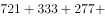
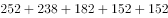
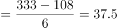
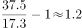

# 综合分析判断（现期加总比较+增长量判定+两期比重变化+年均增长量倍数）

考点：[[20-考点/资料分析/综合/综合分析判断（现期加总比较+增长量判定+两期比重变化+年均增长量倍数）|综合 / 综合分析判断（现期加总比较+增长量判定+两期比重变化+年均增长量倍数）]]
材料：[[15-材料/资料分析/247396 江苏民航机场旅客吞吐量：文字段讲20|247396 江苏民航机场旅客吞吐量：文字段讲20]]

**问法模型**：题干问'从上述资料中能够推出的是'→ 对A~D逐项验证：缺增速的量（增长量、比重变化）用百分点差还原判断方向，表格数据完整的选项直接取数加总比较

## 推理链
1. 第1步：A项——文字段只给'江苏增速−各省市增速'的百分点差，江苏2019年1-10月同比增速r在材料中空缺，且华东各省（市）现期吞吐量未知，增长量=现期×r/(1+r)无法计算，A推不出
2. 第2步：B项——从表格取2018年数据：南京禄口2858万人次；其余8机场之和=721+333+277+252+238+182+152+152=2307万人次
3. 第3步：2858＞2307，南京禄口大于其余8机场之和，B成立
4. 第4步：C项——由百分点差还原：华东增速=江苏增速−6.2个百分点，上海增速=江苏增速−9.7个百分点，故上海增速＜华东地区增速
5. 第5步：两期比重结论——部分增长率（上海）＜整体增长率（华东），比重同比下降，C'比重提高'错误
6. 第6步：D项——年均增量=（末年−基年）÷间隔年数：常州奔牛(333−108)/6=37.5万人次/年，连云港白塔埠(152−48)/6≈17.3万人次/年
7. 第7步：37.5÷17.3≈2.2倍，即前者'多'约1.2倍而非'多2倍多'，D错误
8. 第8步：四项中仅B可推出，与官方答案一致

**最快解法**：⚡ 综合题先挑数据最完整、纯表格取数的选项做：B项对其余8机场截位口算加总 7.2+3.3+2.8+2.5+2.4+1.8+1.5+1.5≈23.0百万人次＜28.6百万人次，直接锁定B，其余选项用于复核排除

## 易错点
- ⚠ 把'高X个百分点'当增速或增长量用：A项差值大≠增长量多，缺江苏增速r和各省现期量时增长量完全无法比较
- ⚠ C项比重方向搞反：差值越大者增速越慢（比上海高9.7个百分点→上海增速最低），部分增速＜整体增速则比重下降而非提高
- ⚠ D项'是几倍'与'多几倍'混淆：37.5÷17.3≈2.2倍是'是2.2倍'，'多'仅约1.2倍；另外注意2018年淮安（152）与连云港（152）数值相同，横向读表易串行

## 母题抽象
> 🧩 当题干出现'能够推出的是'且文字段只给百分点差时，先做表格数据可直接加总比较的选项（其余项之和vs最大值），缺基期增速的选项直接判'推不出'；比重变化只需比较'部分增速−整体增速'的符号。

**同类特征**：能够推出的是、综合分析四选项逐项验证、百分点差还原增速、占华东地区的比重同比变化、年均增量多几倍、大于其他机场之和

## 相关题
- [[10-真题/资料分析/综合/2367976 综合推断（'能够推出'判定——交集必然性-容斥思想）|2367976]]（江苏 2019，相关度1）
- [[10-真题/资料分析/增长/2452576 增长率比较（百分点差还原增速大小）|2452576]]（江苏 2020，相关度1）
- [[10-真题/资料分析/综合/2452651 综合推断（占比差×总人数求人数差 + 容斥交集下限判定）|2452651]]（江苏 2020，相关度1）

---

### 题干
从上述资料中能够推出的是

### 选项
- A. 2019年1-10月安徽民航机场旅客吞吐量在华东地区同比增加最多
- B. 2018年南京禄口民航机场旅客吞吐量大于江苏其他8个民航机场之和　✅
- C. 2019年1-10月上海民航机场旅客吞吐量占华东地区的比重同比有所提高
- D. 2013-2018年常州奔牛民航机场旅客吞吐量年均增量比连云港白塔埠的多2倍多

### 官方解析

A项：定位文字资料，华东地区中除江苏外，其余省市仅给出2019年1-10月民航机场旅客吞吐量同比增速与江苏民航机场同比增速的关系，无法推出同比增长量的大小关系，错误。

B项：定位表格资料可知各民航机场2018年旅客吞吐量数据。南京禄口民航机场为2858万人次，其余8个民航机场旅客吞吐量之和为万人次，因此2018年南京禄口民航机场旅客吞吐量大于江苏其他8个民航机场之和，正确。

C项：定位文字资料“2019年1-10月，江苏民航机场旅客吞吐量4901万人次，同比增长，增速比华东地区（六省一市）高6.2个百分点，比上海高9.7个百分点”，则华东地区同比增速为，上海同比增速为，根据两期比重比较结论，部分增长率（）整体增长率（），比重同比下降，错误。

D项：定位表格资料可知，2012年常州奔牛民航机场旅客吞吐量为108万人次，2018年为333万人次；2012年连云港白塔埠民航机场旅客吞吐量为48万人次，2018年为152万人次。根据公式：年均增长量，2013-2018年常州奔牛民航机场旅客吞吐量年均增量万人次，连云港白塔埠民航机场旅客吞吐量年均增量万人次，前者比后者多倍，错误。

故正确答案为B。

### 给定材料

        2019年1-10月，江苏民航机场旅客吞吐量4901万人次，同比增长，增速比华东地区（六省一市）高6.2个百分点，比上海高9.7个百分点，比浙江高5.7个百分点，比山东高4.4个百分点，比福建高8.7个百分点，比江西高6.9个百分点，与安徽持平。

> [!warning] 疑点（官方解析可能有误，待人工复核）
> 官方解析文字排版缺失数值：B项'其余8个机场之和为__万人次'空缺（补算应为2307），D项'多__倍'空缺（补算约为1.2倍、是约2.2倍）；按表格数据补算后B成立、D错误，结论与官方答案B一致，不影响答案。

<!-- CODEX-ANSWER-REVIEW:BEGIN -->
### 本次独立复核

**复核状态：** `confirmed`（独立复算确认答案）

**计分答案：** B（可计分）

**复核解析：**

2018年南京禄口吞吐量2858万人次，其余8机场合计2307万人次，因此B可推出。A仅有1—10月总量不能证明安徽绝对增量第一；上海地区增速比江苏低9.7个百分点而华东只低6.2个百分点，上海份额下降，C错；常州与连云港年均增量比180/96=1.875，未超过两倍。

**相关信息：**

独立复核：按题干定义逐项检验，关键基数、比值、增速与图表读数写明以便复算。

**题源依据：** [固定版本原题](https://github.com/Mentat-Uran/kaogongzhentizhengliu/blob/84ab93d4b64b61d897bece8a1c0a5bab06b4feb2/10-%E7%9C%9F%E9%A2%98/%E8%B5%84%E6%96%99%E5%88%86%E6%9E%90/%E7%BB%BC%E5%90%88/2452588%20%E7%BB%BC%E5%90%88%E5%88%86%E6%9E%90%E5%88%A4%E6%96%AD%EF%BC%88%E7%8E%B0%E6%9C%9F%E5%8A%A0%E6%80%BB%E6%AF%94%E8%BE%83%2B%E5%A2%9E%E9%95%BF%E9%87%8F%E5%88%A4%E5%AE%9A%2B%E4%B8%A4%E6%9C%9F%E6%AF%94%E9%87%8D%E5%8F%98%E5%8C%96%2B%E5%B9%B4%E5%9D%87%E5%A2%9E%E9%95%BF%E9%87%8F%E5%80%8D%E6%95%B0%EF%BC%89.md)；固定内容 commit `84ab93d4b64b61d897bece8a1c0a5bab06b4feb2`，Markdown blob `c144f64574d23b8f1cec72dc7a52f329873992e0`。
<!-- CODEX-ANSWER-REVIEW:END -->
