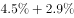
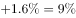
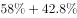
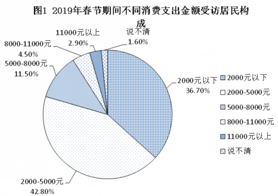
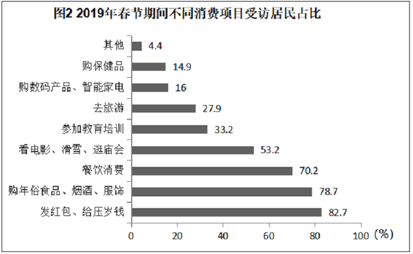

# 综合推断（占比差×总人数求人数差 + 容斥交集下限判定）

考点：[[20-考点/资料分析/综合/综合推断（占比差×总人数求人数差 + 容斥交集下限判定）|综合 / 综合推断（占比差×总人数求人数差 + 容斥交集下限判定）]]
材料：[[15-材料/资料分析/247400 某市统计局2019年2月中下旬对20|247400 某市统计局2019年2月中下旬对20]]

**问法模型**：“从上述资料中能够推出的是”→ 逐项验证：可精算项用“占比差×2000=人数差”直接确认，含“没有人/一定有/至少有”的项用容斥下限max(0, 占比和−100%)判定能否确定

## 推理链
1. 第1步：总量2000人；图2多选占比：看电影滑雪逛庙会53.2%、参加教育培训33.2%、购年俗食品烟酒服饰78.7%、购保健品14.9%、购数码智能家电16%、去旅游27.9%；图1金额档：8000~11000元4.50%、11000元以上2.90%、说不清1.60%。
2. 第2步：C项套人数差模型：人数=占比×2000，53.2%×2000=1064人，33.2%×2000=664人。
3. 第3步：1064−664=400人，与C项“多400人”完全一致，C正确。
4. 第4步：A项用容斥判定：图1中“可能超8000元”的占比=8000~11000元4.50%+11000元以上2.90%+说不清1.60%=9.0%，与“购年俗食品烟酒服饰”78.7%之和=87.7%<100%，两集合可能无交集，无法断定“没有人超8000元”，A错误。
5. 第5步：B项：文字段“基本持平”占比数值在本版材料中缺失，且即便两占比之和>100%也只能确定交集存在、得不出“16人”这一精确人数，B错误。
6. 第6步：D项：14.9%+16%+27.9%=58.8%<100%，三集合交集下限为max(0,58.8%−100%)=0，可能无交集，“至少有”不成立，D错误。
7. 第7步：仅C能从资料中确切推出，锁定答案C。

**最快解法**：⚡ 综合推断优先扫“可精算项”：C项口算 53.2%−33.2%=20.0%，20%×2000=400人直接锁定正确项；A、D用“占比和是否≥100%”的容斥下限秒杀（87.7%<100%、58.8%<100%均可能无交集，‘没有人’与‘至少有’均推不出），B因占比缺失且交集只能得范围、得不出精确16人排除。

## 易错点
- ⚠ 容斥方向搞反：占比和<100%只说明“可能无交集”——既不能断定“没有人”（A项），也不能断定“至少有”（D项）；交集下限=max(0, 占比和−100%)。
- ⚠ “有16人”类精确人数是陷阱：即便两集合占比之和>100%可确定交集存在，也只能得区间范围，得不出具体人数；且本版文字段“基本持平”比例数值留空，不得自行补数或拿图1“说不清1.60%”冒充。
- ⚠ 跨图口径混淆：图1互斥合计100%、图2多选相容合计超100%，跨图集合判断须统一为人数；“说不清1.60%”不属于任何金额档，判断“超8000元”时必须并入可能集合，否则A项占比和算错。

## 母题抽象
> 🧩 当综合推断题出现“能够推出的是”时，先找“两个占比之差×总人数”的可精算项直接验证锁定；凡遇“没有人/一定有人/至少有”的交集断言，用容斥下限max(0,占比和−100%)判断：下限为0则“至少有/一定有”不成立，占比和<100%则“没有人”的断言也不成立。

**同类特征**：能够推出的是、综合推断四选项、占比差×总人数、容斥交集下限、没有人/有16人/至少有、图1金额档×图2多选项目交叉

## 相关题
- [[10-真题/资料分析/综合/2367976 综合推断（'能够推出'判定——交集必然性-容斥思想）|2367976]]（江苏 2019，相关度1）
- [[10-真题/资料分析/综合/2452588 综合分析判断（现期加总比较+增长量判定+两期比重变化+年均增长量倍数）|2452588]]（江苏 2020，相关度1）

---

### 题干
关于2019年春节期间消费，从上述资料中能够推出的是：

### 选项
- A. 
“购年俗食品、烟酒、服饰”的受访居民中没有人消费支出超过8000元

- B. 
消费支出与上年基本持平的受访居民中有16人消费支出为2000-5000元

- C. 
受访居民中去“看电影、滑雪、逛庙会”的比“参加教育培训”的多400人
　✅
- D. 
至少有的受访居民同时选择“购保健产品”“购数码产品、智能家电”和“去旅游”

### 官方解析

A项：定位图2可知，“购年俗食品、烟酒、服饰”的受访居民占比为；定位图1可知，消费支出超过8000元，一定包括消费支出8000~11000元和11000元以上，表示“说不清”的受访居民也有可能有人的消费支出超过8000元，他们的占比分别为、、，三者占比之和为；“购年俗食品、烟酒、服饰”的受访居民和消费支出可能超过8000元受访居民占比之和至多为，小于整体，所以二者之间可能没有交集，故不能确定“购年俗食品、烟酒、服饰”的受访居民中有没有人消费支出超过8000元，错误。

B项：定位文字资料可知，的受访居民消费支出与上年基本持平；定位图1可知消费支出为2000~5000元的受访者占比为，因为，所以二者有交集，可以确定消费支出与上年基本持平的受访居民中有消费支出为2000~5000元的人，但无法确定具体人数，错误.

C项：定位图2可知，受访居民中去“看电影、滑雪、逛庙会”的占比为，受访居民中“参加教育培训”的占比为，二者人数相差人，正确.

D项：定位图2可知，“购保健产品”的受访居民占比为，“购数码产品、智能家电”的受访居民占比为，“去旅游”的受访居民占比为，三者占比之和为，故三者之间可能没有交集，无法确定关系，错误。

故正确答案为C。

### 给定材料

        2019年2月中下旬，某市统计局随机抽取2000名在该市居住半年以上的18～65周岁居民，就其2019年春节期间的消费情况进行了调查。调查结果显示：与上年春节相比，的受访居民消费支出有所增加，的受访居民消费支出基本持平。

                                                     

                                                                          

> [!warning] 疑点（官方解析可能有误，待人工复核）
> 本版材料文字段中“消费支出有所增加”“基本持平”前的比例数值缺失，官方解析B项也未引用该具体数值，仅以“无法确定具体人数”判错；该口径缺口不影响C项计算与最终答案，但B项论证依据不完整，做题须回原始材料核对，不得用图1“说不清1.60%”补数。

<!-- CODEX-ANSWER-REVIEW:BEGIN -->
### 本次独立复核

**复核状态：** `resolved`（答案与解析已核定）

**计分答案：** C（可计分）

**复核解析：**

1. A项：可能超过8000元的人占比至多4.5%+2.9%+1.6%=9.0%，与购买年俗食品等人群78.7%之和仍小于100%，不能推出两者无交集，故“没有人超过8000元”无法确定。
2. B项：基本持平占42.8%，消费2000—5000元占58.0%；两边际比例只保证交集至少(42.8%+58.0%−100%)×2000=16人，不能确定精确交集人数为16，故不能推出B。
3. C项：看电影等占53.2%，教育培训占33.2%，人数差=(53.2%−33.2%)×2000=400人，C成立。
4. D项：三类选择比例14.9%+16.0%+27.9%=58.8%，未达到推出三者必有交集的100%下限，不能推出“至少有”该比例的共同选择者。仅C成立。

**相关信息：**

考點：综合推断（占比差×总人数求人数差 + 容斥交集下限判定）。來源：2020年江苏省公务员录用考试《行测》题（B类）（网友回忆版）；2020年。> 🧩 当综合推断题出现“能够推出的是”时，先找“两个占比之差×总人数”的可精算项直接验证锁定；凡遇“没有人/一定有人/至少有”的交集断言，用容斥下限max(0,占比和−100%)判断：下限为0则“至少有/一定有”不成立，占比和<100%则“没有人”的断言也不成立。

**同类特征**：能够推出的是、综合推断四选项、占比差×总人数、容斥交集下限、没有人/有16人/至少有、图1金额档×图2多选项目交叉

**题源依据：** [固定版本原题](https://github.com/Mentat-Uran/kaogongzhentizhengliu/blob/84ab93d4b64b61d897bece8a1c0a5bab06b4feb2/10-%E7%9C%9F%E9%A2%98/%E8%B5%84%E6%96%99%E5%88%86%E6%9E%90/%E7%BB%BC%E5%90%88/2452651%20%E7%BB%BC%E5%90%88%E6%8E%A8%E6%96%AD%EF%BC%88%E5%8D%A0%E6%AF%94%E5%B7%AE%C3%97%E6%80%BB%E4%BA%BA%E6%95%B0%E6%B1%82%E4%BA%BA%E6%95%B0%E5%B7%AE%20%2B%20%E5%AE%B9%E6%96%A5%E4%BA%A4%E9%9B%86%E4%B8%8B%E9%99%90%E5%88%A4%E5%AE%9A%EF%BC%89.md)；固定内容 commit `84ab93d4b64b61d897bece8a1c0a5bab06b4feb2`，Markdown blob `6341f5e28785aca32b75903f63f9685bc4ff3f5f`。
<!-- CODEX-ANSWER-REVIEW:END -->
