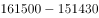
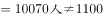
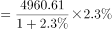
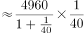
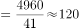
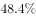
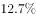
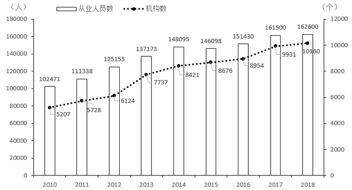

# 综合判断（选非题）——同比增量与图表数值核对

考点：[[20-考点/资料分析/综合/综合判断（选非题）——同比增量与图表数值核对|综合 / 综合判断（选非题）——同比增量与图表数值核对]]
材料：[[15-材料/资料分析/247412 以2018年为重点、回溯2010—2|247412 以2018年为重点、回溯2010—2]]

**问法模型**：题干问'不能推出的是'（选非题）→ 将四个选项的'年份+指标+数值'逐一与文字/图形对应数据做差或比大小，与材料矛盾的一项即答案

## 推理链
1. 第1步：题干为选非题，需对A—D逐项核对，找出唯一与材料矛盾的选项
2. 第2步：A项查图形点线系列，机构数由2010年5207个依次为5728、6124、7737、8421、8676、8954、9931、10160个，2011—2018年逐年上升，A可推出
3. 第3步：B项查文字，2018年末博物馆4918个＞文物保护管理机构3550个，B可推出
4. 第4步：C项查图形柱状系列，2017年末从业人员161500人、2016年末151430人，161500-151430=10070人，并非1100人，C不可推出
5. 第5步：'1100人'实为2018年末同比增量（162600-161500=1100人，对应文字'比上年末增加0.11万人'），C把2018年增量错安到2017年，属时间错位
6. 第6步：D项按官方解析用增长量公式计算，2018年末藏品4960.61万件比上年末增加超过100万件，D可推出
7. 第7步：四项中仅C与材料数据矛盾，且本题为选非题，故正确答案为C

**最快解法**：⚡ 选非题优先验证含具体数字的选项：C项直接读图做差，161500-151430=10070人，与1100人相差近10倍，一眼证伪C；同时识别'1100人'正是2018年增量162600-161500（即文字0.11万人）的数值迁移；A看折线是否单调走高、B比较4918与3550大小即可，无需细算D

## 易错点
- ⚠ 时间错位：C中'1100人'是2018年末的同比增量（162600-161500=1100人，即文字'0.11万人'），而2017年末实际增量为161500-151430=10070人，年份安错即中招
- ⚠ 单位换算：文字用'万人'（0.11万人=1100人）、图形用'人'，量级需统一，勿把0.11万误读成极小差异
- ⚠ 选非题惯性错误：本题求'不能推出'，误按'选正确项'作答会错选A/B/D；另A项机构数应读点线（右轴，个），勿错读左轴柱状人数

## 母题抽象
> 🧩 当题干出现'不能推出/说法错误'的选非判断特征时，先攻含具体数值的选项：从图中读相邻两年数据直接做差，核查'时间点+指标+数值'三要素是否错位（尤其'比上年增加××'类描述易把现期年增量安到上一年），与材料不符者即为答案

**同类特征**：选非题（不能推出）、从业人员同比增量、比上年增加、0.11万人=1100人、2017年末vs2018年末时间错位、图形逐年读数做差验证

## 相关题
- [[10-真题/资料分析/增长/2367786 增长量计算（增长量=现期×r-(1+r)）|2367786]]（江苏 2019，相关度1）
- [[10-真题/资料分析/综合/5746653 综合分析选非题（增长量计算与位次比较混合验证）|5746653]]（江苏 2023，相关度1）
- [[10-真题/资料分析/增长/3523612 增长量计算（区间判定）|3523612]]（四川 2021，相关度1）
- [[10-真题/资料分析/增长/2144617 同比增长率比较（增长量÷基期量，基期=现期-增长量）|2144617]]（选调 2018，相关度1）
- [[10-真题/判断推理/逻辑判断/11367778 分析推理-匹配类（人-专业-书两两匹配+排除法）|11367778]]（江苏 2025，相关度1）

---

### 题干
从上述材料不能推出的是

### 选项
- A. 2011-2018年全国文物机构数呈逐年增加的态势
- B. 2018年末全国博物馆数量比文物保护管理机构数量多
- C. 2017年末全国文物机构从业人员比上年末增加1100人　✅
- D. 2018年末全国文物机构拥有文物藏品比上年末增加100多万件

### 官方解析

A项：定位图形资料可知，2011-2018年全国文物机构数逐年增加，正确。

B项：定位文字资料可得，2018年末，全国文物保护管理机构3550个，博物馆4918个，博物馆数量多于文物保护管理机构数量，正确。

C项：定位图形资料可得，2017年末全国文物机构从业人员数为161500人，2016年末为151430人，人，错误。

D项：定位文字资料可得，2018年末全国文物机构拥有文物藏品4960.61万件，比上年末增长。根据公式：增长量，可得所求增长量万件，正确。

本题为选非题，故正确答案为C。

### 给定材料

        2018年末，全国共有各类文物机构10160个，比上年末增加229个。其中，文物保护管理机构3550个，占；博物馆4918个，占。全国文物机构从业人员16.26万人，比上年末增加0.11万人。其中，高级职称占，中级职称占。全国文物机构拥有文物藏品4960.61万件，比上年末增长。其中，博物馆文物藏品3754.25万件，文物商店文物藏品751.40万件。

图  2010—2018年全国文物机构及其从业人员情况

> [!warning] 疑点（官方解析可能有误，待人工复核）
> 材料导读称图中2018年较2017年精确差值为'162600-161500=1610人'，实为1100人（与文字'0.11万人'一致），属导读笔误，不影响本题答案；另D项官方解析依赖文字中被挖空的藏品增长率，给定文本无法完整复算，按官方结论采信

<!-- CODEX-ANSWER-REVIEW:BEGIN -->
### 本次独立复核

**复核状态：** `resolved`（答案与解析已核定）

**计分答案：** C（可计分）

**复核解析：**

1. 第1步：题干为选非题，需对A—D逐项核对，找出唯一与材料矛盾的选项
2. 第2步：A项查图形点线系列，机构数由2010年5207个依次为5728、6124、7737、8421、8676、8954、9931、10160个，2011—2018年逐年上升，A可推出
3. 第3步：B项查文字，2018年末博物馆4918个＞文物保护管理机构3550个，B可推出
4. 第4步：C项查图形柱状系列，2017年末从业人员161500人、2016年末151430人，161500-151430=10070人，并非1100人，C不可推出
5. 第5步：'1100人'实为2018年末同比增量（162600-161500=1100人，对应文字'比上年末增加0.11万人'），C把2018年增量错安到2017年，属时间错位
6. 第6步：D项按官方解析用增长量公式计算，2018年末藏品4960.61万件比上年末增加超过100万件，D可推出
7. 第7步：四项中仅C与材料数据矛盾，且本题为选非题，故正确答案为C

**最快解法**：⚡ 选非题优先验证含具体数字的选项：C项直接读图做差，161500-151430=10070人，与1100人相差近10倍，一眼证伪C；同时识别'1100人'正是2018年增量162600-161500（即文字0.11万人）的数值迁移；A看折线是否单调走高、B比较4918与3550大小即可，无需细算D

**相关信息：**

考點：综合判断（选非题）——同比增量与图表数值核对。來源：2020年江苏省公务员录用考试《行测》题（C类）（网友回忆版）；2020年。> 🧩 当题干出现'不能推出/说法错误'的选非判断特征时，先攻含具体数值的选项：从图中读相邻两年数据直接做差，核查'时间点+指标+数值'三要素是否错位（尤其'比上年增加××'类描述易把现期年增量安到上一年），与材料不符者即为答案

**同类特征**：选非题（不能推出）、从业人员同比增量、比上年增加、0.11万人=1100人、2017年末vs2018年末时间错位、图形逐年读数做差验证

**题源依据：** [固定版本原题](https://github.com/Mentat-Uran/kaogongzhentizhengliu/blob/84ab93d4b64b61d897bece8a1c0a5bab06b4feb2/10-%E7%9C%9F%E9%A2%98/%E8%B5%84%E6%96%99%E5%88%86%E6%9E%90/%E7%BB%BC%E5%90%88/2452738%20%E7%BB%BC%E5%90%88%E5%88%A4%E6%96%AD%EF%BC%88%E9%80%89%E9%9D%9E%E9%A2%98%EF%BC%89%E2%80%94%E2%80%94%E5%90%8C%E6%AF%94%E5%A2%9E%E9%87%8F%E4%B8%8E%E5%9B%BE%E8%A1%A8%E6%95%B0%E5%80%BC%E6%A0%B8%E5%AF%B9.md)；固定内容 commit `84ab93d4b64b61d897bece8a1c0a5bab06b4feb2`，Markdown blob `6e37ba4ec2c6290a7f5285179ee8273b44a956ad`。
<!-- CODEX-ANSWER-REVIEW:END -->
