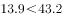
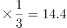
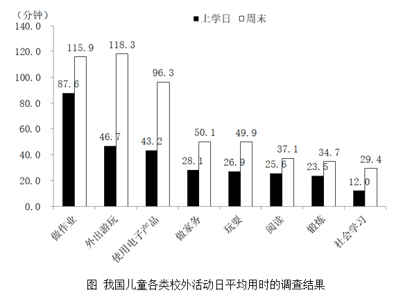

# 综合分析-能够推出判断（数据口径可得性检验+临界值比较）

考点：[[20-考点/资料分析/综合/综合分析-能够推出判断（数据口径可得性检验+临界值比较）|综合 / 综合分析-能够推出判断（数据口径可得性检验+临界值比较）]]
材料：[[15-材料/资料分析/247415 全国10个市'我国儿童校外生活状况'|247415 全国10个市'我国儿童校外生活状况']]

**问法模型**：题干'从上述调查资料中能够推出的是'→综合分析逐项双检模型：每个选项先查材料是否提供其所需口径的数据（缺口径即'无法推出'），再对可算项用临界值法验证数值真假

## 推理链
1. 第1步：从文字提取核心数据链：有效问卷15000份；上学日儿童日均使用电子产品43.2分钟，其中学习13.9分钟、娱乐16.6分钟；周末乡镇儿童108.2分钟、市区儿童88.4分钟
2. 第2步：A项检验：按官方口径'很重视'占80%以上，人数=15000×80%=12000人以上，即超过12000人，与选项'不足12000人'矛盾，A错误
3. 第3步：B项检验：材料仅给出'周末'乡镇108.2与市区88.4的拆分，无上学日的乡镇/市区数据，无法求两者整体'日平均'用时之比，B无法推出
4. 第4步：C项检验：娱乐16.6分钟是上学日全部儿童的均值，材料未给乡镇拆分，17.3分钟无任何数据来源，C无法推出
5. 第5步：D项检验：上学日使用电子产品用时的三分之一=43.2÷3=14.4分钟，学习用时13.9<14.4，确为不足三分之一，D正确
6. 第6步：仅D项可由材料数据推出，对照选项选定D

**最快解法**：⚡ 排除法+临界值法：先扫D项（唯一有完整数据可算的选项），43.2÷3=14.4，13.9<14.4即刻判真；A/B/C三项共用'数据口径缺口'排除法——A依赖占比数值、B缺上学日乡镇/市区拆分、C缺娱乐的乡镇拆分，凡材料未提供该口径数据者一律'无法推出'

## 易错点
- ⚠ B项口径陷阱：108.2与88.4只是'周末'的乡镇/市区拆分，勿当成整体日平均直接相比（88.4/108.2≈0.82也并非'不及一半'的依据）；因缺上学日拆分，整体日平均之比无法求，选B即错
- ⚠ C项陷阱：16.6分钟为全部儿童上学日娱乐均值，勿试图用43.2-13.9-16.6=12.7分钟（用途未给出的部分）去拼凑17.3；乡镇拆分缺失，属凭空造数
- ⚠ D项临界值易误判：43.2÷3=14.4，13.9仅比14.4小0.5分钟，必须精确计算，粗估'13.9≈三分之一'易错判为超过

## 母题抽象
> 🧩 当题干出现'能够推出的是/可以推出的是'特征时，用逐项双检法：先验数据可得性（材料未给该口径→'无法推出'，常作为2~3个干扰项），再对可算项用临界值法（比较部分量与总量÷N，如13.9 vs 43.2÷3=14.4）验证真伪

**同类特征**：'从上述调查资料中能够推出的是'（综合分析问法）、问卷数×比重求人数（15000份）、乡镇/市区口径拆分数据（108.2/88.4）、部分量占总量的比例判定（13.9/43.2）、四个选项真假混合、含'无法推出'型干扰项、跨文字+图表拼数据

## 相关题
（暂无）

---

### 题干
从上述调查资料中能够推出的是

### 选项
- A. 
对儿童校外生活表示“很重视”的家长不足12000人

- B. 
市区儿童日平均使用电子产品的用时不及乡镇儿童的

- C. 
乡镇儿童上学日利用电子产品看动画等娱乐的平均用时17.3分钟

- D. 
儿童上学日利用电子产品学习的用时不足使用电子产品用时的三分之一
　✅

### 官方解析

A项：定位文字资料“回收有效问卷15000份······对儿童校外生活表示“很重视”的家长占以上”，则所求家长人数人，超过12000人，错误。

B项：结合文字资料和图形资料，资料仅给出周末乡镇儿童与市区儿童使用电子产品的日平均用时，以及全部儿童上学日与周末日平均用时，无法推出市区儿童与乡镇儿童的日平均使用电子产品的用时，错误。

C项：文字资料仅给出上学日全部儿童利用电子产品看动画等娱乐的日平均用时，无法推出乡镇儿童的日平均用时，错误。

D项：定位文字资料可知，上学日，儿童日平均使用电子产品用时43.2分钟，其中利用电子产品学习用时13.9分钟，，正确。

故正确答案为D。

### 给定材料

        某研究机构从全国随机抽取10个市的儿童家长，对其进行“我国儿童校外生活状况”的问卷调查，回收有效问卷15000份。调查结果显示：对儿童校外生活表示“很重视”的家长占以上，表示“很满意”或“比较满意”的占；上学日，儿童日平均使用电子产品用时43.2分钟，其中利用电子产品学习用时13.9分钟，看动画等娱乐用时16.6分钟；周末，乡镇儿童日平均使用电子产品用时108.2分钟，市区儿童88.4分钟。

> [!warning] 疑点（官方解析可能有误，待人工复核）
> 材料导读标注文字中'很重视'占比数值留空（'占__以上'），官方解析A项却直接得出人数超过12000人，推断原题文字应为'占80%以上'（15000×80%=12000）；按本份留空文本A项严格不可验证，但按官方口径A错误成立，不影响D为正确答案

<!-- CODEX-ANSWER-REVIEW:BEGIN -->
### 本次独立复核

**复核状态：** `confirmed`（独立复算确认答案）

**计分答案：** D（可计分）

**复核解析：**

上学日学习用时占电子产品使用总时长=13.9/43.2≈32.18%，低于三分之一，D成立。A按“很重视”比例折算超过12000；市区/乡镇总时长比88.4/108.2≈81.7%，不低于80%；乡镇娱乐子项时长没有给出。

**相关信息：**

独立复核：按题干定义逐项检验，关键基数、比值、增速与图表读数写明以便复算。

**题源依据：** [固定版本原题](https://github.com/Mentat-Uran/kaogongzhentizhengliu/blob/84ab93d4b64b61d897bece8a1c0a5bab06b4feb2/10-%E7%9C%9F%E9%A2%98/%E8%B5%84%E6%96%99%E5%88%86%E6%9E%90/%E7%BB%BC%E5%90%88/2452784%20%E7%BB%BC%E5%90%88%E5%88%86%E6%9E%90-%E8%83%BD%E5%A4%9F%E6%8E%A8%E5%87%BA%E5%88%A4%E6%96%AD%EF%BC%88%E6%95%B0%E6%8D%AE%E5%8F%A3%E5%BE%84%E5%8F%AF%E5%BE%97%E6%80%A7%E6%A3%80%E9%AA%8C%2B%E4%B8%B4%E7%95%8C%E5%80%BC%E6%AF%94%E8%BE%83%EF%BC%89.md)；固定内容 commit `84ab93d4b64b61d897bece8a1c0a5bab06b4feb2`，Markdown blob `6bd5d5f7806abdbb46354d711bc6fea9d1fb9b19`。
<!-- CODEX-ANSWER-REVIEW:END -->
