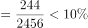
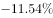
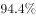

# 综合判断选非题（比重临界比较+增速正负核对+降幅绝对值比较+年末增速排序）

考点：[[20-考点/资料分析/综合/综合判断选非题（比重临界比较+增速正负核对+降幅绝对值比较+年末增速排序）|综合 / 综合判断选非题（比重临界比较+增速正负核对+降幅绝对值比较+年末增速排序）]]
材料：[[15-材料/资料分析/247456 截至2015年12月底北京市文化及相|247456 截至2015年12月底北京市文化及相]]

**问法模型**：'下列表述中错误的是'→ 综合判断选非题，逐项核对：A项用新设数÷年末总数与'一成(10%)'临界比较，B项查增速是否均>0，C项对负增速取绝对值比降幅，D项按年末增速列排序取前三

## 推理链
1. 第1步：A项从表格提取：文化休闲娱乐服务业年末企业总数2456户、全年新设企业数244户
2. 第2步：用比重公式：新设占年末总数比重=244÷2456，与一成(10%)比较
3. 第3步：2456×10%=245.6>244，故244÷2456≈9.93%<10%，即不足一成，A项'一成以上'说法错误
4. 第4步：B项核对年末企业总数·增速列：10个行业增速均为正（最低为文化专用设备1.12%），说明各行业企业数都比上年增加，表述正确
5. 第5步：C项核对新设增速列中负值行业：文化休闲娱乐-10.95%、文化创意和设计-14.05%、文化专用设备-17.95%、文化用品-32.65%、工艺美术品-9.29%、文化产品辅助生产-11.54%，降幅（绝对值）最大为文化用品生产32.65%，表述正确
6. 第6步：D项按年末增速排序：广播电视电影94.40%>文化艺术服务22.87%>工艺美术品20.38%>文化用品12.16%等，前三名与表述一致，表述正确
7. 第7步：本题为选非题，仅A项表述错误，故正确答案为A

**最快解法**：⚡ 临界比较法秒杀A项：2456的10%=245.6户，而新设仅244户<245.6，占比必不足一成，A即错；选非题优先做计算量最小的A项即可锁定答案，BCD只需粗核（B增速全为正、C负增速比绝对值、D年末增速列排序）无需精算

## 易错点
- ⚠ A项临界陷阱：244÷2456≈9.93%极度贴近10%，粗算易误判为'一成以上'，必须用2456×10%=245.6与244精确比较
- ⚠ C项'降幅'比较的是增速的绝对值：-32.65%降幅最大，若按代数值大小（负大反而小）会误判
- ⚠ D项排序必须用'年末企业总数·增速'列，若误用'全年新设企业数·增速'列（454.17%、337.78%）会得出错误的前三行业；选非题找出错误项即为答案，勿把正确表述项当答案

## 母题抽象
> 🧩 当题干出现'表述错误/不正确的是'综合判断题时，先验证含具体数值且计算量最小的选项（比重与整十临界比较：分母×10%与分子直接比大小），再用增速正负号、降幅取绝对值、对应列排序逐项核对其余选项

**同类特征**：表述中错误的是、选非题、各行业企业表述、一成以上（10%临界）、降幅最大、增速最快的三个行业

## 相关题
- [[10-真题/资料分析/综合/250219 综合分析选非题（图表数据可推断性判断）|250219]]（深圳市考 2008，相关度1）
- [[10-真题/资料分析/综合/10297333 综合分析选非题（同比增速逐年比较+年均增长量+比重百分点还原）|10297333]]（浙江 2025，相关度1）
- [[10-真题/资料分析/综合/14355349 综合分析-选非题（增长率计算比较+人均值计算）|14355349]]（浙江 2024，相关度1）
- [[10-真题/资料分析/综合/17097816 综合判断·选非题（增长率与增长量偷换）|17097816]]（山西 2024，相关度1）
- [[10-真题/资料分析/综合/2052088 综合分析-选非题（趋势判断+增速排序+增长量比较+增长率计算逐项核对）|2052088]]（吉林 2017，相关度1）

---

### 题干
下列有关北京市文化及相关产业各行业企业的表述中，错误的是：

### 选项
- A. 截至2015年12月底文化休闲娱乐服务业的企业中，一成以上为2015年新设企业　✅
- B. 截止2015年12月底北京市文化及相关产业各行业企业数量都比上年有一定增加
- C. 北京市文化及相关产业各行业中，在2015年新设企业户数同比降幅最大的行业是文化用品的生产业
- D. 截至2015年12月底企业数量同比增速最快的三个行业是广播电视电影服务业、文化艺术服务业、工艺美术品的生产业

### 官方解析

A项：定位表格可得，文化休闲娱乐服务业2015年年末企业总数为2456户，全年新设企业数为244户。根据公式：比重，则所求，即不足一成，错误；

B项：定位表格可得，截至2015年12月底，北京市文化及相关产业各行业企业总数同比增速均大于0，说明企业数量都比上年有一定增加，正确；

C项：定位表格可得，2015年新设企业户数同比增速为负数的行业有：文化休闲娱乐服务（）、文化创意和设计服务（）、文化专用设备的生产（）、文化用品的生产（）、工艺美术品的生产（）、文化产品生产的辅助生产（），降幅比较的是增长率的绝对值，则降幅最大的为文化用品生产业，正确；

D项：定位表格可得，2015年各行业年末企业总数同比增速最快的三个行业是广播电视电影服务（）、文化艺术服务（）和工艺美术品的生产（），正确。

本题为选非题，故正确答案为A。

### 给定材料

        截至2015年12月底，北京市文化及相关产业企业共有198948户，同比增长，占全市企业总数的；2015年新设文化及相关产业企业30323户，同比增长。

