# 综合判断题（基期量折算＋城镇化率拆人口比＋增长率判定＋每百户换算，四选项逐项验证）

考点：[[20-考点/资料分析/综合/综合判断题（基期量折算＋城镇化率拆人口比＋增长率判定＋每百户换算，四选项逐项验证）|综合 / 综合判断题（基期量折算＋城镇化率拆人口比＋增长率判定＋每百户换算，四选项逐项验证）]]
材料：[[15-材料/资料分析/247457 A自治区2012~2016年末城镇与|247457 A自治区2012~2016年末城镇与]]

**问法模型**：“能够从上述资料中推出的是”→逐项验证型综合判断：基期量=现期÷(1+增长倍数)、人口比=城镇化率÷(1−城镇化率)、增长率=(现−基)÷基、每6户拥有量=每百户×6÷100，逐一核算后排除。

## 推理链
1. 第1步：A项取文字段：2016年末城镇人均居住面积32.20平方米、比1978年末增长5.5倍（增长幅度），故1978年末城镇人均居住面积=32.20÷(1+5.5)=32.20÷6.5≈4.95平方米。
2. 第2步：1985年末农村牧区基期量=27.40÷(1+增长倍数)，官方按原卷数据核算该值大于4.95平方米（给定原文该倍数留空，不得臆造），故1978年城镇<1985年农村牧区，A项“高于”不成立，错误。
3. 第3步：B项：城镇人口1542.1万人，农村牧区人口占比=1−城镇化率，城镇/农村牧区=城镇化率÷(1−城镇化率)，数学上仅当城镇化率>66.7%才超2倍；官方按原卷城镇化率核算不足2倍（给定材料中该数值留空），B错误。
4. 第4步：C项取表格：城镇每百户移动电话2016年末222.21部、2012年末206.11部，增长率=(222.21−206.11)÷206.11=16.10÷206.11≈7.8%，未达到选项“8%以上”，C错误。
5. 第5步：D项取表格：2014年末农村牧区平均每百户家用汽车17.12辆，每6户拥有量=17.12×6÷100=1.03辆>1辆，D正确。
6. 第6步：综上仅D项能从资料推出，正确答案为D。

**最快解法**：⚡ 先验计算量最小的D项：17.12辆/每百户→每户约0.17辆，×6≈1.03辆>1辆，D成立即锁定答案，无需逐项排查；若需排他，A项32.2÷6.5≈5（截位直除），远小于2016年农村牧区27.4的任何合理基期；C项16.1/206.11≈7.8%（百化分：16.1约为206的8%不到）快速排除。

## 易错点
- ⚠ “比1978年末增长5.5倍”是增长幅度而非倍数：基期=32.20÷6.5≈4.95，误用32.20÷5.5≈5.85会高估基期（结论方向虽不变但模型错误）。
- ⚠ C项“户均”与“每百户”口径：表格给每百户222.21/206.11部，两年同除100不影响增长率，可直接作差作比；真正陷阱是算出7.8%后误判“达到8%”。
- ⚠ “每6户拥有量”必须×6÷100换算，直接用17.12会放大百倍；另B项城镇化率、A项1985年增长倍数在给定原文留空，不得凭空补数，须以原卷完整数据为准。

## 母题抽象
> 🧩 当综合判断题问“能够推出的是”时，优先验证数据最全、计算量最小的选项（如“每N户拥有量”用每百户×N÷100一步判定），成立即锁定；其余按基期=现期÷(1+增长倍数)、城镇化率拆人口比、“增长了X%以上”比增长率快速排错。

**同类特征**：能够从上述资料中推出的是、四选项跨考点：基期折算/人口倍数/增长率阈值/每百户换算、“比某年末增长5.5倍”求基期、城镇化率拆分城镇与农村牧区人口、“增长了…以上”增长率判定、“每6户拥有量”=每百户×6÷100

## 相关题
- [[10-真题/资料分析/综合/19283943 综合分析判断题（倍数比较+求和判断+隐含平均每场座位数反推）|19283943]]（国考 2025，相关度1）
- [[10-真题/资料分析/综合/1796162 综合判断（月均计算、平均运输距离、比重对比、增长量比较逐项验证）|1796162]]（贵州 2016，相关度1）
- [[10-真题/资料分析/综合/2133504 综合判断题（现期比重+现期平均数多项验证，一对三错）|2133504]]（国考 2018，相关度1）
- [[10-真题/资料分析/综合/2444706 综合判断题（增长量+比重+倍数逐项验证）|2444706]]（四川 2019，相关度1）
- [[10-真题/资料分析/综合/2571728 综合分析逐项判断（等差递推求和＋单位换算＋比值估算）|2571728]]（山东 2020，相关度1）

---

### 题干
关于A自治区的以下信息，能够从上述资料中推出的是

### 选项
- A. 
1978年末城镇人均居住面积高于1985年末农村牧区人均居住面积

- B. 
2016年末城镇人口数量是农村牧区人口数量的2倍以上

- C. 
2016年末城镇居民户均移动电话拥有量比2012年末增长了以上

- D. 
2014年末农村牧区平均每6户农牧民拥有的汽车数量在1辆以上
　✅

### 官方解析

A项：定位文字材料第二段“2016年末A自治区城镇人均居住面积达32.20平方米，比1978年末增长了5.5倍；农村牧区人均居住面积达27.40平方米，比1985年末增长”，则1978年末城镇人均居住面积为：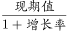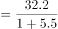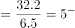平方米；1985年末农村牧区人均居住面积为：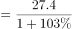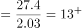平方米，因此前者小于后者，错误；

B项：定位文字材料第一段“2016年末，A自治区城镇人口为1542.1万人，城镇化率(城镇人口占总人口比重)为”，则2016年末农村牧区人口占比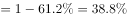，2016年末城镇人口数量是农村牧区人口数量的倍数为：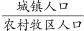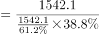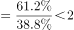，错误；

C项：定位表格，2016年末、2012年末城镇居民户均移动电话拥有量分别为222.21部、206.11部，则2016年增长率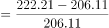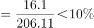，错误；

D项：定位表格，2014年末农村牧区平均每百户家用汽车拥有量为17.12辆，则平均每6户农牧民拥有的汽车数量为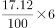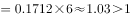辆，正确。

故正确答案为D。

### 给定材料

        2016年末，A自治区城镇人口为1542.1万人，城镇化率(城镇人口占总人口比重)为。

        2016年末A自治区城镇人均居住面积达32.20平方米，比1978年末增长了5.5倍；农村牧区人均居住面积达27.40平方米，比1985年末增长。2016年末A自治区城镇居民家庭每百户拥有家用汽车38.48辆、家用电脑62台、移动电话222.21部；农牧民家庭每百户拥有家用汽车27.29辆、家用电脑23台、移动电话231.53部。

