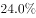
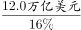
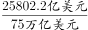
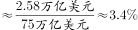
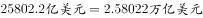
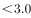

# 综合判断题（逐条验证可推出条数：折线图逐年比较+比重反推+表格排序计数）

考点：[[20-考点/资料分析/综合/综合判断题（逐条验证可推出条数：折线图逐年比较+比重反推+表格排序计数）|综合 / 综合判断题（逐条验证可推出条数：折线图逐年比较+比重反推+表格排序计数）]]
材料：[[15-材料/资料分析/247460 2016年“一带一路”沿线64国的G|247460 2016年“一带一路”沿线64国的G]]

**问法模型**：题干出现'以下信息可从资料中推出的有几条'→对①②③逐条独立验证真假/可推性（读图比较、反推比重、排序计数），数出正确条数对照选项

## 推理链
1. 第1步：①读折线图，2011-2016年贸易占全球份额依次为23.3%、24.0%、24.0%、23.9%、22.1%、21.7%，2013年与2012年持平于24.0%，并非每年均低于上年，①错误
2. 第2步：②取表格'总计'行：东南亚11国GDP合计25802.2亿美元≈2.58万亿美元；文字给出沿线64国GDP为12.0万亿美元且占全球GDP一固定比重（本材料数值空缺，官方解析按原题16.0%口径），反推全球GDP=12.0÷16%=75万亿美元
3. 第3步：东南亚GDP占全球比重=2.58÷75≈3.4%；官方基准放缩：全球GDP的16%=12.0万亿美元，则4%=3.0万亿美元，2.58万亿美元<3.0万亿美元，比重不到4%，不在4%~5%之间，②错误
4. 第4步：③读表格人口列，最多的2国为印度尼西亚25380.2万人、菲律宾10419.5万人
5. 第5步：逐国加总进出口额：新加坡2968.9+3468.1=6437.0、泰国1957.4+2136.1=4093.5、越南1909.5+1865.0=3774.5居前三；印尼1426.9+1502.8=2929.7、菲律宾859.4+563.1=1422.5均未进前三，③正确
6. 第6步：可推出的仅③共1条，对照选项选B

**最快解法**：⚡ 逐条排除法+基准放缩：①零计算看图——2012与2013均为24.0%持平，直接排除；③零计算看表——人口列前二（印尼25380.2、菲律宾10419.5）与出口额前三（新加坡3468.1、泰国2136.1、越南1865.0）无重合，③成立；②用'找标尺'——16%↔12.0万亿美元→4%↔3.0万亿美元>东南亚2.58万亿美元，比重<4%排除；先做①③再验②，仅1条可推出选B

## 易错点
- ⚠ ①漏看折线图2012、2013均为24.0%持平（且纵轴从21.5%非0起点，视觉放大跌幅），误判'每年低于上年'成立
- ⚠ ②单位与范围双重陷阱：表格总计25802.2亿美元须换算为2.58万亿美元与文字12.0万亿美元同口径，且表格'总计'是东南亚11国、不等于沿线64国，不能用2.58/12.0当占全球比重；本材料文字中GDP占全球比重数值空缺，须依官方解析原题口径（16.0%）反推全球GDP
- ⚠ ③进出口列序为'先进后出'，若只看单列（出口口径前三为新、泰、马）或看反列名易出错，应逐国加总进口+出口比较，印尼、菲律宾在任何口径下均不在前三

## 母题抽象
> 🧩 当题干出现'可从资料中推出几条'时，先做零计算条目（读图逐年比较、表格最值与排序计数），再做需反推条目（部分÷占比=整体，再取整数比例作标尺放缩验证区间），最后数正确条数对照选项

**同类特征**：可从资料中推出的有几条、占全球份额均低于上年水平（折线逐年比较）、比重在…之间（区间/放缩判断）、人口最多的2个国家（表格最值定位）、进出口总额均未排进前三（排序计数）、跨文字+表格混合验证

## 相关题
（暂无）

---

### 题干

以下信息，可从资料中推出的有几条：

①2012-2016年，每年“一带一路”沿线国家对外贸易占全球份额均低于上年水平

②2016年东南亚“一带一路”沿线国家GDP占全球GDP的比重在-之间

③2016年东南亚“一带一路”沿线国家中，人口最多的2个国家进出口总额均未排进前三

### 选项
- A. 0
- B. 1　✅
- C. 2
- D. 3

### 官方解析

①定位折线图，发现2012年和2013年“一带一路”沿线国家对外贸易占全球份额是不变的，均为，不满足均低于上年水平，因此说法错误；

②方法一：定位表格，已知2016年东南亚“一带一路”沿线国家GDP合计为25802.2亿美元；定位文字材料，已知2016年“一带一路”沿线64个国家GDP之和约为12.0万亿美元，占全球GDP的。那么2016年全球GDP为万亿美元，那么所求比重为，不在～之间，因此说法错误。

方法二：定位表格，已知2016年东南亚“一带一路”沿线国家GDP合计为25802.2亿美元；定位文字材料，已知2016年“一带一路”沿线64个国家GDP之和约为12.0万亿美元，占全球GDP的。全球GDP的为12.0万亿美元，全球GDP的为3.0万亿美元，万亿美元，说明不到，因此说法错误；

③定位表格，发现2016年东南亚“一带一路”沿线国家中，人口数最多的2个国家分别是印度尼西亚和菲律宾，进出口总额排在前三名的国家分别是新加坡、泰国、越南，印度尼西亚和菲律宾均未排进前三名，因此说法正确。能推出的只有③。

故正确答案为B。

### 给定材料

        2016年“一带一路”沿线64个国家GDP之和约为12.0万亿美元，占全球GDP的；人口总数约为32.1亿人，占全球人口的；对外贸易总额约为71885.5亿美元，占全球贸易总额的。

> [!warning] 疑点（官方解析可能有误，待人工复核）
> 本材料文字中三处'占全球比重'数值均空缺，官方解析②按原题口径（占全球GDP16.0%）反推全球GDP=75万亿美元；但无论②按'计算结果错误'还是'数据缺失无法推出'处理，均不计入可推出条数，不影响正确答案B

<!-- CODEX-ANSWER-REVIEW:BEGIN -->
### 本次独立复核

**复核状态：** `resolved`（答案与解析已核定）

**计分答案：** B（可计分）

**复核解析：**

①不成立：贸易占全球比重2011—2016年为23.3%、24.0%、24.0%、23.9%、22.1%、21.7%；2013年与2012年相等，并非低于。②不成立：全球GDP=12.0万亿美元/16%=75万亿美元；东南亚GDP=2.58022万亿美元，占比2.58022/75≈3.44%，低于4%。③成立：人口最多的印尼、菲律宾进出口总额分别2929.7、1422.5亿美元，均未进入前三；前三为新加坡6437.0、泰国4093.5、越南3774.5亿美元。仅一项成立，按原选项对应答案B。

**修订材料：**

恢复固定公式图数据：全球GDP、人口、贸易占比分别为16.0%、43.4%、21.7%；选项②比较阈值为4%—6%。东南亚11国2016年GDP合计25802.2亿美元。表中进口/出口额（亿美元）：新加坡2968.9/3468.1，泰国1957.4/2136.1，越南1909.5/1865.0，马来西亚1685.4/1895.7，印度尼西亚1426.9/1502.8，菲律宾859.4/563.1。

**相关信息：**

资料分析—份额、基期总量反推及排序；比例分子分母统一单位，进出口总额需先将进出口相加。

**题源依据：** [固定版本原题](https://github.com/Mentat-Uran/kaogongzhentizhengliu/blob/84ab93d4b64b61d897bece8a1c0a5bab06b4feb2/10-%E7%9C%9F%E9%A2%98/%E8%B5%84%E6%96%99%E5%88%86%E6%9E%90/%E7%BB%BC%E5%90%88/2453192%20%E7%BB%BC%E5%90%88%E5%88%A4%E6%96%AD%E9%A2%98%EF%BC%88%E9%80%90%E6%9D%A1%E9%AA%8C%E8%AF%81%E5%8F%AF%E6%8E%A8%E5%87%BA%E6%9D%A1%E6%95%B0%EF%BC%9A%E6%8A%98%E7%BA%BF%E5%9B%BE%E9%80%90%E5%B9%B4%E6%AF%94%E8%BE%83%2B%E6%AF%94%E9%87%8D%E5%8F%8D%E6%8E%A8%2B%E8%A1%A8%E6%A0%BC%E6%8E%92%E5%BA%8F%E8%AE%A1%E6%95%B0%EF%BC%89.md)；固定内容 commit `84ab93d4b64b61d897bece8a1c0a5bab06b4feb2`，Markdown blob `04c5df80174a7d453b981058671d3fcc2835c576`。
<!-- CODEX-ANSWER-REVIEW:END -->
