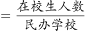
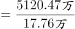
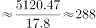
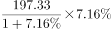
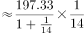
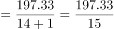
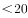
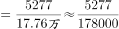
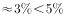

# 综合分析·能够推出型（现期平均数+增长量计算+比重计算+增速比较）

考点：[[20-考点/资料分析/综合/综合分析·能够推出型（现期平均数+增长量计算+比重计算+增速比较）|综合 / 综合分析·能够推出型（现期平均数+增长量计算+比重计算+增速比较）]]
材料：[[15-材料/资料分析/247461 2017年全国各级各类民办教育发展情|247461 2017年全国各级各类民办教育发展情]]

**问法模型**：'能够从上述资料中推出的是'→逐项套模型：A现期平均数=在校生总数÷学校总数、B增长量=现期×r/(1+r)、C比重=部分学校数÷民办学校总数、D增速直接比大小，证伪三项留一项

## 推理链
1. 第1步：从材料总述提取：2017年各级各类民办学校17.76万所（=177600所），各类民办教育在校生5120.47万人；再取分项：民办初中5277所、民办中职在校生197.33万人、民办普通小学在校生814.17万人、民办普通高中在校生306.26万人
2. 第2步：验A项（现期平均数）：平均每所民办学校在校生=5120.47万人÷17.76万所，分子分母'万'字相消≈288人/所<300人，A错误
3. 第3步：验B项（增长量）：民办中职在校生197.33万人、比上年增长r（r数值在完整材料中，本文缺失），增长量=197.33×r/(1+r)万人，官方结果不足20万人，B错误
4. 第4步：验C项（比重）：民办初中5277所÷民办学校总数177600所≈2.97%，低于选项图片所设比例线（官方判定不满足'以上'），C错误
5. 第5步：验D项（增速比较）：民办普通高中在校生306.26万人的同比增速（完整材料数值）大于民办普通小学在校生814.17万人的同比增速（完整材料数值），两个'在校生比上年增长'直接比大小即可，D正确
6. 第6步：排除A、B、C，故正确答案为D

**最快解法**：⚡ 免计算优先+一次除法定案：先看D——材料中高中与小学在校生的两个'比上年增长%'直接比大小（高中>小学），零计算；再秒A——'万人÷万所'万字自动抵消，5120.47÷17.76，因17.76×300=5328>5120.47，商必小于300；C截位直除5277/177600≈2.97%；B百化分用现期×r/(1+r)估算。考场按D→A→C→B顺序，两步即可锁定D

## 易错点
- ⚠ 单位量级陷阱：17.76万所=177600所，C项求比重前必须统一量级（A项因'万人÷万所'万字相消可免换算），直接用17.76会差1万倍
- ⚠ 口径混淆：A的分母是民办学校总数17.76万所（含幼儿园，不能用五个学段分项之和替代），C的分子分母同为'民办学校'内部口径，勿错接到'占全国学校总数'那个整体（且该比重数值缺失）
- ⚠ 同名'比上年增长'指向不同主体：学校数与在校生各有独立增速且方向可相反（中职学校数'下降'、在校生'增长'），D必须比较'在校生'的增速而非学校数增速，B只对在校生的正增长套现期×r/(1+r)

## 母题抽象
> 🧩 当题干出现'能够从上述资料中推出的是/说法正确的是'时，按'免计算的直接比较项→一步除法估算项（平均数、比重）→公式估算项（增长量=现期×r/(1+r)）'的顺序逐项证伪，剩余项即答案

**同类特征**：能够从上述资料中推出的是、平均每所民办学校在校生人数超过300人、同比增加了20多万人、占民办学校总数……以上、同比增速快于、四选项混合平均数/增长量/比重/增速比较

## 相关题
- [[10-真题/资料分析/综合/19283943 综合分析判断题（倍数比较+求和判断+隐含平均每场座位数反推）|19283943]]（国考 2025，相关度1）
- [[10-真题/资料分析/综合/1796162 综合判断（月均计算、平均运输距离、比重对比、增长量比较逐项验证）|1796162]]（贵州 2016，相关度1）
- [[10-真题/资料分析/综合/2133504 综合判断题（现期比重+现期平均数多项验证，一对三错）|2133504]]（国考 2018，相关度1）
- [[10-真题/资料分析/综合/2444706 综合判断题（增长量+比重+倍数逐项验证）|2444706]]（四川 2019，相关度1）
- [[10-真题/资料分析/综合/2571728 综合分析逐项判断（等差递推求和＋单位换算＋比值估算）|2571728]]（山东 2020，相关度1）

---

### 题干
能够从上述资料中推出的是

### 选项
- A. 
2017年平均每所民办学校在校生人数超过300人

- B. 
2017年民办中等职业学校在校生人数同比增加了20多万人

- C. 
2017年民办初中学校数量占民办学校总数的以上

- D. 
2017年民办普通高中在校生人数同比增速快于民办普通小学
　✅

### 官方解析

A项：定位文字材料，“2017年全国共有各级各类民办学校17.76万所（），······各类民办教育在校生达5120.47万人（），比上年增长”。根据现期平均数公式：，可以计算出2017年平均每所民办学校在校生人数人人。错误；

B项：定位文字材料，“2017年，······民办中等职业学校······在校生197.33万人，比上年增长”。根据增长量，可计算出2017年民办中等职业学校在校生人数同比增加了万人万人。错误；

C项：定位文字材料，“2017年全国共有各级各类民办学校17.76万所，······民办初中5277所”。根据公式：比重，可计算出2017年民办初中学校数量占民办学校总数的比重。错误；

D项：定位文字材料，“2017年民办普通小学在校生814.17万人，比上年增长；民办普通高中在校生306.26万人，比上年增长”。可知2017年民办普通高中在校生人数同比增速（）快于民办普通小学（）。正确。

故正确答案为D。

### 给定材料

        2017年全国共有各级各类民办学校17.76万所，占全国学校总数；各类民办教育在校生达5120.47万人，比上年增长。其中：民办幼儿园16.04万所，比上年增长；在园儿童2572.34万人，比上年增长。民办普通小学6107所，比上年增长；在校生814.17万人，比上年增长。民办初中5277所，比上年增长；在校生577.68万人，比上年增长。民办普通高中3002所，比上年增长；在校生306.26万人，比上年增长。民办中等职业学校2069所，比上年下降；在校生197.33万人，比上年增长。

> [!warning] 疑点（官方解析可能有误，待人工复核）
> 本题文本中全部同比增速、'占全国学校总数'比重及C项比例式的图片数值均缺失（官方解析中对应数值同样空缺），B、C、D无法在本档案内独立复算，仅能依官方结论判定A错（≈288<300）、B错（<20万）、C错、D对（高中在校生增速>小学在校生增速）；此系材料/解析传值缺失，不构成对D为唯一正确答案的质疑
