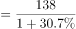
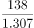
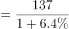
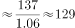
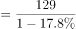
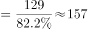

# 综合分析·选非题（混合增长率定性判断＋基期量＋直接读数排序）

考点：[[20-考点/资料分析/综合/综合分析·选非题（混合增长率定性判断＋基期量＋直接读数排序）|综合 / 综合分析·选非题（混合增长率定性判断＋基期量＋直接读数排序）]]
材料：[[15-材料/资料分析/248014 2018年1-11月我国互联网和相关|248014 2018年1-11月我国互联网和相关]]

**问法模型**：题干'以下说法不正确的是'→逐项验证：A/B用基期量=现期/(1+增长率)定量核对，C直接读数比较排序，D用混合增长率'总体居中'定性判错，锁定不正确项

## 推理链
1. 第1步：提取材料数据：截至2018年11月末部署服务器138万台（增速文本空缺）；1-11月数据中心收入137亿元（同比增长空缺）；接入业务收入129亿元同比下降（降幅空缺）；信息服务收入7615亿元，子项电商平台3212亿元、网络游戏1628亿元（增速均空缺）
2. 第2步：A项套基期量公式'基期=现期/(1+增长率)'，以原卷增速代入138万台，得2017年11月末服务器数量超过100万台，A表述正确
3. 第3步：B项分别算基期量：数据中心=137/(1+增速a)，接入=129/(1-降幅b)，比较得2017年1-11月数据中心收入少于接入业务收入，B表述正确
4. 第4步：C项直接读末段下载量排序：系统工具2892亿次＞金融1911亿次＞日常工具1212亿次＞电子商务999亿次（注意社交通讯同为1911亿次勿串行），C表述正确
5. 第5步：D项用混合增长率定性结论'总体增速必介于各部分增速之间'：信息服务（7615亿元）为总体，电商平台（3212亿元）、网络游戏（1628亿元）及其余子项为部分，故信息服务增速只能居于所有子业务增速的中间范围，不可能高于'所有'子业务，D表述错误
6. 第6步：本题选'不正确'项，锁定D

**最快解法**：⚡ 混合增长率定性秒杀＋排除法：先抓D项'高于其所有子业务'的绝对化表述，由'总体增速居中'结论直接判错秒选D；A、B用基期量公式快速估算排除（增长率部分/整体），C纯读数排除，全题几乎不需精确计算

## 易错点
- ⚠ 混合增长率方向判反：误以为'信息服务规模大、增速高'就高于全部子项；正确结论是总体增速必介于各部分之间（居中），'高于所有子项'必错
- ⚠ 指标层级嵌套与抄数串行：电商平台3212亿元、网络游戏1628亿元是信息服务7615亿元的子项，不可与业务总收入8518亿元混比（分业务之和7881<8518，不能加和反推）；下载量中社交通讯与金融同为1911亿次，抄数易串行，且1.75万亿次与亿次混用需换算17500亿
- ⚠ 选非题惯性＋增速空缺：按常规'选正确'做题会误判；文本中服务器/数据中心/接入增速数值空缺，A、B须以原卷完整数据代入，不能凭空补数，但D项可绕开数值用定性结论作答

## 母题抽象
> 🧩 当综合分析（选非）题出现'总体增速/指标值高于（或低于）其所有组成部分'的绝对化表述时，直接用混合增长率'总体居中'定性判错，无需具体增速数值即可秒杀

**同类特征**：以下说法不正确的是（选非）、混合增长率·总体居中、绝对化表述·高于所有子项、基期量=现期/(1+增长率)、直接读数比较排序、增速数值空缺·定性判断

## 相关题
- [[10-真题/资料分析/综合/2050552 综合分析（基期计算＋增速趋势判断＋口径辨析）|2050552]]（吉林 2017，相关度1）
- [[10-真题/资料分析/综合/12019694 综合分析选非题（基期量+人均反推人口+比重临界判断）|12019694]]（广东 2026，相关度1）
- [[10-真题/资料分析/综合/4708194 双口径差值方向判定（转入-转出）与转出比例比较·综合判断选非题|4708194]]（福建 2019，相关度1）
- [[10-真题/资料分析/增长/4714068 隔年基期量计算（增量+增速百分点差倒推）|4714068]]（福建 2018，相关度1）

---

### 题干
根据上述资料，以下说法不正确的是：

### 选项
- A. 截至2017年11月末，互联网企业部署的服务器数量超过100万台
- B. 2017年1-11月，互联网数据中心业务收入少于互联网接入业务
- C. 截至2018年11月底，应用下载量：系统工具类＞金融类＞日常工具类＞电子商务类
- D. 2018年1-11月，信息服务收入的同比增长率高于其所有子业务收入的同比增长率　✅

### 官方解析

A项：定位文字材料第四段，“···截至（2018年）11月末，部署的服务器数量达138万台，同比增长。”。根据公式：基期量，可计算出截至2017年11月末，互联网企业部署的服务器数量万台。即超过100万台，正确；

B项：定位文字材料第四段，“（2018年）1-11月，互联网企业完成互联网数据中心业务收入137万元，同比增长”；定位文字材料第五段，“（2018年）1-11月，互联网企业完成互联网接入业务收入129亿元，同比下降···”。根据公式：基期量，可计算出2017年1-11月，互联网数据中心业务收入亿元；互联网接入业务收入亿元。故前者少于后者，正确；

C项：定位文字材料最后一段，“截至（2018年）11月底······游戏类、系统工具类、影音播放类、社交通讯类、日常工具类、生活服务类和金融类应用下载量均超过千亿次，分别为3014亿次、2892亿次、2264亿次、1911亿次、1212亿次、1143亿次和1911亿次···。其余各类应用中，下载总量超过500亿次的应用还有电子商务类（999亿次）、···”。可知，截至2018年11月底，应用下载量：系统工具类（2892亿次）金融类（1911亿次）日常工具类（1212亿次）电子商务类（999亿次）。正确；

D项：定位文字材料第三段，“（2018年）1-11月，信息服务收入达7615亿元，同比增长，其中，电子商务平台收入3212亿元，同比增长；网络游戏（包括客户端游戏、手机游戏、网页游戏等）业务收入1628亿元，同比增长”，材料中虽然未给出其他子业务收入情况，但根据混合增长率的结论：总体的增长率大小居于所有部分增长率中间范围。可知，2018年1-11月，信息服务收入的同比增长率是居于所有子业务中间范围的，故不会高于其所有子业务收入的同比增长率。错误。

本题为选非题，故正确答案为D。

### 给定材料

        2018年1-11月，我国互联网和相关服务业发展态势良好，业务收入保持较快增长，盈利状况基本稳定。分领域看，网络销售、影音直播等应用深受用户欢迎，市场规模稳步扩大，网络生活服务市场活跃。

一、总体运行情况

        1-11月，我国规模以上互联网和相关服务企业（简称互联网企业）完成业务收入8518亿元，同比增长，增速较1-10月提高1.7个百分点，与去年同期基本持平。主要省份保持良好增长态势，互联网业务收入总量居前三位的广东、上海、北京互联网业务收入分别增长、和。

二、分业务运行情况

（一）信息服务业务

        1-11月，信息服务收入达7615亿元，同比增长，其中，电子商务平台收入3212亿元，同比增长；网络游戏（包括客户端游戏、手机游戏、网页游戏等）业务收入1628亿元，同比增长。

（二）互联网数据中心业务

        1-11月，互联网企业完成互联网数据中心业务收入137亿元，同比增长；截至11月末，部署的服务器数量达138万台，同比增长。

（三）互联网接入业务

        1-11月，互联网企业完成互联网接入业务收入129亿元，同比下降，降幅较上半年和前三季度分别收窄6.9个和5个百分点。

三、移动应用程序（APP）数量情况

        我国市场上移动互联网应用数量小幅增长。截至11月底，我国市场上监测到的移动应用为447万款。11月份，我国第三方应用商店与苹果应用商店中新上架14.3万款移动应用。截至11月底，我国本土第三方应用商店移动应用数量超过266万款，苹果商店（中国区）移动应用数量超过181万款。

        截至11月底，游戏类应用数量为137.6万款。生活服务类应用规模达54万款，排名第二。排名第三和第四的分别是电子商务类应用和主题壁纸类应用，规模分别为42万款和37.1万款。在市场热点类应用当中，以物流企业应用、货运运输服务应用和具有自有物流服务能力的电子商城为代表的智慧物流类应用数量超过2.4万款；而提供二维码扫码、转账等金融支付功能的网络支付类应用数量约为2.5万款。

        截至11月底，第三方应用商店分发累计数量超过1.75万亿次。游戏类、系统工具类、影音播放类、社交通讯类、日常工具类、生活服务类和金融类应用下载量均超过千亿次，分别为3014亿次、2892亿次、2264亿次、1911亿次、1212亿次、1143亿次和1911亿次，其中游戏类、系统工具类和影音播放类应用下载量均突破两千亿次。其余各类应用中，下载总量超过500亿次的应用还有电子商务类（999亿次）、资讯阅读类（931亿次）和主题壁纸类（754亿次）。

> [!warning] 疑点（官方解析可能有误，待人工复核）
> 所给文本中服务器部署、数据中心、接入业务等增速/降幅数值为空缺，A、B项的基期量具体数值需以原卷完整数据代入验证；此为文本转录空缺而非官方解析错误，官方解析逻辑与正确答案D无冲突

<!-- CODEX-ANSWER-REVIEW:BEGIN -->
### 本次独立复核

**复核状态：** `resolved`（答案与解析已核定）

**计分答案：** D（可计分）

**复核解析：**

2018年1—11月服务器138万台、同比增长30.7%，基期=138÷1.307≈105.59万台，A正确。数据中心收入137亿元、同比增长6.4%，基期≈128.76亿元；互联网接入收入129亿元、同比下降17.8%，基期≈156.93亿元，数据中心收入较少，B正确。下载量排序为系统工具2892亿、金融1911亿、日常工具1212亿、电商999亿次，C正确。D称总体增速高于所有分业务增速不成立：总体增长率是各业务增速按基期收入加权的混合增长率，必位于分项增速范围内，不可能严格高于每一项。故唯一不正确项D。

**相关信息：**

资料分析—基期量与混合增长率；互联网分业务收入单位均为亿元。原题文字已经给出数据中心137亿元、接入业务129亿元；恢复公式图补齐同比增幅后逐项复算。

**题源依据：** [固定版本原题](https://github.com/Mentat-Uran/kaogongzhentizhengliu/blob/84ab93d4b64b61d897bece8a1c0a5bab06b4feb2/10-%E7%9C%9F%E9%A2%98/%E8%B5%84%E6%96%99%E5%88%86%E6%9E%90/%E7%BB%BC%E5%90%88/2456379%20%E7%BB%BC%E5%90%88%E5%88%86%E6%9E%90%C2%B7%E9%80%89%E9%9D%9E%E9%A2%98%EF%BC%88%E6%B7%B7%E5%90%88%E5%A2%9E%E9%95%BF%E7%8E%87%E5%AE%9A%E6%80%A7%E5%88%A4%E6%96%AD%EF%BC%8B%E5%9F%BA%E6%9C%9F%E9%87%8F%EF%BC%8B%E7%9B%B4%E6%8E%A5%E8%AF%BB%E6%95%B0%E6%8E%92%E5%BA%8F%EF%BC%89.md)；固定内容 commit `84ab93d4b64b61d897bece8a1c0a5bab06b4feb2`，Markdown blob `440dc9ba48706d503d26389c1ec8198239357234`。
<!-- CODEX-ANSWER-REVIEW:END -->
