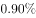
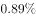
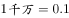
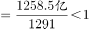
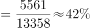
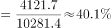

# 综合判断题（比重趋势+增长量比较+平均数+比重与阈值对比，四模型混合验证）

考点：[[20-考点/资料分析/综合/综合判断题（比重趋势+增长量比较+平均数+比重与阈值对比，四模型混合验证）|综合 / 综合判断题（比重趋势+增长量比较+平均数+比重与阈值对比，四模型混合验证）]]
材料：[[15-材料/资料分析/248013 全国技术合同成交情况：文字部分讲20|248013 全国技术合同成交情况：文字部分讲20]]

**问法模型**：题干'能够从上述资料中推出的是'→依次用'读折线判趋势、柱值做差比门槛、分子÷分母算平均、比重与阈值放缩比较'四个模型逐项排查

## 推理链
1. 第1步：A项读图中折线（占GDP比重%），2007年0.90→2008年0.89为下降、2008年0.89→2009年0.89为持平，比重并非逐年上升，A错误
2. 第2步：B项用图中相邻柱值逐年做差：2006年1818-1551=267亿元、2007年409亿元……2017年13424-11407=2017亿元，12个年份最小增量267亿元远超'千万'=0.1亿元，应为12个而非8个，B错误
3. 第3步：C项定位文字'专利技术合同成交1291项，成交额1258.5亿元'，平均每项成交额=1258.5÷1291≈0.98亿元<1亿元，C错误
4. 第4步：D项定位文字'重大技术合同13358项、10281.4亿元；涉及知识产权的合同5561项、4121.7亿元'
5. 第5步：项数比重=5561÷13358≈41.6%，成交金额比重=4121.7÷10281.4≈40.1%
6. 第6步：两个比重均超过阈值（40%），项数、金额同时过线，D正确

**最快解法**：⚡ 综合题'先易后难'三步排除：①C项一眼看出1258.5<1291，截位直除商必<1，平均每项不足1亿元，秒杀；②B项只算最小增量1818-1551=267亿元>>0.1亿元（千万），知12个年份全部超标即可排除；③A项看折线2007→2008下降排除；④D项用放缩验证：13358×40%=5343.2<5561且10281.4×40%=4112.56<4121.7，两比重均>40%，锁定D

## 易错点
- ⚠ 双轴图陷阱：A项判断'比重逐年上升'必须看折线（%）而非柱（亿元），看错对象直接误判
- ⚠ B项'超千万'=超过0.1亿元，门槛极低而逐年增量动辄数百亿元，易高估门槛逐个精算浪费时间或数错个数（实为12个不是8个）
- ⚠ C项平均数分子分母须同属'专利技术合同'（1258.5亿元/1291项），勿错用技术秘密（2239.6亿元/2959项）或重大合同整体数据
- ⚠ D项'均超过'要求项数与成交金额两个比重同时过线，只验一个易误判；且金额比重40.1%仅贴线超过，须精算不能毛估

## 母题抽象
> 🧩 当题干出现'能够从上述资料中推出的是'的综合判断时，按'趋势读线→增长量做差比门槛→平均数做商→比重与阈值放缩'顺序逐项快验，善用'分母×阈值与分子比大小'的放缩法秒判比重类选项

**同类特征**：能够从上述资料中推出的是、综合判断四个选项、占GDP比重逐年上升、同比增长超千万（增长量门槛）、平均每项成交额、项数和成交金额均超过某比例

## 相关题
- [[10-真题/资料分析/综合/16070148 综合判断题（柱状图多期加总比较＋表格基期量计算＋数据可得性判断＋比重比较）|16070148]]（贵州 2026，相关度2）
- [[10-真题/资料分析/综合/19283943 综合分析判断题（倍数比较+求和判断+隐含平均每场座位数反推）|19283943]]（国考 2025，相关度1）
- [[10-真题/资料分析/综合/1796162 综合判断（月均计算、平均运输距离、比重对比、增长量比较逐项验证）|1796162]]（贵州 2016，相关度1）
- [[10-真题/资料分析/综合/2133504 综合判断题（现期比重+现期平均数多项验证，一对三错）|2133504]]（国考 2018，相关度1）
- [[10-真题/资料分析/综合/2444706 综合判断题（增长量+比重+倍数逐项验证）|2444706]]（四川 2019，相关度1）

---

### 题干
能够从上述资料中推出的是：

### 选项
- A. 
2005-2017年，全国技术合同成交金额占GDP的比重逐年上升

- B. 
2006-2017年，全国技术合同成交金额同比增长超千万的年份有8个

- C. 
2017年，1000万元以上重大技术合同中，专利技术合同平均每项成交额超过1个亿

- D. 
2017年，1000万元以上重大技术合同中，涉及各类知识产权的合同项数和成交金额均超过
　✅

### 官方解析

A项：定位图形材料可知，2007年和2008年，全国技术合同成交金额占GDP的比重分别为和，比重下降，并非逐年上升，错误；

B项：定位图形材料可知，2005年-2017年，全国技术合同成交金额。根据公式：增长量，且亿可知，2006-2017年，每年的全国技术合同成交金额均超过0.1亿，即均超过千万，共12个年份，错误；

C项：定位文字材料第二段可知，专利技术合同成交1291项，成交额1258.5亿元，代入公式：平均数亿，错误；

D项：定位文字材料第二段可知，2017年全国共成交1000万元以上重大技术合同13358项，成交额10281.4亿元，重大技术合同中涉及各类知识产权的合同，成交5561项，成交金额为4121.7亿元。代入公式：比重，则合同项数的比重；成交金额的比重，两者均超过，正确。

故正确答案为D。

### 给定材料

        2017年，我国技术市场交易额稳步增长，全年共签订各类技术合同36.8万项，成交金额13424.2亿元，比上年分别增长和。

        2017年全国共成交1000万元以上重大技术合同13358项，同比增长；成交额10281.4亿元，同比增长。重大技术合同中涉及各类知识产权的合同，成交5561项，成交金额为4121.7亿元。其中，技术秘密为主要交易形式，成交2959项，成交额2239.6亿元，居第一位；专利技术合同成交1291项，成交额1258.5亿元，居第二位。

> [!warning] 疑点（官方解析可能有误，待人工复核）
> 题干D选项中的阈值以图片公式嵌入、官方解析文字中数值同样缺失（A项比重数值处亦为空），按计算项数比重≈41.6%、金额比重≈40.1%推断阈值为40%，结论与官方答案D完全自洽，仅为文本呈现缺失，不构成对答案的疑义
