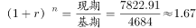
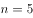
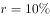
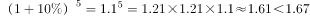
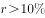
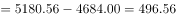
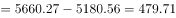
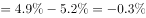
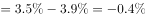
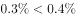

# 年均增长率判定+综合分析逐项验证（增量数列-比重降幅数列-趋势外推）

考点：[[20-考点/资料分析/综合/年均增长率判定+综合分析逐项验证（增量数列-比重降幅数列-趋势外推）|综合 / 年均增长率判定+综合分析逐项验证（增量数列/比重降幅数列/趋势外推）]]
材料：[[15-材料/资料分析/248015 2013-2018年H市生产总值(G|248015 2013-2018年H市生产总值(G]]

**问法模型**：『下列判断正确的是』综合判断题 → 逐一验证四个选项：A用年均增长率公式(1+r)^n=现期/基期对照阈值锚值，B验证逐年增量数列，C验证比重降幅数列，D判断趋势能否外推

## 推理链
1. 第1步：A项从图1提取2013年GDP=4684.00亿元、2018年GDP=7822.91亿元，年份差n=2018-2013=5（间隔5年）
2. 第2步：A项用年均增长率公式(1+r)^5=7822.91/4684.00≈1.670，将其与阈值锚值1.1^5=1.61051对照
3. 第3步：A项因4684.00×1.61051≈7544亿元<7822.91亿元，即1.670>1.611，故年均增长率超过该阈值（约10%），A正确
4. 第4步：B项算逐年增量：2014年=5180.56-4684.00=496.56亿元，2015年=5660.27-5180.56=479.71亿元，479.71<496.56，增量并非逐年增加，B错误
5. 第5步：C项列第一产业比重逐年降幅数列：0.3、0.2、0.4、0.4、0.4个百分点，2015年降幅0.2<2014年降幅0.3，并非呈逐年上升趋势，C错误（仅比较两端0.3→0.4会误判）
6. 第6步：D项第二产业比重55.0→55.2→52.6→50.7→49.0→46.2为先升后降，历史趋势外推不能必然断定2019年下降，D错误
7. 第7步：对照四个选项，仅A正确，与官方答案一致

**最快解法**：⚡ 公式法+锚值对照：A项(1+r)^5=7822.91/4684.00≈1.67，心算1.1^5≈1.61<1.67即锁定r>10%为正确项；B、C、D快速排除——B只需算前两个增量即见496.56→479.71回落，C只需列五个降幅发现0.2<0.3，D看比重数列先升即否'必然下降'。

## 易错点
- ⚠ 年均增长率年份差n=2018-2013=5而非6（6个数据点只有5个间隔），且勿硬算5次方根，用1.1^5=1.611、1.2^5≈2.488等锚值对照现期/基期比值即可
- ⚠ B项'增加值'按本篇口径指增加额（两期GDP相减）而非产业产值，且'逐年增加'要求逐期验证，一组回落（479.71<496.56）即整项推翻
- ⚠ C项'下降幅度呈上升趋势'不能只比较时间段两端（0.3→0.4），必须逐年验证降幅数列，0.2<0.3说明中间回落，趋势表述不成立
- ⚠ D项属'根据趋势推断未来'类表述，趋势有波动（第二产业比重先升后降）时只能得'不一定'，凡含'将会/必然'的推断项通常错误

## 母题抽象
> 🧩 当综合判断题出现『年平均增长幅度超过X%』时，用(1+r)^n=现期/基期、以1.1^n等锚值对照判定；凡『逐年增加/上升』表述必须逐期列数列验证而非看两端，凡『根据趋势推断下期』且历史趋势有转向的一律不选。

**同类特征**：下列判断正确的是（综合判断四选项）、年平均增长幅度（年均增长率）、GDP增加值逐年增加、比重下降幅度呈上升趋势、根据趋势判断2019年比重、双图联用：GDP总量图+三次产业比重图

## 相关题
（暂无）

---

### 题干
根据资料，下列判断正确的是：

### 选项
- A. 
2013-2018年，H市生产总值年平均增长幅度超过
　✅
- B. 
2013-2018年，H市GDP增加值逐年增加

- C. 
2013-2018年，H市第一产业产值占GDP比重下降幅度呈上升趋势

- D. 
根据2013-2018年趋势，2019年H市第二产业产值占GDP比重将会下降

### 官方解析

A项：定位第一个统计图可知，2013年、2018年H市GDP分别为4684.00亿元、7822.91亿元。代入年均增长率公式：，年份差，将代入原式，则有，则说明年均增长率，正确；

B项：定位第一个统计图可知，2013-2018年H市GDP依次为4684.00亿元、5180.56亿元、5660.27亿元、6274.38亿元、7003.05亿元、7822.91亿元。2014年GDP的增长量亿元，2015年GDP的增长量亿元，并非上升，错误；（备注：根据38题可知，本篇资料中的“增加值”指的并非“产值”，而是“增加额”）

C项：定位第二个统计图可知，各年份第一产业占GDP的比重。可以计算出2014年较2013年；2018年较2017年。可以看出2013-2018年，H市第一产业产值占GDP比重下降幅度呈上升趋势。正确；（备注：趋势是比较时间段的两端，这样本题就没有唯一正确答案了。）

D项：定位第二个统计图可知，第二产业占GDP的比重为先上升后下降的趋势，因此2019年H市第二产业占GDP的比重不一定会下降，错误。

故正确答案为A。

### 给定材料

> [!warning] 疑点（官方解析可能有误，待人工复核）
> 官方解析C项先写『正确』又备注『若按两端比较则本题无唯一答案』，表述自相矛盾；按逐年降幅数列（0.3、0.2、0.4、0.4、0.4，其中0.2<0.3）C应判错误，与唯一正确答案A一致，应以逐年验证口径为准。另选项A中公式为图片未直接给出，依官方解析结论推定该阈值为10%（1.1^5≈1.611<1.670成立，而1.11^5≈1.685>1.670，若阈值高于10.8%则A不成立）。

<!-- CODEX-ANSWER-REVIEW:BEGIN -->
### 本次独立复核

**复核状态：** `confirmed`（独立复算确认答案）

**计分答案：** A（可计分）

**复核解析：**

H市2013—2018 GDP复合年均增幅=(7822.91/4684)^(1/5)−1≈10.8%，超过选项阈值10%，A成立。年度GDP增量并非逐年增加；第一产业占比降幅未逐年扩大；第二产业占比先升后降，不能据趋势断言2019继续下降。

**相关信息：**

独立复核：按题干定义逐项检验，关键基数、比值、增速与图表读数写明以便复算。

**题源依据：** [固定版本原题](https://github.com/Mentat-Uran/kaogongzhentizhengliu/blob/84ab93d4b64b61d897bece8a1c0a5bab06b4feb2/10-%E7%9C%9F%E9%A2%98/%E8%B5%84%E6%96%99%E5%88%86%E6%9E%90/%E7%BB%BC%E5%90%88/2456417%20%E5%B9%B4%E5%9D%87%E5%A2%9E%E9%95%BF%E7%8E%87%E5%88%A4%E5%AE%9A%2B%E7%BB%BC%E5%90%88%E5%88%86%E6%9E%90%E9%80%90%E9%A1%B9%E9%AA%8C%E8%AF%81%EF%BC%88%E5%A2%9E%E9%87%8F%E6%95%B0%E5%88%97-%E6%AF%94%E9%87%8D%E9%99%8D%E5%B9%85%E6%95%B0%E5%88%97-%E8%B6%8B%E5%8A%BF%E5%A4%96%E6%8E%A8%EF%BC%89.md)；固定内容 commit `84ab93d4b64b61d897bece8a1c0a5bab06b4feb2`，Markdown blob `711fd6874f31f8b643dde8aa9637fe35908e657d`。
<!-- CODEX-ANSWER-REVIEW:END -->
