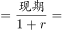
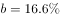
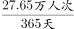
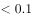
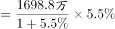
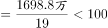

# 综合判断（主考点：两期比重变化判定——部分增速与整体增速比较；辅考点：基期量回推、日均平均数、增长量估算）

考点：[[20-考点/资料分析/综合/综合判断（主考点：两期比重变化判定——部分增速与整体增速比较；辅考点：基期量回推、日均平均数、增长量估算）|综合 / 综合判断（主考点：两期比重变化判定——部分增速与整体增速比较；辅考点：基期量回推、日均平均数、增长量估算）]]
材料：[[15-材料/资料分析/257532 2017年全国及J省海洋经济发展情况|257532 2017年全国及J省海洋经济发展情况]]

**问法模型**：'下列选项能够从资料中推出的是'的四选一综合判断问法 → 逐项验证：比重变化用'部分增速vs整体增速'快判，基期比较用'基期=现期÷(1+增速)'，日均=总量÷365，增长量=现期×r/(1+r)，零计算或粗算排除三项

## 推理链
1. 第1步：A项提取第3段条件——造船完工量1412.4万载重吨为同比下降，新承接订单量1393.4万载重吨为同比增长，两指标增速方向相反
2. 第2步：套基期公式'基期=现期÷(1+增速)'：2016年完工量=1412.4÷(1-下降率)＞1412.4，2016年新承接订单量=1393.4÷(1+增长率)＜1393.4＜1412.4，故2016年新承接订单量低于造船完工量，A项不能推出
3. 第3步：B项提取末段条件——全省沿海地区风电装机589.7万千瓦（整体）与海上风电装机162.5万千瓦（部分）为包含关系（海上风电⊂沿海风电），图中增速显示海上风电（部分）同比增速高于沿海地区（整体）同比增速
4. 第4步：套两期比重结论'部分增速＞整体增速⇔比重上升'，故2017年海上风电占沿海地区风电装机的比重高于上年，B项可以推出
5. 第5步：C项验算——入境过夜旅游者27.65万人次为全年总量，日均=27.65万÷365≈0.076万人次，与'近0.8万人次'相差约10倍，C项错误
6. 第6步：D项验算——集装箱吞吐量1698.8万标箱，增长量=1698.8×r/(1+r)，代入材料同比增速后不足100万标箱，与'100多万标箱'不符，D项错误；对照四项，仅B能推出

**最快解法**：⚡ 两期比重结论直判+方向排除法：B项零计算——部分（海上风电162.5）增速＞整体（沿海589.7）增速⇒比重上升，直接锁定正确项；A项用方向法秒杀——'下降的指标基期更大、增长的指标基期更小'，故2016完工基期＞1412.4＞1393.4＞新承接基期，排除；C项27.65万÷365≈0.08万人次量级排除；D项小增速下增长量=1698.8r/(1+r)必不足100万排除

## 易错点
- ⚠ 整体与部分误判：589.7万千瓦（沿海地区风电）与162.5万千瓦（海上风电）是包含关系，B项比重的分子必须是海上风电、分母必须是沿海地区装机，若把两者当并列指标或代入方向颠倒即错判
- ⚠ 增速方向代错：造船完工量与手持订单为同比下降、新承接为同比增长，A项回推2016基期时须一减一加，若全部按增长处理会得出'新承接基期更高'的反向结论而误选A
- ⚠ 量级与模型陷阱：C项27.65万人次是全年总量，漏做÷365或漏看'万'字会误判0.8万量级（实际0.076万，差约10倍）；D项须用增长量=现期×r/(1+r)估算，不可拿现期1698.8万标箱的零头凭感觉判断

## 母题抽象
> 🧩 综合判断题中见到'部分占整体的比重高于上年水平'选项时，不计算比重，直接用'部分增速＞整体增速⇒比重上升'零计算判定；其余选项按'基期回推看增速方向、日均=总量÷365、增长量=现期×r/(1+r)'逐项粗算排除

**同类特征**：能够从上述资料中推出的是、四选一综合判断、占……比重高于上年水平、平均每天接待……万人次、较上年增长了……万标箱、海上风电与沿海风电（部分—整体）增速比较

## 相关题
- [[10-真题/资料分析/综合/1746812 综合判断题（逐项验证：比重计算、双指标排序比较、同比方向判断）|1746812]]（国考 2016，相关度2）
- [[10-真题/资料分析/综合/10942304 综合判断（增长量计算+单位换算；两期比重比较；下降速度比较）|10942304]]（山东 2024，相关度2）
- [[10-真题/资料分析/综合/12536418 综合判断题（基期量计算+增长量计算+差额变化比较+两期比重比较混合考查）|12536418]]（四川 2024，相关度2）
- [[10-真题/资料分析/综合/15833800 综合判断（年均平均数+同比增量递增+最值查找+增长率多模型混合验证）|15833800]]（贵州 2026，相关度2）
- [[10-真题/资料分析/综合/2187843 综合判断题（混合增长率居中原理+现期比重+总量减部分差值）|2187843]]（山东 2018，相关度2）

---

### 题干
下列选项中，能够从上述资料中推出的是：

### 选项
- A. 2016年，J省造船工业新承订单量高于其造船完工量
- B. 2017年，J省海上风电装机容量占沿海地区风电装机容量的比重高于上年水平　✅
- C. 2017年，J省沿海三市平均每天接待入境过夜旅游者近0.8万人次
- D. 2017年，J省沿海沿江港口完成集装箱吞吐量较上年增长了100多万标箱

### 官方解析

A项：定位材料第三段，“2017年，J省造船完工量为1412.4万载重吨，同比下降；新承订单量为1393.4万载重吨，同比增长”，则2016年J省造船完工量，2016年新承订单量，故2016年新承订单量低于其造船完工量，错误；

B项：定位材料最后一段，“2017年······全省沿海地区风电装机容量······同比增长；海上风电装机容量······同比增长”，即部分增长率，总体增长率，则。根据两期比重结论，当部分增长率总体增长率时，可判定比重上升，正确；

C项：定位材料第四段，“2017年，J省沿海三市······接待入境过夜旅游者27.65万人次，同比增长”，则2017年J省沿海三市平均每天接待入境过夜旅游者为万人次，错误；

D项：定位材料第二段，“2017年，全省沿海沿江港口完成······集装箱吞吐量1698.8万标箱，同比增长”，则2017年J省沿海沿江港口完成集装箱吞吐量较上年的增长量万，错误。

故正确答案为B。

### 给定材料

        2017年全国海洋生产总值77611亿元，比上年增长，海洋生产总值占国内生产总值的。

        2017年，J省海洋生产总值为7217亿元，比上年增长，海洋生产总值占地区生产总值的，2017年，全省沿海沿江港口完成货物吞吐量20.4亿吨，同比增长；集装箱吞吐量1698.8万标箱，同比增长。

        2017年，J省造船完工量为1412.4万载重吨，同比下降；新承订单量为1393.4万载重吨，同比增长；手持订单量为3662.3万载重吨，同比下降，分别占全国份额的、和。

        2017年，J省沿海三市接待国内游客10558.01万人次，同比增长；接待入境过夜旅游者27.65万人次，同比增长。

        2017年，J省实现海水养殖产量93.1万吨，同比增长；海洋捕捞产量53万吨，同比下降；远洋渔业产量2.9万吨，同比增长。

        2017年，J省海工装备产值同比增长。全省沿海地区风电装机容量达到589.7万千瓦，同比增长；海上风电装机容量达到162.5万千瓦，同比增长。2017年，全省完成海水淡化产量1.31万吨，同比增长。

> [!warning] 疑点（官方解析可能有误，待人工复核）
> 材料文本中所有同比增速百分数留空（具体数值存于图片附件），官方解析相应数值处亦为空白：A项定量比较、B项'部分增速＞整体增速'的判定、C项与D项的精算均依赖图中具体增速数据，实际解题须回原图核对，仅凭文本无法完整定量验证；此为数据缺失提示，非对答案B的质疑
