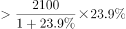
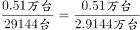
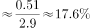

# 综合分析'能够推出'逐项验证（核心为增长量=现期×r-(1+r)的下界估算与比重判定）

考点：[[20-考点/资料分析/综合/综合分析'能够推出'逐项验证（核心为增长量=现期×r-(1+r)的下界估算与比重判定）|综合 / 综合分析'能够推出'逐项验证（核心为增长量=现期×r/(1+r)的下界估算与比重判定）]]
材料：[[15-材料/资料分析/257534 2016年国产工业机器人全年销售状况|257534 2016年国产工业机器人全年销售状况]]

**问法模型**：题干为'能够从上述资料中推出的是'→ 对A~D逐项做可推出性验证：A用增长量模型但现期/增速均非精确数据、B用比重=5100/29144、C需行业增速与总体增速比较而数据缺失、D用'3倍有余⇒r>300%'做增量下界估算

## 推理链
1. 第1步：提取可读硬数据——2016年总销量29144台；工厂用AGV销量'超过2100台'；焊接和钎焊0.51万台=5100台；3C与电气设备行业销量'均超过5000台'，电气设备'同比大幅增长3倍有余'（即增速r>300%）
2. 第2步：验证A项——增长量=现期×r/(1+r)，但现期仅为'超过2100台'的下限式约数而非精确值，同比增速数值为公式图片不可读，无精确数据支撑'较上年增加500多台'，无法推出，A错
3. 第3步：验证B项——比重=5100÷29144≈17.5%，即约1.7成、不到2成，'2成以上'不成立，B错
4. 第4步：验证C项——行业占比同比升降取决于该行业增速与总体增速（或基期量）的比较，材料未给3C行业增速及2015年销量，汽车行业增速亦为图片不可读，无法判定占比变化，C错
5. 第5步：验证D项——'增长3倍有余'即r>300%，增长量=现期×r/(1+r)>5000×300%/(1+300%)=5000×3/4=3750台，且现期本身'超过5000台'使下界更高，故增量必超3000台，D成立
6. 第6步：对照四项，仅D可由材料数据严格推出，选D

**最快解法**：⚡ 先攻D（唯一含下限估算的确定项）：百化分/公式法——'3倍有余'⇒r>300%，r/(1+r)>3/4=75%，增量>5000×75%=3750台>3000台，一步锁定；B项顺手排除：截位直除5100/29144≈17.5%<20%

## 易错点
- ⚠ '增长3倍有余'指增长率r>300%（即现为基期的4倍以上），勿与'是原来的3倍'（r=200%）混淆；本题即便误用r>200%，下界5000×2/3≈3333台仍>3000台结论侥幸不变，但口径必须分清
- ⚠ '超过2100台''超过5000台'均为下限式约数，不能当精确值代入求'精确增量'；A项正是'约数现期+图片不可读增速'组合设'无法推出'的坑
- ⚠ 单位混排：焊接0.51万台必须换算成5100台再与总量29144台相除，否则比重判断出错；C项占占比升降勿凭'3C销量第一'直觉误判，占比升降必须比较该行业增速与总体增速，材料未给即'无法推出'

## 母题抽象
> 🧩 当综合分析题材料出现'超过X台''增长N倍有余'等下限式约数时，用增量=现期×r/(1+r)取下界（r/(1+r)百化分：增3倍→3/4）验证'增量超某值'类选项常可一步锁定答案；而依赖约数算精确值或数据缺失（如行业增速）的选项一律判'无法推出'

**同类特征**：能够从上述资料中推出的是（综合分析四选一）、同比大幅增长3倍有余（r>300%）、销量超过5000台（下限式约数）、增长量=现期×r/(1+r)下界估算、占总销量2成（20%）比重判断、占比同比升降需行业增速与总体增速比较

## 相关题
- [[10-真题/资料分析/综合/2049872 综合分析题（四选项真伪判断：基期倍数计算+数据可判性排除）|2049872]]（湖南 2017，相关度1）
- [[10-真题/资料分析/综合/2376605 综合分析·逐项正误判断（正确项C为'图文数据逐年加总+比例比较'，干扰项涉及增长量还原、占比反推总数、两年排名比对）|2376605]]（黑龙江 2019，相关度1）
- [[10-真题/资料分析/综合/4770017 综合分析·逐项判断（单价换算＋全年合计估算＋连续环比下降＋万吨-万千克单位换算）|4770017]]（四川 2017，相关度1）

---

### 题干
关于2016年国产工业机器人销售状况，能够从上述资料中推出的是：

### 选项
- A. 工厂用AGV机器人销量较上年增加了500多台
- B. 焊接和钎焊机器人销量占总销量的2成以上
- C. 3C、汽车行业销量占总销量比重均同比上升
- D. 电气设备行业销售增量超过3000台　✅

### 官方解析

A项：定位文字材料第二段，工厂用AGV机器人销量超过2100台，同比增长。因此增长量台，但无法推出500多台，错误；

B项：定位文字材料第一、三段，2016年国产工业机器人······全年累计销售29144台······2016年······焊接和钎焊机器人销售0.51万台，可得焊接和钎焊机器人销量占总销量的比重为，不到两成，错误；

C项：定位文字材料第一、四段，“国产工业机器人······较上年增长······3C行业和电气设备······特别是电气设备行业，同比大幅增长3倍有余”。未给出3C行业增长量（率）或者2015年销量相关的数据，故无法判定其占比变化，错误；

D项：定位文字材料第四段，“电气设备行业销量均超过5000台······特别是电气设备行业，同比大幅增长3倍有余”，可得电气设备行业销售增量台，超过3000台，正确。

故正确答案为D。

### 给定材料

        2016年国产工业机器人销量继续增长，全年累计销售29144台，较上年增长，增速较上年提升。

        从机械结构看，2016年国产多关节机器人销量首次超过万台，为11756台，增速已连续两年超过，占国产工业机器人总销量的，比上年提高12.9个百分点。坐标机器人仍是国产工业机器人销量第一的机型，2016年销售12830台，占销售总量的比重为，比上年回落3.5个百分点，连续两年占比回落。工厂用AGV机器人销量超过2100台，同比增长。并联机器人销售增长。而SCARA机器人和圆柱坐标机器人的销售则出现超过的下降。

        从应用领域看，2016年搬运与上下料仍是国产工业机器人的首要应用领域，全年销售1.65万台，同比增长，增速放缓，占国产工业机器人销售总量的；焊接和钎焊机器人销售0.51万台，同比增长；装配与拆卸机器人销售0.37万台，同比增长。此外涂层与胶封机器人的销售也实现了的增长，特别是其中的喷漆上釉机器人销量增长了，而洁净室机器人和加工机器人的销售量均出现了同比下降。

       从应用行业看，3C行业和电气设备行业销量均超过5000台，分列第一第二位，特别是电气设备行业，同比大幅增长3倍有余。汽车行业销量同比增长；非金属矿物制品业销量同比增长。此外，在家具、服装、烟草等消费品制造行业的机器人消费量均翻番。

