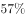

# 多指标占比的极值比较与综合判断（45分钟公交服务能力占比、轨道覆盖通勤比重的四城市横向排序）

考点：[[20-考点/资料分析/综合/多指标占比的极值比较与综合判断（45分钟公交服务能力占比、轨道覆盖通勤比重的四城市横向排序）|综合 / 多指标占比的极值比较与综合判断（45分钟公交服务能力占比、轨道覆盖通勤比重的四城市横向排序）]]
材料：[[15-材料/资料分析/257871 甲、乙、丙、丁四个城市的通勤特征对比|257871 甲、乙、丙、丁四个城市的通勤特征对比]]

**问法模型**：'关于…公共交通情况，下列说法正确的是'的四选一综合判断 → 按选项关键词从图二提取对应占比指标，横向找最大/最小值城市，逐项验证'最强/最弱＋最好/最差'双重断言是否同时成立

## 推理链
1. 第1步：定位图二，提取'45分钟公交服务能力占比'：甲32%、乙39%、丙50%、丁57%；'轨道覆盖通勤比重'：甲27%、乙33%、丙37%、丁30%（注意不取深灰的'5公里通勤比重'38%/48%/51%/57%）
2. 第2步：判断规则——'公共交通服务能力'对应45分钟公交服务能力占比，占比最高=最强、最低=最弱；'轨道覆盖通勤'对应轨道覆盖通勤比重，比重最高=最好、最低=最差
3. 第3步：横向比较公交服务能力：丁57%＞丙50%＞乙39%＞甲32%，甲占比最低，即公共交通服务能力最弱
4. 第4步：横向比较轨道覆盖通勤：丙37%＞乙33%＞丁30%＞甲27%，甲比重最低，即轨道覆盖通勤最差
5. 第5步：逐项核对——A项'甲最强'与第3步'甲最弱'矛盾，错；B项'甲最弱且轨道覆盖最差'与第3、4步完全一致；C项乙39%小于丙50%和丁57%、并非最强，错；D项丁30%小于乙33%和丙37%、并非最好，错
6. 第6步：只有B项两个分句同时成立，故正确答案为B

**最快解法**：⚡ 极值速判法＋双断言校验：在图二上横向扫两列占比，'45分钟公交服务能力占比'最小值为甲32%，'轨道覆盖通勤比重'最小值为甲27%——甲在两个指标上双垫底，直接锁定'最弱＋最差'的B项；再快速排除：A前半句'最强'与事实相反，C乙39%非最大，D丁30%非最大，考场30秒内可完成

## 易错点
- ⚠ 指标取错列：图二每城三根柱含义不同，公交服务能力须看浅灰'45分钟公交服务能力占比'、轨道须看中灰'轨道覆盖通勤比重'；若误取深灰'5公里通勤比重'（丁57%最大），会误判丁市公交服务能力最强而错选D
- ⚠ A项'最强/最弱'一字之差：甲公交服务能力实为最弱（32%最低），A写成'最强'；若只看到后半句'轨道覆盖最差'正确就选A，即掉入半真半假陷阱
- ⚠ C项半真半假：'乙轨道覆盖通勤一般'（33%居中）看似成立，但前半句'公交服务能力最强'不成立（39%＜丙50%、丁57%），综合判断题须两个分句全对才能选

## 母题抽象
> 🧩 当题干出现'下列说法正确的是'且各选项均为'某市XX最强/最弱（最好/最差）'式极值断言时，先对每列占比指标横向排序找极值城市，再逐项做双重断言（AND）校验——单句正确、单句错误的选项是主要陷阱

**同类特征**：关于…情况，下列说法正确的是（综合判断题）、公共交通服务能力最强/最弱、轨道覆盖通勤最好/最差、每选项由'但是/并且'连接的双重断言、仅需图二三个占比指标，不涉及图一公里数据、四城市横向极值比较而非计算

## 相关题
（暂无）

---

### 题干
关于四个城市通勤的公共交通情况，下列说法正确的是：

### 选项
- A. 甲市公共交通服务能力最强但是轨道覆盖通勤最差
- B. 甲市公共交通服务能力最弱并且轨道覆盖通勤最差　✅
- C. 乙市公共交通服务能力最强但是轨道覆盖通勤一般
- D. 丁市公共交通服务能力最强并且轨道覆盖通勤最好

### 官方解析

A项：定位图二可得，甲市45分钟公交服务能力占比为，为四个城市中占比最低的，即公共交通服务能力最弱，错误；

B项：定位图二可得，甲市45分钟公交服务能力占比为，为四个城市中占比最低的，即公共交通服务能力最弱；轨道覆盖通勤比重为，为四个城市中比重最低的，即轨道覆盖通勤最差，正确；

C项：定位图二可得，乙市45分钟公交服务能力占比为，小于丙市（）与丁市（），即公共交通服务能力不是最强的，错误；

D项：定位图二可得，丁市轨道覆盖通勤比重为，小于乙市（）与丙市（），即轨道覆盖通勤不是最好的，错误。

故正确答案为B。

### 给定材料

