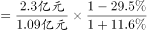
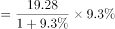
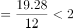
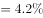
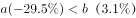

# 综合分析题·混合增长率判断整体与部分增速关系（辅以基期倍数、增长量、两期平均数排除）

考点：[[20-考点/资料分析/综合/综合分析题·混合增长率判断整体与部分增速关系（辅以基期倍数、增长量、两期平均数排除）|综合 / 综合分析题·混合增长率判断整体与部分增速关系（辅以基期倍数、增长量、两期平均数排除）]]
材料：[[15-材料/资料分析/257879 S市服务业小微样本企业2017年经营|257879 S市服务业小微样本企业2017年经营]]

**问法模型**：'能够从上述资料中推出的是'四选一综合判断→逐项套公式验证，正确项用混合增长率定性推理：整体增速介于各部分增速之间，存在负增长部分时其余部分增速必高于整体增速。

## 推理链
1. 第1步：A项定位第三段：2017年营业税金及附加1.09亿元同比下降、增值税2.30亿元同比增长；按基期倍数公式，2016年倍数=(2.30/1.09)×(1-降幅)/(1+增速)，其中2016年营业税金及附加=1.09/(1-降幅)>1.09、2016年增值税=2.30/(1+增速)<2.30，分子分母双向压缩，倍数不超过2倍，A错误。
2. 第2步：B项定位第四段：2017年应付职工薪酬19.28亿元同比增长（增速数值在给定文本缺失），按增长量=19.28×r/(1+r)，代入原卷增速计算所得不足2亿元，'同比增加2亿多元'不成立，B错误。
3. 第3步：C项定位第二段：2017年总体资产938.58亿元同比增长（正增长），而房地产业、交通运输仓储邮政业、教育业资产总计比2016年分别下降（负增长），其他行业资产同比均有不同程度增长。
4. 第4步：混合增长率规则：整体增速是各部分按基期体量加权的中间值，必介于最小与最大部分增速之间。
5. 第5步：房地产等下降部分增速<0<总体资产增速，故'除房地产业外其他行业'作为另一部分，其资产增速必大于总体资产增速，即高于选项所给数值（原卷总体资产增速），C正确。
6. 第6步：D项定位第三、一段：平均每万元营业收入缴纳营业税金及附加=营业税金及附加/营业收入，分子增速（税金，下降，a<0）<分母增速（营收，增长，b>0），由两期平均数结论a<b时平均数低于上年，D称'高于上年'错误。
7. 第7步：仅C项成立，与官方答案一致。

**最快解法**：⚡ 混合增长率定性秒杀：见到'整体正增长+某组成部分负增长'特征，立判'其余部分增速>整体增速'，C项免计算直接锁定；A项用基期倍数(2.30/1.09)×(1-降幅)/(1+增速)验证不超2倍，B项用增长量公式19.28r/(1+r)<2亿排除，D项用'分子增速<分母增速→平均数下降'排除。

## 易错点
- ⚠ 把'比2016年回落15.7个百分点''增速比2016年下降0.9个百分点'误解为营收或资产总量在下降，实为2017年与2016年两年增速之差，反推2016年增速应用加法
- ⚠ A项直接用现期2.30÷1.09≈2.11倍判'超过2倍'，忽略基期换算后分子缩小(÷(1+增速))、分母放大(÷(1-降幅))，倍数被压缩至2倍以内
- ⚠ D项两期平均数比较方向记反：分子（税金）增速小于分母（营收）增速时平均数下降（低于上年），并非上升；且营业税金及附加（降）与增值税（升）是两个税种两个方向，勿张冠李戴
- ⚠ 总量用亿元、户均/人均用万元混排，若涉及计算须先换算（1亿=10000万），直接'亿÷万'差一万倍量级

## 母题抽象
> 🧩 当综合分析题出现'整体指标正增长、其中某组成部分负增长'的特征时，用混合增长率定性判断'其余部分增速必然高于整体增速'即可免算锁定正确项，其余选项按基期倍数、增长量、两期平均数公式逐一排除。

**同类特征**：能够从上述资料中推出的是、综合分析四选一、整体与部分增速关系、除房地产业外的增速比较、基期倍数验证、两期平均数比较（高于/低于上年）

## 相关题
- [[10-真题/资料分析/综合/2031178 综合分析题（逐项验证：增长量计算、基期量反推、比重阈值判断）|2031178]]（北京 2017，相关度2）
- [[10-真题/资料分析/综合/13255455 综合分析题-逐项验证（基期量换算比较、增长率计算与比较）|13255455]]（选调 2023，相关度2）
- [[10-真题/资料分析/综合/2028370 综合分析判断（同比升降年份计数+比重变化定性判断+基期量定性比较）|2028370]]（国考 2017，相关度2）
- [[10-真题/资料分析/综合/2187869 综合分析判断（文字材料逐项验证+基期数回推）|2187869]]（山东 2018，相关度2）
- [[10-真题/资料分析/综合/19283943 综合分析判断题（倍数比较+求和判断+隐含平均每场座位数反推）|19283943]]（国考 2025，相关度1）

---

### 题干
能够从上述资料中推出的是：

### 选项
- A. 
2016年，S市服务业小微样本企业缴纳营业增值税超过营业税金及附加的2倍

- B. 
2017年，S市服务业小微样本企业总体应付职工薪酬同比增加2亿多元

- C. 
2017年，除房地产业外，S市其他服务业小微样本企业总体资产同比增速高于
　✅
- D. 
2017年，S市服务业小微样本企业平均每万元营业收入缴纳营业税金及附加高于上年水平

### 官方解析

A项：定位文字材料第三段可得，2017年，S市服务业小微样本企业总体营业税金及附加为1.09亿元（B），同比下降（b）；缴纳增值税2.30亿元（A），同比增长（a）。 根据基期倍数公式：，则所求倍。错误；

B项：定位文字材料第四段可得，“2017年，S市服务业小微样本企业总体应付职工薪酬19.28亿元，比2016年增长”。根据增长量，则所求亿元。错误；

C项：定位文字材料第二段可得，“2017年，S市服务业小微样本企业总体资产938.58亿元，同比增长······除房地产业······资产总计比2016年分别下降······”。可知S市服务业小微样本企业总体资产增长率，房地产业增长率，所以其他服务业小微样本企业总体资产增长率总体增长率（）房地产业（）。正确；

D项，定位文字材料第三段可得，2017年，S市服务业小微样本企业总体营业税金及附加······同比下降（a）；定位文字材料第一段可得，“2017年，S市服务业小微样本企业总体实现营业收入······同比增长（b）”。平均每万元营业收入缴纳营业税及附加，根据两期平均数结论，，平均数低于上年水平。错误。

故正确答案为C。

### 给定材料

        2017年，S市服务业小微样本企业总体实现营业收入105.39亿元，同比增长 ，比2016年回落了15.7个百分点，户均实现营业收入510.63万元。

        2017年，S市服务业小微样本企业总体资产938.58亿元，同比增长 ，增速比2016年下降0.9个百分点，户均资产4547.40万元。分门类看，除房地产业，交通运输、仓储和邮政业，教育业资产总计比2016年分别下降、和外，其他行业资产总计同比均有不同程度的增长。

        2017年，S市服务业小微样本企业总体营业税金及附加为1.09亿元，同比下降；缴纳增值税2.30亿元，同比增长，户均缴纳增值税11.16万元。

        2017年，S市服务业小微样本企业总体应付职工薪酬19.28亿元，比2016年增长。户均应付职工薪酬93.50万元。从业人员人数29028人，人均年薪酬6.64万元，比2016年增加0.60万元。

> [!warning] 疑点（官方解析可能有误，待人工复核）
> 给定文本中各处同比增速具体百分数均留空、C项所比数值以图片公式呈现无法读取，A项'不超过2倍'、B项'不足2亿元'的排除及C项所比数值无法用本档案数据完全复算，须以原卷数值核对；但C项成立与否仅依赖'总体资产正增长且房地产业等部分负增长'的混合增长率定性关系，不依赖具体数值，结论与官方答案C一致。
