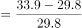
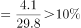
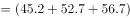
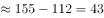
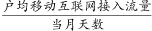
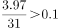
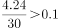

# 综合分析选非题（混合增长率定性+环比增速+季度加总作差+户均日流量换算）

考点：[[20-考点/资料分析/综合/综合分析选非题（混合增长率定性+环比增速+季度加总作差+户均日流量换算）|综合 / 综合分析选非题（混合增长率定性+环比增速+季度加总作差+户均日流量换算）]]
材料：[[15-材料/资料分析/257880 全国移动互联网接入流量：2017年6|257880 全国移动互联网接入流量：2017年6]]

**问法模型**：题干问'无法从上述资料中推出的是'（选非综合判断）→ 逐项用图表数据验证真假，锁定唯一无据可推或与资料矛盾的一项

## 推理链
1. 第1步：A项从柱状图取数：2017年11月接入流量29.8亿GB、12月33.9亿GB，环比增长率=(33.9−29.8)/29.8=4.1/29.8≈13.8%，高于选项所给阈值，A可推出，排除
2. 第2步：C项分季加总：2018年二季度=42.8+45.2+52.7+56.7=197.4亿GB，一季度=35.3+33.6+42.8=111.7亿GB，增长量=197.4−111.7=85.7亿GB＞40亿GB，C可推出，排除
3. 第3步：D项按'日接入流量=当月户均流量÷当月天数'验证：2018年3—6月为3.29/31≈0.106、3.41/30≈0.114、3.97/31≈0.128、4.24/30≈0.141，均＞0.1GB/户；2月2.63/28≈0.094、1月2.77/31≈0.089及2017年各月最高2.69/31≈0.087均＜0.1，恰为4个月，D可推出，排除
4. 第4步：B项先做差得隐藏数据：非手机设备上网流量=266−262=4亿GB，占整体266亿GB比重仅约1.5%
5. 第5步：整体增速是手机上网增速与非手机增速的加权混合，按'混合居中'口诀整体增速介于两者之间；因手机上网增速高于整体增速，故非手机增速＜整体增速，未超过2倍（200%），B'同比增长超过2倍'与资料矛盾，无法推出
6. 第6步：本题为选非题，唯一无法推出的是B，故正确答案为B

**最快解法**：⚡ 选非题逐项速验、定性项秒杀：C直接分季加总作差（197.4−111.7=85.7亿GB，远超40亿GB）；A截位直除4.1/29.8≈13.8%；D用3.29/31≈0.106锁定3月起破0.1、2月0.094不破；B不必精算，用混合增长率'混合居中'定性判断——整体增速介于手机与非手机两组分之间，非手机增速不可能超过整体增速的2倍量级，直接锁定答案B

## 易错点
- ⚠ 选非题看反要求：A、C、D均为可推出项，误把能推出的选项当成答案
- ⚠ B项混合增长率：忘记先做差得非手机流量4亿GB（材料无现成数据），或误以为小基数量增速可任意大；'混合居中'限定非手机增速小于整体增速，故不超2倍
- ⚠ D项'日接入'口径陷阱：须用月户均流量÷当月天数（2月按28天），直接拿月户均3.29等与0.1比较会误判；另注意双轴图柱读左轴、线读右轴，约20倍量级差不可串轴直读

## 母题抽象
> 🧩 当题干出现'无法从资料中推出的是'（选非综合判断）特征时，逐项验证：能用图上数据直算的先硬算（加总、作差、截位直除），涉两组分混合增速的用'混合居中'定性排除，最后核对选非要求确定答案

**同类特征**：无法从上述资料中推出的是（选非）、混合增长率·混合居中、非手机流量=整体−手机（做差得隐藏量）、环比增长…以上、季度加总作差、户均日接入流量（月值÷当月天数）

## 相关题
- [[10-真题/资料分析/增长/2578813 环比增长率阈值计数（增长率比较）|2578813]]（四川 2020，相关度1）

---

### 题干
无法从上述资料中推出的是：

### 选项
- A. 
2017年12月移动互联网接入流量较上月增长以上

- B. 
2018年上半年通过非手机移动设备上网的流量同比增长超过2倍
　✅
- C. 
2018年第二季度移动互联网接入流量比第一季度增长40亿GB以上

- D. 
2017年6月-2018年6月，户均移动互联网日接入流量超过0.1GB/户的月份仅有4个

### 官方解析

A项：定位图形材料可得：2017年11月，移动互联网接入流量为29.8亿GB；2017年12月，移动互联网接入流量为33.9亿GB。则增长率，正确；

B项：定位文字材料可得：全国移动互联网累计流量的同比增长率为，通过手机上网的流量的同比增长率为。由于“非手机移动设备上网的流量手机移动设备上网的流量移动互联网流量”，根据混合增长率口诀“混合居中”可知，2018年上半年通过非手机移动设备上网的流量同比增长率小于全国移动互联网流量的同比增长率，未超过2倍，错误；

C项：定位柱状图，2018年1-6月移动互联网接入流量分别为35.3亿GB、33.6亿GB、42.8亿GB、45.2亿GB、52.7亿GB、56.7亿GB，根据公式：增长量现期量基期量，则所求二季度一季度亿GB，正确；

D项：定位折线图，根据公式：户均移动互联网日接入流量，可知户均移动互联网日接入流量超过0.1GB/户的月份有4个，分别为2018年3月（GB/户），2018年4月（GB/户），2018年5月（GB/户），2018年6月（GB/户），正确。

本题为选非题，故正确答案为B。

### 给定材料

        2018年上半年，全国移动互联网累计流量达266亿GB，同比增长；其中通过手机上网的流量达到262亿GB，同比增长。

> [!warning] 疑点（官方解析可能有误，待人工复核）
> 本文材料中两个同比增速数值缺失（官方解析中亦为空白），B项'混合居中'的定量依据（手机上网增速高于整体增速、且整体增速未超200%）依赖原题完整数值；A项阈值为图片公式未能读取数值，按官方解析判定A成立；以上均不影响答案B的判定

<!-- CODEX-ANSWER-REVIEW:BEGIN -->
### 本次独立复核

**复核状态：** `confirmed`（独立复算确认答案）

**计分答案：** B（可计分）

**复核解析：**

非手机流量2018上半年约266−262=4亿GB，基期总流量约266/2.996=88.8、手机约262/3.147=83.3，非手机基期约5.5亿GB，现期反而下降，谈不上同比增长超过2倍，B无法推出。其余：12月环比约13.8%；季度流量差约29亿GB；日均超过0.1GB的户均月份恰4个月。

**相关信息：**

独立复核：按题干定义逐项检验，关键基数、比值、增速与图表读数写明以便复算。

**题源依据：** [固定版本原题](https://github.com/Mentat-Uran/kaogongzhentizhengliu/blob/84ab93d4b64b61d897bece8a1c0a5bab06b4feb2/10-%E7%9C%9F%E9%A2%98/%E8%B5%84%E6%96%99%E5%88%86%E6%9E%90/%E7%BB%BC%E5%90%88/2578814%20%E7%BB%BC%E5%90%88%E5%88%86%E6%9E%90%E9%80%89%E9%9D%9E%E9%A2%98%EF%BC%88%E6%B7%B7%E5%90%88%E5%A2%9E%E9%95%BF%E7%8E%87%E5%AE%9A%E6%80%A7%2B%E7%8E%AF%E6%AF%94%E5%A2%9E%E9%80%9F%2B%E5%AD%A3%E5%BA%A6%E5%8A%A0%E6%80%BB%E4%BD%9C%E5%B7%AE%2B%E6%88%B7%E5%9D%87%E6%97%A5%E6%B5%81%E9%87%8F%E6%8D%A2%E7%AE%97%EF%BC%89.md)；固定内容 commit `84ab93d4b64b61d897bece8a1c0a5bab06b4feb2`，Markdown blob `82ab01acfc01c0c9c42d4d36e6d65bec03827f71`。
<!-- CODEX-ANSWER-REVIEW:END -->
