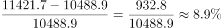
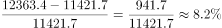
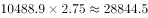

# 综合判断题（倍差反推城镇收入＋增长率比较＋比重比较＋数据完整性判断）

考点：[[20-考点/资料分析/综合/综合判断题（倍差反推城镇收入＋增长率比较＋比重比较＋数据完整性判断）|综合 / 综合判断题（倍差反推城镇收入＋增长率比较＋比重比较＋数据完整性判断）]]
材料：[[15-材料/资料分析/312966 2014-2020年全国城镇与农村居|312966 2014-2020年全国城镇与农村居]]

**问法模型**：“根据以上材料可以推出的是”综合判断问法 → 逐项验证排除：无人口权重不可算全国混合人均、增速须逐年计算、“始终/持续”类找一年反例、倍差题用城镇=倍差×农村反推

## 推理链
1. 第1步：A项——材料只有城镇（2020年≈2.56×17131.4≈43856元）与农村（17131.4元）两个人均口径数据，全国居民人均可支配收入须按城乡人口数加权平均，材料无任何人口数据，无法推出
2. 第2步：B项——由表1农村总收入2014年10488.9元、2015年11421.7元、2016年12363.4元，2015年增速=(11421.7-10488.9)/10488.9≈8.9%，2016年增速=(12363.4-11421.7)/11421.7≈8.2%，2016年＜2015年，“持续上升”被推翻
3. 第3步：C项——2014年工资性收入4152.2元＜经营性收入4237.4元，同一年份总数相同（10488.9元）、分项大者比重高，故2014年占比最高的是经营性收入而非工资性收入，“始终最高”被一年反例推翻
4. 第4步：D项——表1给出2014年农村居民人均可支配收入10488.9元，图1折线给出2014年城乡收入倍差2.75（农村为1，即城镇/农村=2.75）
5. 第5步：按表下注公式反推，2014年城镇居民人均可支配收入=2.75×10488.9≈28844.5元
6. 第6步：28844.5×20%=5768.9元，而2014年农民经营性收入仅4237.4元＜5768.9元，D项成立，故正确答案为D

**最快解法**：⚡ 先易后难逐项排除：A一眼锁定“无人口数据不可算全国人均”（且30493.9恰为（43856.4+17131.4)/2的城乡简单平均陷阱值）；B只算2015、2016两年增速即破（8.9%→8.2%）；C比2014年工资4152.2与经营4237.4即破；D用倍差反推2.75×10488.9≈28844.5元，其20%≈5769元，与4237.4元直接比较即得

## 易错点
- ⚠ A项陷阱：30493.9元恰为城乡两个人均值的简单算术平均，但全国居民人均收入须按城乡人口加权，材料全部为人均口径且无人口数据，不能把两个人均值直接相加平均
- ⚠ B项误看绝对量：农村收入逐年增加≠增速持续上升，基期变大时相近增量对应增速下降，须按增长率=增量/基期逐年计算
- ⚠ D项倍差方向易反：注中“农村为1”即城镇/农村=2.75，城镇=2.75×农村=28844.5元；若颠倒为农村÷2.75、或把2.75直接当差额（应为(2.75-1)×农村）均错
- ⚠ C项“始终最高”只需找一年反例即可推翻（2014年经营4237.4＞工资4152.2），不必逐年核算

## 母题抽象
> 🧩 当题干出现“根据以上材料可以推出的是/正确的是”且选项含“持续”“始终”等全称判断时，先用数据完整性排除混合人均类（缺人口权重不可算），再用一年反例排除全称判断，剩余项用“城镇=倍差×农村”反推后按目标比例（如20%）直接比较验证

**同类特征**：根据以上材料可以推出的是、全国居民人均可支配收入、增速持续上升、占…比重始终最高、小于…的20%、城乡收入倍差反推城镇值

## 相关题
- [[10-真题/资料分析/增长/4004825 基期量计算|4004825]]（新疆 2021，相关度1）

---

### 题干
根据以上材料可以推出的是：

### 选项
- A. 2020年全国居民人均可支配收入约为30493.9元
- B. 2015-2020年农村居民人均可支配收入增速持续上升
- C. 2014-2020年工资性收入占农村居民可支配收入的比重始终最高
- D. 2014年农民经营性收入小于同时期城镇居民可支配收入的20%　✅

### 官方解析

A项：定位统计图及统计表，可得2020年农村居民及城镇居民人均可支配收入，并未给出农村和城镇居民人数，故无法推出全国居民人均可支配收入，错误； 

B项：定位统计表，可得2014-2020年农村居民人均可支配收入分别为10488.9元、11421.7元、12363.4元、13432.4元、14617.1元、16020.8元、17131.4元。根据公式：增长率，则2015-2020年农村居民人均可支配收入增速分别为：2015年，；2016年，。可得2016年增速＜2015年增速，非持续上升，错误；

C项：定位统计表，可得2014-2020年农村居民人均可支配收入及工资性收入的数据。根据比重公式可知，因每年整体量不变，故直接比较每年部分量大小即可。由2014年工资性收入（4152.2元）＜2014年经营性收入（4237.4元），可得2014年工资性收入占农村居民人均可支配收入的比重不是最高，错误；

D项：定位统计表，可得2014年农村居民人均可支配收入为10488.9元；农民经营性收入为4237.4元。定位统计图，2014年城乡收入倍差为2.75。根据城乡收入倍差，可知2014年城镇居民人均可支配收入为元，故2014年农民经营性收入（4237.4元）＜28844.5×20%=5768.9元，正确。

故正确答案为D。

### 给定材料

