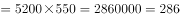
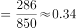
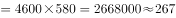
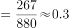
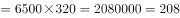
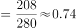
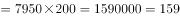
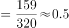

# 跨表比值比较（2月工资总额÷2月产值，最大者比较）

考点：[[20-考点/资料分析/综合/跨表比值比较（2月工资总额÷2月产值，最大者比较）|综合 / 跨表比值比较（2月工资总额÷2月产值，最大者比较）]]
材料：[[15-材料/资料分析/257872 C集团公司甲、乙、丙、丁四个车间1月|257872 C集团公司甲、乙、丙、丁四个车间1月]]

**问法模型**：题干问'工资总额与产值比率最大的车间'→先用'2月人数×2月平均工资'派生各车间工资总额并统一量级（元→万元），再除以表二2月产值，四个比值直接比较取最大。

## 推理链
1. 第1步：从表一提取2月数据：甲550人×5200元、乙580人×4600元、丙320人×6500元、丁200人×7950元；从表二提取2月产值（斜纹柱）：甲850、乙880、丙280、丁320（万元）。
2. 第2步：公式：工资总额=职工人数×月平均工资；比率=2月工资总额÷2月产值；单位统一1万元=10000元。
3. 第3步：代入计算：甲=550×5200=286万元，286/850≈33.7%；乙=580×4600=266.8万元，266.8/880≈30.3%；丙=320×6500=208万元，208/280≈74.3%；丁=200×7950=159万元，159/320≈49.7%。
4. 第4步：比较四个比率：丙≈74.3%＞丁≈49.7%＞甲≈33.7%＞乙≈30.3%，比率最大的为丙车间。
5. 第5步：与选项对照，丙车间对应C，故正确答案为C。

**最快解法**：⚡ 量级统一+截位直除：先算各车间2月工资总额（万元），与2月产值直除看首位商——甲286/850首商3、乙266.8/880首商3、丁159/320首商4、丙208/280首商7明显最大，无需精算即锁定丙车间。

## 易错点
- ⚠ 单位量级陷阱：工资总额单位为'元'、产值单位为'万元'，必须把工资总额除以10000统一成万元（如甲2860000元=286万元），否则比率放大或缩小1万倍
- ⚠ 工资总额是隐含派生指标，须用2月人数×2月平均工资现期数据计算，勿误用1月数据；表一合计行平均工资为'—'，不能套用合计数
- ⚠ 柱状图双柱相邻易读反：2月产值须取斜纹柱（甲850、乙880、丙280、丁320），且人数取2月列（如乙580而非600）

## 母题抽象
> 🧩 当题干出现'A与B的比率最大的主体比较'且分子需派生（人数×平均工资）、分子分母分属两表且单位不同时，先派生分子并统一量级，再截位直除比较首位商锁定最大者。

**同类特征**：比率最大、工资总额与产值、车间间比较、跨表综合（表一×表二）、现期（2月）数据、元与万元量级换算

## 相关题
（暂无）

---

### 题干
2月工资总额与产值比率最大的车间：

### 选项
- A. 甲车间
- B. 乙车间
- C. 丙车间　✅
- D. 丁车间

### 官方解析

根据题干“······与······比率最大的车间”，结合材料2月的职工人数、月平均工资及各车间产值，可判定本题为比值比较问题。根据，定位材料可得：

甲车间2月工资总额万元，工资总额与产值比率；

乙车间2月工资总额万元，工资总额与产值比率；

丙车间2月工资总额万元，工资总额与产值比率；

丁车间2月工资总额万元，工资总额与产值比率， 工资总额与产值比率最大的为丙车间。

备注：本题将单位换算统一，比较时直接列式比较即可。

故正确答案为C。

### 给定材料

