# 综合分析四选一——同比增量计算与比较（增量=现期×r/(1+r)），辅以累计做差求单月、两期比重比较

考点：[[20-考点/资料分析/综合/综合分析四选一——同比增量计算与比较（增量=现期×r/(1+r)），辅以累计做差求单月、两期比重比较|综合 / 综合分析四选一——同比增量计算与比较（增量=现期×r/(1+r)），辅以累计做差求单月、两期比重比较]]
材料：[[15-材料/资料分析/257930 2017年1-4月T地区批发和零售业|257930 2017年1-4月T地区批发和零售业]]

**问法模型**：问法为'能够从资料中推出的是'的综合分析验证题→逐项代入核查：A项用'1-4月−1-3月'做差求4月单月并与一季度月均（1-3月÷3）比较，B/C项用增量=现期×r/(1+r)验证，D项用两期比重比较（部分增速vs整体增速）判定升降

## 推理链
1. 第1步：C项定位表格'按规模分'的1-3月（即一季度）列：大型企业1381亿元/同比+8.4%、中型企业3533亿元/同比+6.1%、小微型企业3639亿元/同比+15.3%
2. 第2步：同比增量公式：增量=现期×r/(1+r)，等价于增长率换算r/(1+r)（15.3%→约13.3%，8.4%→约7.7%，6.1%→约5.8%）
3. 第3步：小微型企业一季度增量=3639×15.3%/115.3%≈3639×13.3%≈483亿元（官方解析记485.2亿元）
4. 第4步：大型企业增量=1381×8.4%/108.4%≈107亿元，中型企业增量=3533×6.1%/106.1%≈203亿元，两者之和≈310亿元（即便用放缩上界1381×8.4%+3533×6.1%≈332亿元也不到小微的七成）
5. 第5步：483（485）>310（332），小微一季度同比增量超过大型+中型之和，C项成立
6. 第6步：排除验证——A项：4月批发业=10251−7913=2338<7913/3≈2638成立，但零售业4月=856−640=216>640/3≈213.3，'均低于'不成立；B项：外商及港澳台商企业一季度增量=614×16.7%/116.7%≈88亿元<100亿元；D项：官方解析依文字两口径增速判定限额以上（部分）增速低于销售总额（整体）增速，部分增速<整体增速→比重较上年同期下降

**最快解法**：⚡ 增量率换算+截位估算：把增速换算为增量率r/(1+r)（15.3%→13.3%、8.4%→7.7%、6.1%→5.8%），小微≈3639×13.3%≈484，大+中≈107+203≈310（或放缩上界116+216=332），484>332一步锁定C；B项必须防'忘除(1+r)'陷阱：614×16.7%≈102.5只是增量上界，再÷1.167得≈88<100

## 易错点
- ⚠ B项命题陷阱：直接用现期×r得614×16.7%≈102.5>100会误判B正确；增量必须乘r/(1+r)，实际≈88亿元<100亿元——'忘除(1+r)'是本题核心埋雷点
- ⚠ 时间口径：'一季度'严格对应表中'1-3月'累计列，勿误用'1-4月'列数据与增速算增量（如小微一季度增速15.3%，1-4月为14.8%，两列不可混用）
- ⚠ A项'均低于'须批发、零售两项同时验证，且4月单月必须做差（856−640=216）后再与640/3≈213.3比较，零售业被否即A错；D项是整体（15220亿元）与部分（11107亿元）的两期比重比较，须用文字段两口径增速，不能用表格分项增速替代整体或部分增速

## 母题抽象
> 🧩 当综合分析题出现'某期同比增量超过/未超过另几项之和'的特征时，用增量率r/(1+r)换算+截位直除逐项估算比较，并用'现期×r'作放缩上界快速裁决；同题其余选项常埋'忘除(1+r)'、'累计/单月混用'、'部分-整体口径偷换'三类陷阱，须逐项回表核对时间列与口径

**同类特征**：能够从资料中推出的是（综合分析四选一）、限额以上商品销售额（口径限定）、一季度……同比增量超过大型企业和中型企业之和、增量=现期×r/(1+r)模型、1-3月累计列即一季度，1-4月与1-3月做差得单月、跨考点混合验证：做差比月均/增量比较/两期比重

## 相关题
（暂无）

---

### 题干
关于2017年T地区限额以上商品销售额，能够从资料中推出的是：

### 选项
- A. 4月批发业及零售业销售额均低于一季度月均数值
- B. 一季度，外商及港澳台商企业销售额同比增长100亿元以上
- C. 一季度，小微型企业销售额同比增量超过大型企业和中型企业之和　✅
- D. 1-4月，限额以上商品销售额占批发和零售业商品销售总额的比重较上年同期有所提升

### 官方解析

（以下解析中的描述均省略了T地区限额以上商品这个前提。）

A项：定位表格材料，2017年1-4月批发业销售额为10251亿元，1-3月销售额为7913亿元，则4月份销售额为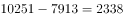亿元，一季度月均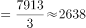亿元，4月份销售额低于一季度月均数值；2017年1-4月零售业销售额为856亿元，1-3月销售额为640亿元，则4月份销售额为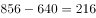亿元，一季度月均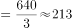亿元，4月份销售额高于一季度月均数值，错误；

B项：定位表格材料，2017年1-3月外商及港澳台商企业销售额为614亿元，同比增长率为，则2017年一季度，外商及港澳台商企业销售额同比增长量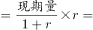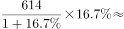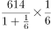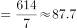亿元亿元，错误；

C项：定位表格材料，2017年1-3月小微型企业销售额为3639亿元，同比增长率为，所以小微型企业销售额同比增长量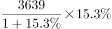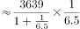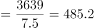亿元；2017年1-3月中型企业销售额为3533亿元，同比增长率为，所以中型企业销售额同比增长量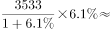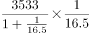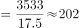亿元；2017年1-3月大型企业销售额为1381亿元，同比增长率为，所以大型企业销售额同比增长量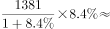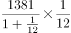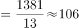亿元；故大、中型企业同比增长量之和为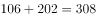亿元小微型企业销售额同比增长量485.2亿元，即小微型企业销售额同比增量超过大型企业和中型企业之和，正确；

D项：定位文字材料，2017年1-4月，T地区批发和零售业商品销售总额为15220亿元，同比增长，其中，限额以上商品销售额达到11107亿元，同比增长。则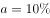，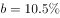，，根据两期比重比较结论，比重较上年同期有所下降，错误。

故正确答案为C。

### 给定材料

        2017年1-4月，T地区批发和零售业商品销售总额为15220亿元，同比增长，其中，限额以上商品销售额达到11107亿元，同比增长；4月份，T地区批发和零售业商品销售总额和限额以上商品销售额分别为3339亿元和2554亿元。

> [!warning] 疑点（官方解析可能有误，待人工复核）
> 官方解析C项给出小微型企业同比增量485.2亿元，按3639×15.3%/115.3%精确计算应约为482.9亿元，存在约2亿元的截位/计算瑕疵，但不影响'大于大中型之和约310亿元'的结论与答案C；另文字材料中'同比增长'后的两处百分数在题源缺失，D项'比重较上年同期下降'的判定依赖官方掌握的原文增速数据（部分增速低于整体增速），无法从所给材料数值直接复核。

<!-- CODEX-ANSWER-REVIEW:BEGIN -->
### 本次独立复核

**复核状态：** `confirmed`（独立复算确认答案）

**计分答案：** C（可计分）

**复核解析：**

一季度小微企业销售额同比增量≈3639×15.3/115.3≈483亿元；大型≈1381×8.4/108.4≈107亿元，中型≈3533×6.1/106.1≈203亿元，两者合计约310亿元，小微增量更大，C成立。

**相关信息：**

独立复核：按题干定义逐项检验，关键基数、比值、增速与图表读数写明以便复算。

**题源依据：** [固定版本原题](https://github.com/Mentat-Uran/kaogongzhentizhengliu/blob/84ab93d4b64b61d897bece8a1c0a5bab06b4feb2/10-%E7%9C%9F%E9%A2%98/%E8%B5%84%E6%96%99%E5%88%86%E6%9E%90/%E7%BB%BC%E5%90%88/2579790%20%E7%BB%BC%E5%90%88%E5%88%86%E6%9E%90%E5%9B%9B%E9%80%89%E4%B8%80%E2%80%94%E2%80%94%E5%90%8C%E6%AF%94%E5%A2%9E%E9%87%8F%E8%AE%A1%E7%AE%97%E4%B8%8E%E6%AF%94%E8%BE%83%EF%BC%88%E5%A2%9E%E9%87%8F%3D%E7%8E%B0%E6%9C%9F%C3%97r-(1%2Br)%EF%BC%89%EF%BC%8C%E8%BE%85%E4%BB%A5%E7%B4%AF%E8%AE%A1%E5%81%9A%E5%B7%AE%E6%B1%82%E5%8D%95%E6%9C%88%E3%80%81%E4%B8%A4%E6%9C%9F%E6%AF%94%E9%87%8D%E6%AF%94%E8%BE%83.md)；固定内容 commit `84ab93d4b64b61d897bece8a1c0a5bab06b4feb2`，Markdown blob `8007e6288f7bea65963b973a0be4433d4bcee19a`。
<!-- CODEX-ANSWER-REVIEW:END -->
