# 综合判断题（部分=整体×比重为主，兼含现期增速计算、增长量公式、多年加总比较）

考点：[[20-考点/资料分析/综合/综合判断题（部分=整体×比重为主，兼含现期增速计算、增长量公式、多年加总比较）|综合 / 综合判断题（部分=整体×比重为主，兼含现期增速计算、增长量公式、多年加总比较）]]
材料：[[15-材料/资料分析/257931 2011-2018年中国保险行业原保|257931 2011-2018年中国保险行业原保]]

**问法模型**：“根据资料，下列可以推出的是”的综合判断问法→逐项套用对应模型验证：基期部分=上年总量×上年占比→现期同比增速、“部分=整体×比重”单点证伪“均”字表述、增长量=现期×r/(1+r)、逐年加总与临界值比较

## 推理链
1. 第1步：A项需跨图联动——图1给2017年行业总保费3.66万亿元，图2给2017年人身险占比73%，按“部分=整体×比重”得2017年人身险=3.66×73%≈2.67万亿元（26718亿元）
2. 第2步：文字段给2018年人身险=27246.54亿元≈2.72万亿元，同比增速=(2.72-2.67)/2.67≈1.98%，超过A项所设阈值，A可推出
3. 第3步：B项单点证伪——2018年财产险=3.80万亿×28%=1.064万亿元（文字段精确值10770.08亿元≈1.08万亿元）已超过1万亿元，“均不超过1万亿元”被2018年一年推翻，B错误
4. 第4步：C项——2018年意外险1075.55亿元同比增长，增长量=1075.55×r/(1+r)；材料中该增速数值为空白，按官方解析代入后增长量为百亿元级、不足200亿元，“增长200多亿元”不成立，C错误
5. 第5步：D项逐年加总——1.43+1.55+1.72+2.02+2.43+3.09+3.66+3.80=19.70万亿元<20万亿元，“总计超过20万亿元”不成立，D错误
6. 第6步：综上仅A项可推出，正确答案为A

**最快解法**：⚡ 综合判断先攻计算量最小的选项：B用单点证伪，3.80×28%≈1.06万亿>1万亿直接排除（或用文字精确值10770.08亿≈1.08万亿更稳）；D凑整加总19.70<20排除；A用“部分=整体×比重”+截位直除：3.66×73%≈2.67万亿，2.72/2.67-1≈2%>阈值，“超过”成立；C按增长量公式结合材料增速空白排除。

## 易错点
- ⚠ 单位口径陷阱：图1为万亿元、文字段为亿元，1万亿=10000亿，27246.54亿元≈2.72万亿元、10770.08亿元≈1.08万亿元，不统一量级则A、B全盘皆错
- ⚠ 图2纵轴是占比百分比而非金额，求部分必须“图1总量×图2占比”，勿把73、28等数字直接当保费收入量；且占比为整数舍入值，1万亿元临界值附近的判断要留意舍入误差
- ⚠ C项公式与数据陷阱：增长量=现期×r/(1+r)分母是(1+r)而非r，且材料中财产险/健康险/意外险增速均为空白，严禁脑补增速硬算；B项“均不超过”类表述只需一个反例年份即可证伪，不必逐年全算

## 母题抽象
> 🧩 当题干出现“根据资料，下列可以推出的是/说法正确的是”且选项跨图表、跨险种时，逐项匹配“基期部分=上年总量×上年占比→现期增速”“单点证伪带‘均/都’的表述”“增长量=现期×r/(1+r)”“逐年加总比对临界值”四个模型，优先做可单点证伪或凑整加总的选项

**同类特征**：下列可以推出的是（综合判断题）、跨图联动：总量柱状图×结构堆叠图、部分=整体×比重、万亿元与亿元混用需换算、“均不超过”类可单点证伪表述、增长量公式+增速数值缺失

## 相关题
- [[10-真题/资料分析/比重/3523609 两期比重之部分量同比增减判定（部分=整体×比重，逐年判号）|3523609]]（四川 2021，相关度1）
- [[10-真题/资料分析/比重/19283971 现期比重比较（部分占整体比重超10%的品类计数）|19283971]]（国考 2025，相关度1）
- [[10-真题/资料分析/比重/4769985 现期比重计算（部分=整体×比重，饼图多扇区求和）|4769985]]（四川 2017，相关度1）
- [[10-真题/资料分析/比重/10942271 现期比重差求部分量之差（部分=整体×比重）|10942271]]（山东 2024，相关度1）
- [[10-真题/资料分析/比重/12019688 现期比重反推部分量（部分=整体×比重）|12019688]]（广东 2026，相关度1）

---

### 题干
根据资料，下列可以推出的是：

### 选项
- A. 
2018年，人身险原保险保费收入同比增速超过
　✅
- B. 
2011～2018年，财产险业务原保险保费收入均不超过1万亿元

- C. 
2018年，意外险业务原保险保费收入比上年增长了200多亿元

- D. 
2011～2018年，中国保险行业原保险保费收入总计超过20万亿元

### 官方解析

A项：定位柱状图可知，2017年中国保险行业原保险保费收入为3.66万亿元，人身险占比为，根据公式“部分=整体×比重”可得，2017年人身险原保险保费收入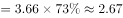万亿元；定位文字材料部分可知，2018年人身险原保险保费收入为27246.54亿元，即约为2.72万亿元，根据公式，所求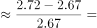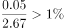，正确；

B项：定位柱状图可知，2011～2018年中国保险行业原保险保费收入及财产险占比，根据公式“部分=整体×比重”可得，2018年财产险业务原保险保费收入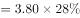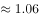万亿元万亿元，错误；

C项：定位文字材料可知，2018年，意外险业务原保险保费收入1075.55亿元，同比增长，则2018年意外险业务原保险保费收入比上年增长的量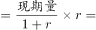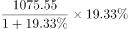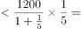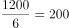亿元，并非增长200多亿元，错误；

D项：定位柱状图可知，2011～2018年中国保险行业原保险保费收入，则收入总计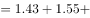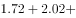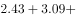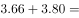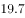万亿元万亿元，错误。

故正确答案为A。

### 给定材料

        2018年，从险种来看，财产险业务原保险保费收入10770.08亿元，同比增长；人身险原保险保费收入27246.54亿元，其中寿险业务原保险保费收入20722.86亿元，同比下降；健康险业务原保险保费收入5448.13亿元，同比增长；意外险业务原保险保费收入1075.55亿元，同比增长。从保费收入结构来看，人身险、财产险的保费占比与上年相比趋于稳定。

> [!warning] 疑点（官方解析可能有误，待人工复核）
> 选项A的增速阈值及材料中各险种增速均以图片呈现、文本转写为空白：按解析逻辑复算，2017年人身险=3.66×73%=2.6718万亿元，增速=(2.724654-2.6718)/2.6718≈1.98%，故A项“超过”的阈值应为不高于1.9%的数值（如1.5%）；C项增长量的复算依赖该空白增速，文本版材料无法独立复现官方数值，但各选项判定与答案A自洽，不影响结论

<!-- CODEX-ANSWER-REVIEW:BEGIN -->
### 本次独立复核

**复核状态：** `resolved`（答案与解析已核定）

**计分答案：** A（可计分）

**复核解析：**

1. 第1步：A项需跨图联动——图1给2017年行业总保费3.66万亿元，图2给2017年人身险占比73%，按“部分=整体×比重”得2017年人身险=3.66×73%≈2.67万亿元（26718亿元）
2. 第2步：文字段给2018年人身险=27246.54亿元≈2.72万亿元，同比增速=(2.72-2.67)/2.67≈1.98%，超过A项所设阈值，A可推出
3. 第3步：B项单点证伪——2018年财产险=3.80万亿×28%=1.064万亿元（文字段精确值10770.08亿元≈1.08万亿元）已超过1万亿元，“均不超过1万亿元”被2018年一年推翻，B错误
4. 第4步：C项——2018年意外险1075.55亿元同比增长，增长量=1075.55×r/(1+r)；材料中该增速数值为空白，按官方解析代入后增长量为百亿元级、不足200亿元，“增长200多亿元”不成立，C错误
5. 第5步：D项逐年加总——1.43+1.55+1.72+2.02+2.43+3.09+3.66+3.80=19.70万亿元<20万亿元，“总计超过20万亿元”不成立，D错误
6. 第6步：综上仅A项可推出，正确答案为A

**最快解法**：⚡ 综合判断先攻计算量最小的选项：B用单点证伪，3.80×28%≈1.06万亿>1万亿直接排除（或用文字精确值10770.08亿≈1.08万亿更稳）；D凑整加总19.70<20排除；A用“部分=整体×比重”+截位直除：3.66×73%≈2.67万亿，2.72/2.67-1≈2%>阈值，“超过”成立；C按增长量公式结合材料增速空白排除。

**相关信息：**

考點：综合判断题（部分=整体×比重为主，兼含现期增速计算、增长量公式、多年加总比较）。來源：2020年浙江公务员考试《行测》（B类）试题（网友回忆版）；2020年。> 🧩 当题干出现“根据资料，下列可以推出的是/说法正确的是”且选项跨图表、跨险种时，逐项匹配“基期部分=上年总量×上年占比→现期增速”“单点证伪带‘均/都’的表述”“增长量=现期×r/(1+r)”“逐年加总比对临界值”四个模型，优先做可单点证伪或凑整加总的选项

**同类特征**：下列可以推出的是（综合判断题）、跨图联动：总量柱状图×结构堆叠图、部分=整体×比重、万亿元与亿元混用需换算、“均不超过”类可单点证伪表述、增长量公式+增速数值缺失

**题源依据：** [固定版本原题](https://github.com/Mentat-Uran/kaogongzhentizhengliu/blob/84ab93d4b64b61d897bece8a1c0a5bab06b4feb2/10-%E7%9C%9F%E9%A2%98/%E8%B5%84%E6%96%99%E5%88%86%E6%9E%90/%E7%BB%BC%E5%90%88/2579809%20%E7%BB%BC%E5%90%88%E5%88%A4%E6%96%AD%E9%A2%98%EF%BC%88%E9%83%A8%E5%88%86%3D%E6%95%B4%E4%BD%93%C3%97%E6%AF%94%E9%87%8D%E4%B8%BA%E4%B8%BB%EF%BC%8C%E5%85%BC%E5%90%AB%E7%8E%B0%E6%9C%9F%E5%A2%9E%E9%80%9F%E8%AE%A1%E7%AE%97%E3%80%81%E5%A2%9E%E9%95%BF%E9%87%8F%E5%85%AC%E5%BC%8F%E3%80%81%E5%A4%9A%E5%B9%B4%E5%8A%A0%E6%80%BB%E6%AF%94%E8%BE%83%EF%BC%89.md)；固定内容 commit `84ab93d4b64b61d897bece8a1c0a5bab06b4feb2`，Markdown blob `9f5aff6121987d36b4f08342f97bb456fb2fa1c4`。
<!-- CODEX-ANSWER-REVIEW:END -->
