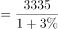
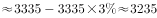
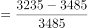

# 综合判断题·数据充分性（能否推出）

考点：[[20-考点/资料分析/综合/综合判断题·数据充分性（能否推出）|综合 / 综合判断题·数据充分性（能否推出）]]
材料：[[15-材料/资料分析/257932 2017年全球清洁能源投资规模及风电|257932 2017年全球清洁能源投资规模及风电]]

**问法模型**：题干为'下列可以推出的是'（能否计算类综合判断）→ 对每项列出求该指标的最小条件集（求增速需'现期+基期'或'现期+增速'；求增长量需'现期+增速'或'基期+现期'），回材料勾选条件齐备者即可推出。

## 推理链
1. 第1步：逐项确认考点取数条件：A求2017年全球风能投资的同比增速，B求2016年全球清洁能源投资的同比增速，C求2017年亚太对光伏投资的同比增量，D求2008年全球风电累计装机的同比增速。
2. 第2步：核对A：正文只给2017年全球风能投资现期量1070亿美元，其'同比增长'后数值空缺（无基期量、无增速）；文中'同比下降'说的是新增装机52.5GW而非投资额，缺条件，排除。
3. 第3步：核对B：2017年全球清洁能源投资3335亿美元，2017年同比增速r（原文给出、所给文本空缺）→2016年投资额=3335÷(1+r)；'仍低于2015年的历史峰值3485亿美元'即2015年投资额可作基期→2016年增速=2016年值÷3485−1，条件链闭合，可推出。
4. 第4步：核对C：增长量=现期×增速/(1+增速)或现期−基期，材料只给全球光伏投资1608亿美元及亚太光伏新增73.7GW、累计221.3GW，亚太对光伏投资额与增速均未给出，排除。
5. 第5步：核对D：柱状图最早年份为2008年风电累计120.7GW，材料无2007年数据或同比增量，缺基期无法求2008年增速，排除。
6. 第6步：四项中仅B的取数与公式链条齐备，对照选项锁定答案B。

**最快解法**：⚡ 条件清单排除法（口诀：求增速=现期+基期或增速；求增长量=现期+增速或基期）：A缺投资额增速与基期、C缺亚太投资现期与增速、D缺2007年基期，三项条件不齐一票排除；B用'现期3335÷(1+2017年增速)→2016年值，再与2015年峰值3485直接作比'链条唯一闭合，秒选B。

## 易错点
- ⚠ 指标口径错位：A项易把'风电新增装机52.5GW同比下降'误当'风能投资'的增速——'同比下降'描述的是装机流量，投资增速数值在原文中另行给出且所给文本空缺。
- ⚠ 漏用隐含基期：忽视'仍低于2015年的历史峰值3485亿美元'可直接当2015年基期值，误判B'缺2015年数据、无法推出'而错选A/C/D。
- ⚠ 图表时间边界与存量陷阱：柱状图只覆盖2008-2017年，D项2008年的同比基期2007年不在材料内；且累计装机是滚存存量（脚注剔除报废），首年无从求同比。

## 母题抽象
> 🧩 当题干出现'下列可以（无法）推出的是'时，先对每项写出求该指标的最小条件清单（增速：现期+基期或增速；增长量：现期+增速或基期），再回材料逐项勾选；'历史峰值××'可直接充当对应年份基期值，条件缺一项即判'无法推出'。

**同类特征**：下列可以推出的是、综合判断、同比增速能否计算、增长量条件充分性、现期量有而基期/增速缺、历史峰值充当基期

## 相关题
- [[10-真题/资料分析/综合/2274486 综合判断题（两期比重变化判定＋平均每家单位收入计算比较）|2274486]]（北京 2019，相关度1）
- [[10-真题/资料分析/综合/5101670 综合判断题（选非题）——逐项验证'能否推出'|5101670]]（云南 2022，相关度1）
- [[10-真题/资料分析/综合/1796564 综合判断题（选非型）—逐年增量与增长率趋势核对|1796564]]（广东 2016，相关度1）

---

### 题干
根据资料，下列可以推出的是：

### 选项
- A. 2017年全球对风能投资的同比增速
- B. 2016年全球对清洁能源投资的同比增速　✅
- C. 2017年亚太地区对光伏投资的同比增量
- D. 2008年全球风电累计装机容量的同比增速

### 官方解析

A项：定位文字材料第二段可得：2017年全球对风能的投资为1070亿美元，风电新增装机容量52.5GW，同比下降。只有全球对风能投资的现期量，无法计算增长率，错误；

B项：定位文字材料第一段可得：2017年，全球对清洁能源的投资为3335亿美元，同比增长，但仍低于2015年的历史峰值3485亿美元。故2016年全球对清洁能源投资亿美元。则2016年全球对清洁能源投资的同比增速，可以推出，正确；

C项：定位文字材料第二段可得：2017年全球对光伏的投资为1608亿美元，同比增长。材料只给出全球对光伏的投资，并未给出亚太地区对光伏投资的相应数据，无法计算增长量，错误；

D项：定位柱状图可得：2008年全球风电累计装机容量为120.7GW，并未给出2007年的数据或同比增量，故无法计算2008年的增长率，错误。

故正确答案为B。

### 给定材料

        2017年，全球对清洁能源的投资为3335亿美元，同比增长，但仍低于2015年的历史峰值3485亿美元。中国的清洁能源投资占全球清洁能源总投资的，占亚太地区清洁能源投资的。

        从主要清洁能源类型看，2017年全球对风能的投资为1070亿美元，风电新增装机容量52.5GW，同比下降；累计装机容量达到539.1GW，同比增长。2017年全球对光伏的投资为1608亿美元，同比增长；光伏新增装机容量99.1GW，同比增长；累计装机容量达到404.5GW。其中，亚太地区新增装机容量73.7GW，累计装机容量221.3GW。（累计装机容量不含报废机器的装机容量）

> [!warning] 疑点（官方解析可能有误，待人工复核）
> 官方解析B项'故2016年全球对清洁能源投资___亿美元'处数值缺失；且所给材料文本中2017年清洁能源投资'同比增长'后的增速数值空缺（材料导读已提示此类投资额推算须以完整原文取数）。B的完整计算为：2016年投资=3335÷(1+r)（r为原文给出的2017年投资同比增速），再与2015年峰值3485亿美元作比得2016年增速。此系原文数值空缺的口径问题，不改变官方答案B。

<!-- CODEX-ANSWER-REVIEW:BEGIN -->
### 本次独立复核

**复核状态：** `confirmed`（独立复算确认答案）

**计分答案：** B（可计分）

**复核解析：**

清洁能源投资2017年为3335亿美元，按图示同比回落约7%反推2016年约3335/0.93=3586亿美元；与2015年3485亿美元相比增长约(3586/3485−1)=2.9%，B可推出。其他选项缺少相应2016风能额、2017亚太光伏额或2007累计装机量，无法计算。

**相关信息：**

独立复核：按题干定义逐项检验，关键基数、比值、增速与图表读数写明以便复算。

**题源依据：** [固定版本原题](https://github.com/Mentat-Uran/kaogongzhentizhengliu/blob/84ab93d4b64b61d897bece8a1c0a5bab06b4feb2/10-%E7%9C%9F%E9%A2%98/%E8%B5%84%E6%96%99%E5%88%86%E6%9E%90/%E7%BB%BC%E5%90%88/2579813%20%E7%BB%BC%E5%90%88%E5%88%A4%E6%96%AD%E9%A2%98%C2%B7%E6%95%B0%E6%8D%AE%E5%85%85%E5%88%86%E6%80%A7%EF%BC%88%E8%83%BD%E5%90%A6%E6%8E%A8%E5%87%BA%EF%BC%89.md)；固定内容 commit `84ab93d4b64b61d897bece8a1c0a5bab06b4feb2`，Markdown blob `866f9ffbe2b2dacc5c49b3e97d1684c13999c8cf`。
<!-- CODEX-ANSWER-REVIEW:END -->
