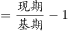
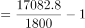
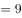

# 两期比重变化判断（部分增速vs总体增速），兼查增长倍数、平均数、基期占比定性反推

考点：[[20-考点/资料分析/综合/两期比重变化判断（部分增速vs总体增速），兼查增长倍数、平均数、基期占比定性反推|综合 / 两期比重变化判断（部分增速vs总体增速），兼查增长倍数、平均数、基期占比定性反推]]
材料：[[15-材料/资料分析/258922 2014-2019年全国农村网络零售|258922 2014-2019年全国农村网络零售]]

**问法模型**：题干为'根据以上资料，下列说法正确的是'综合判断题 → 逐项套模型排除：倍数题用（现期-基期）÷基期、平均数题用总量÷个数、基期占比由'现期较上年提升/下降'定性反推、两期比重升降只比部分增速与总体增速大小

## 推理链
1. 第1步：A项从图1取数：2014年农村网络零售额1800亿元、2019年17082.8亿元；B项从文段取数：832个贫困县实现网络零售额1489.9亿元
2. 第2步：A项套增长倍数公式'增长了=(现期-基期)÷基期'：(17082.8-1800)÷1800=15282.8÷1800≈8.5倍，即增长了不到9倍而非10倍，A错误
3. 第3步：B项套平均数公式'平均数=总量÷个数'：1489.9÷832≈1.79亿元/县<2亿元，B错误
4. 第4步：C项用基期占比定性规则：文段'2019年占全国网络零售总额…较上年略有提升'⇒2018年占比必低于2019年占比，选项称2018年'约占'该值（即2019年原版所给的同一数值）不成立，C错误
5. 第5步：D项套两期比重模型：部分为水产品，增速a=23.2%（图2折线直接读出）；总体为全国农产品网络零售额3975亿元，整体增速b由文段给出（本版留空；按图2加权估算：11类占比合计95.6%，Σ占比×增速≈28.4个百分点，b约28%~30%）
6. 第6步：套两期比重结论'部分增速a<总体增速b⇒现期比重较基期下降'：23.2%<约28%，故2019年水产品占全国农产品网络零售额比重较2018年下降，D正确
7. 第7步：四项对照，仅D成立，与官方答案一致

**最快解法**：⚡ 综合题先易后难秒排+两期比重口诀：A用17082.8÷1800≈9.5倍，'增长了'需再减1得约8.5倍<10倍，排除；B用1489.9÷832≈1.8亿元<2亿元，排除；C由'较上年略有提升'⇒2018年占比更低，排除；D直接读图2折线水产增速23.2%，与农产品整体增速（约28%，文段直给或加权估算）比大小，部分<总体⇒比重下降，D对，全程无需精算比重具体值

## 易错点
- ⚠ '增长了10倍'与'是10倍'口径混淆：17082.8÷1800≈9.49是'是基期的9.5倍'，'增长了'须减1≈8.5倍（不到9倍），漏减1或把9.49凑成10都会误判A
- ⚠ D项比较对象错位：两期比重升降只看'部分增速（水产23.2%）vs总体增速（农产品整体约28%）'，勿看占比9.5%的绝对大小、勿与其他品类增速比、勿混淆成'占全国农村网络零售额'口径
- ⚠ 文段多处数值留空（2019年占比、农产品整体增速等）且选项C为图片公式，验证须按原版材料数据；图2柱（占比）与折线（增速）易看混，11类占比合计仅95.6%，加权估算整体增速存在口径缺口但最低已≈28.4%，不影响D的判断

## 母题抽象
> 🧩 当题干出现'下列说法正确的是'综合判断时，逐项套四模板：倍数先分清'是几倍'与'增长几倍'（差1）、平均数=总量÷个数直接估、基期占比由'较上年提升/下降'反推小于/大于现期、两期比重升降只比部分增速与总体增速大小而无需算比重值

**同类特征**：下列说法正确的是（综合判断四选一）、增长了N倍（倍数口径陷阱）、平均每个/每县（平均数模型）、较上年略有提升（基期占比定性反推）、比重较2018年有所下降（两期比重比较）、部分增速vs总体增速

## 相关题
- [[10-真题/资料分析/综合/2060672 环形结构图读数与占比综合判断（逐项验证）|2060672]]（深圳市考 2017，相关度1）
- [[10-真题/资料分析/比重/2136660 两期比重变化比较（比重上升判断）|2136660]]（河南 2017，相关度1）
- [[10-真题/资料分析/综合/2440290 综合判断（正确表述类）——核心计算项为平均数（销售单价=销售额÷销售面积）四地区比较，辅以同比-环比口径辨析与环比减少量比大小|2440290]]（青海 2019，相关度1）

---

### 题干
根据以上资料，下列说法正确的是（    ）。

### 选项
- A. 
2014-2019年，农村网络零售额增长了10倍

- B. 
2019年，平均每个贫困县网络零售额超2亿元

- C. 
2018年，全国农村网络零售额约占全国网络零售总额的

- D. 
2019年水产品占全国农产品网络零售额的比重较2018年有所下降
　✅

### 官方解析

A项：定位第一个图形材料可知，2014年全国农村网络零售额为1800亿元，2019年为17082.8亿元。根据公式，增长率，因此增长了不到9倍，错误；

B项：定位文字材料第三段，2019年全国832个贫困县实现网络零售额1489.9亿元，则平均每个贫困县网络零售额为亿元，错误；

C项：定位文字材料第一段，2019年全国农村网络零售额从2014年的1800亿元增加至逾1.7万亿元，占全国网络零售总额的，较上年略有提升，可知2018年占比低于，不到，错误；

D项：定位文字材料第三段，2019年全国农产品网络零售额高达3975亿元，同比增长，定位第二个图形材料，2019年全国水产品网络零售额同比增速为，根据两期比重结论：部分增长率（）总体增长率（），则2019年水产品占全国农产品网络零售额的比重较2018年有所下降，正确。

故正确答案为D。 

### 给定材料

        2019年全国农村网络零售额从2014年的1800亿元增加至逾1.7万亿元，占全国网络零售总额的，较上年略有提升；同比增长，高于全国网络零售总额增长率2.6个百分点。

        分地区看，东、中、西部和东北地区农村网络零售额分别占全国农村网络零售额的、、和，同比增长分别为、、和。

        2019年，电子商务进农村综合示范工作聚焦脱贫攻坚和乡村振兴，取得了阶段性成果。全国832个贫困县实现网络零售额1489.9亿元，同比增长，全国农产品网络零售额高达3975亿元，同比增长，其中，水果、肉禽蛋、奶类同比增速排名前三，分别为、和，生鲜农产品网络零售额持续高速增长，潜力不断释放。

> [!warning] 疑点（官方解析可能有误，待人工复核）
> 本版文段中'2019年农村占全国网络零售总额比重'与'全国农产品网络零售额同比增速'均留空，官方解析按原版数值验证C、D；以图2加权估算整体增速≈28.4%~29.7%（11类仅覆盖95.6%），仍大于水产品23.2%，与官方D项结论一致、无矛盾，仅提示C、D的完整验证依赖原版留空数据
