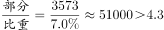
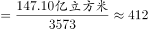
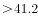
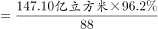
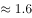
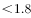
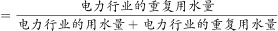
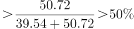

# 综合判断（平均数计算+单位量级核对+比率定义放缩求界）

考点：[[20-考点/资料分析/综合/综合判断（平均数计算+单位量级核对+比率定义放缩求界）|综合 / 综合判断（平均数计算+单位量级核对+比率定义放缩求界）]]
材料：[[15-材料/资料分析/259047 2019年广东省规模以上工业企业的用|259047 2019年广东省规模以上工业企业的用]]

**问法模型**：『下列说法正确的是』综合判断题 → 逐项验证：平均数项用『总量÷个数』并核对亿/万量级，比率项用『重复用水率=重复用水量÷(重复用水量+用水量)』结合分子固定、分母放缩求取值范围

## 推理链
1. 第1步：提取核心数据——2019年全省规上工业用水量39.54亿立方米、重复用水量147.10亿立方米；有重复用水企业3573家，超1000万立方米的企业88家；电力行业重复用水量50.72亿立方米。
2. 第2步：A项验证：全省规上工业企业数=3573÷有重复用水企业所占比重，该占比在所给文本中缺失，官方按此式计算与『约4.3万家』不符，判定A错误（仅由『九成多企业无重复用水』只能得总数>3573÷10%≈3.57万家，无法单独锁定）。
3. 第3步：B项验证：有重复用水企业的平均重复用水量=147.10亿÷3573≈0.0412亿立方米=411.7万立方米≈412万立方米，选项给41.2万立方米，量级错10倍，排除B。
4. 第4步：C项验证：88家企业的重复用水量合计不可能超过全省147.10亿立方米，故平均≤147.10÷88≈1.67亿立方米<1.8亿立方米，无论占比取何值均不可能为1.8亿，排除C（官方用『占重复用水量的__%』验证同判错误）。
5. 第5步：D项依据定义：重复用水率=重复用水量÷(重复用水量+用水量)，电力行业分子固定为50.72亿立方米。
6. 第6步：放缩：电力行业用水量<全省用水量39.54亿立方米，故电力重复用水率=50.72÷(50.72+电力用水量)>50.72÷(50.72+39.54)=50.72÷90.26≈56.2%，即不可能低于约56.2%，D正确。

**最快解法**：⚡ 公式法+放缩：D项分子固定50.72，分母用全省上限39.54放缩，50.72÷90.26≈56.2%即为下界，直接锁定；B、C两项用截位直除『147.10亿÷3573≈412万』『147.10亿÷88≤1.67亿』并核对亿↔万量级快速排错。

## 易错点
- ⚠ 双口径混淆：『用水量39.54亿立方米』与『重复用水量147.10亿立方米』是两个并列指标，B项平均数的分子必须用147.10，误用39.54必错。
- ⚠ 量级换算陷阱：1亿=10⁴万，147.10亿÷3573≈412万立方米，B选项故意写成41.2万（差10倍）；另注意1000万立方米=0.1亿立方米。
- ⚠ 比率定义陷阱：重复用水率=重复用水量÷(重复用水量+用水量)（材料注释在所给文本中缺失），若误当作『重复用水量÷用水量』则D项逻辑无法成立；C项占比缺失时可用『合计≤147.10亿』的上界法秒排。

## 母题抽象
> 🧩 当综合判断题同时出现『平均数=总量÷个数』与『某率=分子÷(分子+分母)型定义』时，先用亿↔万量级核对排除平均数项，再对比率项用『分子固定、分母取极值放缩』求取值范围，验证『不可能低于/高于』类表述。

**同类特征**：综合判断·正确的是、平均重复用水量、重复用水率不可能低于、企业个数（3573家/88家）、亿立方米与万立方米量级换算、用水量与重复用水量双口径

## 相关题
（暂无）

---

### 题干
根据以上资料，下列有关2019年广东省规模以上工业企业重复用水情况正确的是：

### 选项
- A. 
全省约有规模以上工业企业4.3万家

- B. 
有重复用水的企业的平均重复用水量约为41.2万立方米

- C. 
重复用水量超过1000万立方米的企业的平均重复用水量约为1.8亿立方米

- D. 
电力行业的重复用水率不可能低于
　✅

### 官方解析

A项：定位文字材料第三段可知：有重复用水的企业只有3573家，只占全省规模以上工业企业的，可推出全省规模以上工业企业=万，错误；

B项：定位文字材料第二和第三段可知：2019年，广东规模以上工业企业重复用水量为147.10亿立方米；有重复用水的企业只有3573家。因此有重复用水的企业的平均重复用水量万立方米万立方米，错误；

C项：定位文字材料第二和第三段可知：2019年，广东规模以上工业企业重复用水量为147.10亿立方米；重复用水量超过1000万立方米的企业88家，仅占重复用水量的。因此重复用水量超过1000万立方米的企业的平均重复用水量亿立方米亿立方米，错误；

D项：定位文字材料第一和第二段可知：2019年，广东规模以上工业企业用水量39.54亿立方米，电力行业重复用水量为50.72亿立方米。因为电力行业的用水量小于广东规模以上工业企业用水量39.54亿立方米，所以电力行业的重复用水率，正确。

故正确答案为D。

### 给定材料

        2019年，广东规模以上工业企业用水量39.54亿立方米，分水种看，自来水用水量最大，达35.67亿立方米，占全部用水量的；地表淡水用水量2.52亿立方米，地下淡水0.03亿立方米，其他水1.32亿立方米。分地区看，珠三角地区用水量达29.85亿立方米，占比超。

        2019年，广东规模以上工业企业重复用水量为147.10亿立方米，比上年增长，重复用水率提高到（注：重复用水率）。分行业看，重复用水量主要集中在电力、冶金和石油石化行业。其中，电力行业重复用水量为50.72亿立方米，比上年下降，占全省规模以上工业企业全部重复用水量的；冶金行业重复用水量为40.82亿立方米，增长，占全部重复用水量的；石油石化行业重复用水量为32.12亿立方米，增长，占全部重复用水量的。

        整体而言，在全省规模以上工业企业中，重复用水量普及面窄且重复用水率较低的问题值得关注。有重复用水的企业只有3573家，只占全省规模以上工业企业的，说明九成多企业无重复用水。重复用水量超过1000万立方米以上的企业88家，仅占重复用水量的，主要集中在石油化工、电厂和钢铁厂等少数大型企业中，重复用水应用领域明显较窄。

> [!warning] 疑点（官方解析可能有误，待人工复核）
> 官方解析无矛盾，不改动答案；但所给文本中『有重复用水企业占比』『88家企业占重复用水量比重』及重复用水率定义注释均缺失，A、C只能依托官方解析结论排除，D项公式为图片无法读取具体数值，按官方推理口径应为50.72÷(50.72+39.54)≈56.2%。

<!-- CODEX-ANSWER-REVIEW:BEGIN -->
### 本次独立复核

**复核状态：** `resolved`（答案与解析已核定）

**计分答案：** D（可计分）

**复核解析：**

D项电力行业重复用水量50.72亿立方米已高于全省全部工业用水量39.54亿立方米。电力行业用水量不可能超过全省总用水量，因此重复用水率下界至少为50.72/39.54≈128.3%，高于选项门槛，D正确。A按3573家及占比反推全省企业数不等于4.3万；B147.10亿/3573≈411.7万立方米，非41.2万；C按88家与其总量占比所得均值非1.8亿。

**相关信息：**

重复用水率=重复用水量/用水量；行业用水量不超过全省用水量，可得率下界。

**题源依据：** [固定版本原题](https://github.com/Mentat-Uran/kaogongzhentizhengliu/blob/84ab93d4b64b61d897bece8a1c0a5bab06b4feb2/10-%E7%9C%9F%E9%A2%98/%E8%B5%84%E6%96%99%E5%88%86%E6%9E%90/%E7%BB%BC%E5%90%88/2606262%20%E7%BB%BC%E5%90%88%E5%88%A4%E6%96%AD%EF%BC%88%E5%B9%B3%E5%9D%87%E6%95%B0%E8%AE%A1%E7%AE%97%2B%E5%8D%95%E4%BD%8D%E9%87%8F%E7%BA%A7%E6%A0%B8%E5%AF%B9%2B%E6%AF%94%E7%8E%87%E5%AE%9A%E4%B9%89%E6%94%BE%E7%BC%A9%E6%B1%82%E7%95%8C%EF%BC%89.md)；固定内容 commit `84ab93d4b64b61d897bece8a1c0a5bab06b4feb2`，Markdown blob `e934ea84c2f96f37571f3ffa14cc476964d8df92`。
<!-- CODEX-ANSWER-REVIEW:END -->
